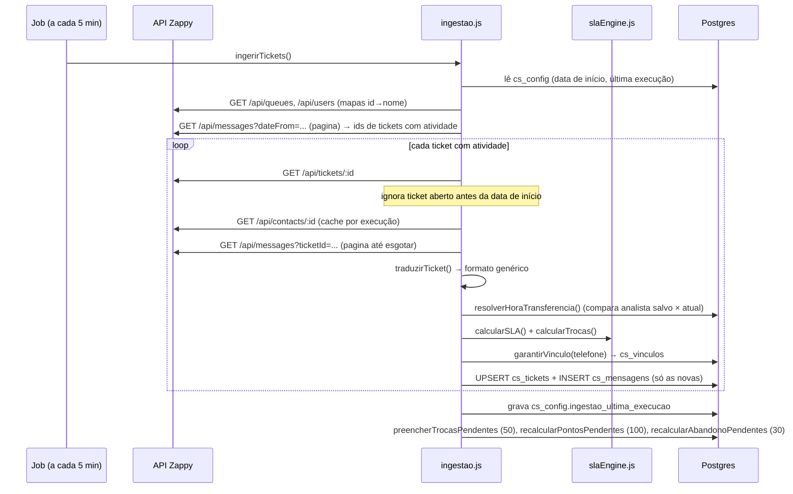
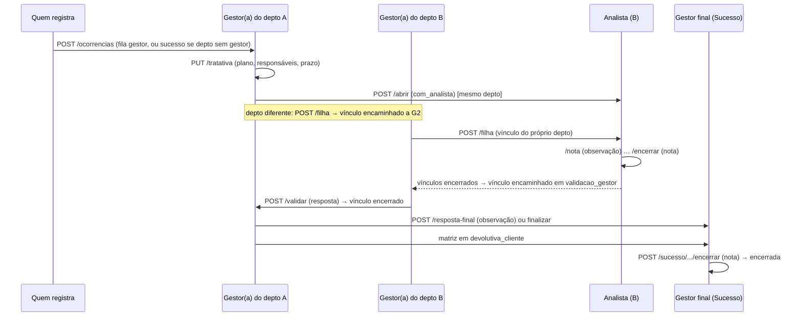
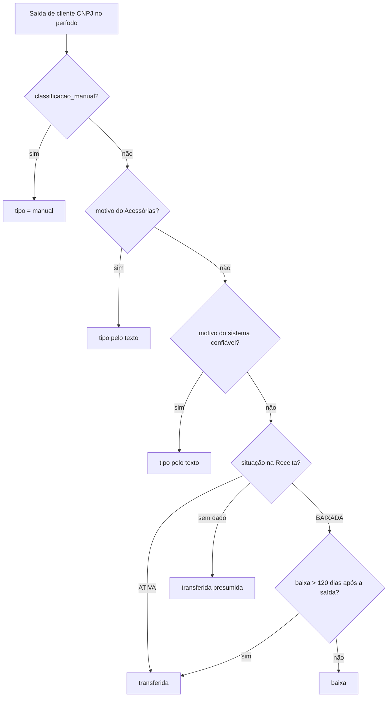

# Mapa do sistema Grupo-E — documento único

Gerado em 31/10/2026 com o código no commit `4299be9`, a partir dos arquivos de `docs/mapa/`. Engenharia reversa do código (servidor Node/Express + PostgreSQL, front-end em HTML/JS puro, hospedado no Render), escrita para reconstruir ou portar o sistema sem abrir o código. Idioma: pt-BR. Níveis de certeza usados em todo o texto: **[CONFIRMADO]** (lido no código), **[INFERIDO]** (deduzido), **[DÚVIDA]** (precisa de confirmação).

## Situação deste documento

**Prontas:** inventário da Fase 1 e anexos de rotas e tabelas; módulo /cs completo (11 partes); Gamificação; /legalizacao; /financeiro.

**Ainda não escritas:** a SPA `/` (clientes, atendimentos, gestão de clientes, tickets, usuários e demais telas), o núcleo (login, usuários, backup, push), e as seções transversais (visão geral de arquitetura, matriz de permissões, integrações externas, automações e jobs, logs e auditoria, portabilidade e checklist de cobertura). Para essas áreas, valem o inventário (parte 1) e os anexos de rotas e tabelas (partes 2 e 3), que já listam tudo, sem o detalhe de regras.

**Limites conhecidos:** (1) `clientes`, `honorarios`, `eventos_clientes`, `analistas` e `investimentos` não têm `CREATE TABLE` no repositório; as colunas delas aqui são inferidas pelo uso, e um `pg_dump --schema-only` fecharia a lacuna; (2) a seção de portabilidade depende do sistema de destino, que não foi informado; (3) algumas telas do /cs (portais Gestor, Analista e Sucesso do Cliente, Minha área, Acessos) estão descritas pelo que fazem, sem o texto de cada botão; (4) nada foi testado em produção, tudo vem da leitura do código.

**Cuidado ao compartilhar:** o texto cita nomes de pessoas, caminhos de rede e nomes de variáveis de ambiente. Nenhum valor de segredo, senha ou token deve entrar aqui.

**Para atualizar:** veja `docs/COMO_ATUALIZAR_A_DOCUMENTACAO.md`.

## Sumário

1. [Fase 1 — Inventário](#parte-1-fase-1-inventario)
2. [Anexo A — As rotas HTTP](#parte-2-anexo-a-as-rotas-http)
3. [Anexo B — As tabelas criadas pelo código](#parte-3-anexo-b-as-tabelas-criadas-pelo-codigo)
4. [/cs — Acesso, login e papéis](#parte-4-cs-acesso-login-e-papeis)
5. [/cs — Ingestão do Zappy, vínculos e SLA](#parte-5-cs-ingestao-do-zappy-vinculos-e-sla)
6. [/cs — Pontuação por ticket e abandono](#parte-6-cs-pontuacao-por-ticket-e-abandono)
7. [/cs — Qualidade (ocorrências, vínculos, anexos, alertas)](#parte-7-cs-qualidade-ocorrencias-vinculos-anexos-alertas)
8. [/cs — Risco de perda](#parte-8-cs-risco-de-perda)
9. [/cs — Churn, motivos e Categorias](#parte-9-cs-churn-motivos-e-categorias)
10. [/cs — Painel, ficha do cliente e Atendimento](#parte-10-cs-painel-ficha-do-cliente-e-atendimento)
11. [/cs — Questor, Omie, Análise Anual e Honorário sugerido](#parte-11-cs-questor-omie-analise-anual-e-honorario-sugerido)
12. [/cs — Sinais de e-mail, Logs, Backup e Limpeza](#parte-12-cs-sinais-de-e-mail-logs-backup-e-limpeza)
13. [/cs — Rotas do radar de SLA e Análise Inteligente](#parte-13-cs-rotas-do-radar-de-sla-e-analise-inteligente)
14. [/cs — Telas e experiência de uso](#parte-14-cs-telas-e-experiencia-de-uso)
15. [Gamificação](#parte-15-gamificacao)
16. [/legalizacao](#parte-16-legalizacao)
17. [/financeiro](#parte-17-financeiro)

---

# Parte 1 — Fase 1 — Inventário

*Origem: `docs/mapa/00-inventario.md`*

## Fase 1 — Inventário do sistema Grupo-E

Gerado em 30/10/2026 a partir do código do repositório (`grupo-e-sistema-main`) e da leitura das quatro entradas web: `/`, `/cs`, `/legalizacao` e `/financeiro`. Escopo: **o sistema inteiro**. Sistema de destino: **não informado** (o roteiro trazia o campo em branco); será pedido antes da seção 14 da Fase 2.

Níveis de certeza usados: **[CONFIRMADO]** explícito no código · **[INFERIDO]** deduzido do contexto · **[DÚVIDA]** ambíguo ou contraditório.

Arquivos desta fase: este inventário, `00b-rotas.md` (as 358 rotas HTTP) e `00c-tabelas.md` (as 72 tabelas criadas pelo código).

**Como a navegação foi feita.** O navegador do app estava sem login (a sessão cai com frequência) e senhas não são digitadas por agentes. Por isso a estrutura de cada página foi lida do HTML e do JavaScript servidos (menus, seções, perfis) e não dos dados exibidos. Os dados e os comportamentos por perfil vêm do código. Não foi possível ver as telas **como gestor** e **como analista** com dados reais; o que cada perfil enxerga foi extraído das regras em `server/cs/acessos.js` e `public/js/cs-painel.js` ([CONFIRMADO] pela leitura, não pela tela).

---

### 1. Pilha tecnológica

| Camada | O que é | Origem |
| --- | --- | --- |
| Linguagem / runtime | JavaScript (CommonJS), Node.js (`engines >= 18`; README diz 22; `render.yaml` só `env: node`) | `package.json` [CONFIRMADO] |
| Servidor HTTP | Express `^4.18.3` | `package.json` |
| Banco de dados | **PostgreSQL** via `pg ^8.22` (`DATABASE_URL`) | `server/db.js` [CONFIRMADO] |
| Autenticação | `jsonwebtoken ^9` (acesso 2 h, refresh rotativo), `bcryptjs ^2.4` (12 rounds), `cookie-parser` | `server/auth.js` |
| Segurança HTTP | CORS restrito por `ALLOWED_ORIGINS`, `express-rate-limit` (300 req/min por IP), cabeçalhos manuais (`nosniff`, `X-Frame-Options: SAMEORIGIN`) | `server/index.js` |
| Compressão | `compression` | `server/index.js` |
| E-mail | `nodemailer ^8` com Gmail (`GMAIL_USER`, `GMAIL_APP_PASS`) | `server/mailer.js` |
| Notificações push | `web-push ^3.6`, chaves VAPID geradas e guardadas no banco | `server/push.js` |
| PDF | `pdf-parse ^1.1` (leitura de alvarás em PDF) | `server/legalizacao/lerAlvarasPasta.js` |
| Front-end | **HTML/CSS/JS puros, sem build** (módulos grandes: `app.js` 11.031 linhas, `cs-painel.js` 4.304, `legalizacao.js` 890, `financeiro.js` 827) | `public/` |
| PWA | `public/sw.js` (service worker de push) | `public/sw.js` |
| Hospedagem | Render (web service, plano free, `healthCheckPath: /health`, keep-alive a cada 14 min) | `render.yaml`, `server/index.js` |
| Rotinas locais | PowerShell + Agendador de Tarefas do Windows, scripts Node e **userscripts do Tampermonkey** | `server/*/agendar*.ps1`, `public/tools/*.user.js` |
| Testes | Scripts Node com `assert` (`testes_*.js`), sem framework; executados à mão | `server/**/testes_*.js` |

**Não existe:** pasta de migrations, `.env.example` (o README manda copiar um), Dockerfile, CI, linter, TypeScript, front-end componentizado. [CONFIRMADO] por listagem.

**Inconsistências já visíveis na pilha** (detalhe na Fase 2, seção 15):
- O README descreve **SQLite nativo do Node 22** e token de acesso de **15 min**; o código usa **PostgreSQL** e token de **2 h**. O README está desatualizado. [CONFIRMADO]
- `render.yaml` e `certiseguroSync.js` usam o host `grupo-e-sistema.onrender.com`; o sistema em uso responde em `grupo-e-sistema-uc2w.onrender.com`. [DÚVIDA] qual é o valor real de `APP_URL` em produção.
- `server/cs/schema_cs.sql` diz "Rodar no Supabase → SQL Editor", mas nada no código usa o SDK do Supabase; o banco é acessado só por `pg`. [INFERIDO] histórico de migração.

---

### 2. Árvore de pastas comentada

```text
grupo-e-sistema-main/
├── package.json, render.yaml          dependências e deploy no Render
├── README.md                          desatualizado (fala de SQLite)
├── docs/mapa/                         esta documentação
├── public/                            front-end estático servido pelo Express
│   ├── index.html + js/app.js         SPA do painel principal (/) — 18 páginas internas
│   ├── cs-painel.html + js/cs-painel.js + css/cs-painel.css   Painel do Sucesso do Cliente (/cs)
│   ├── legalizacao-publica.html + js/legalizacao.js           Legalização (/legalizacao)
│   ├── financeiro.html + js/financeiro.js                     Financeiro (/financeiro)
│   ├── pesquisa.html                  pesquisa de satisfação pública (/pesquisa)
│   ├── gamificacao*.html              ranking, regras e admin antigo da Gamificação
│   ├── cs-como-funciona.html, cs-regras-sla.html, legalizacao-regras.html   guias públicos
│   ├── contabil.html                  portal do contábil (login próprio)
│   ├── minha-nota.html, qualidade.html, legalizacao-antiga.html            telas antigas/redirecionadas
│   ├── reset-password.html            redefinição de senha
│   ├── sw.js                          service worker (push)
│   ├── tools/*.user.js                userscripts Tampermonkey (procurações, REDESIM, Protocolo Online)
│   └── css/, img/, modelos/           estilos, imagens (prêmios), planilha-modelo de importação
└── server/
    ├── index.js                       montagem do Express, jobs agendados, páginas
    ├── db.js, auth.js, reset.js, mailer.js, push.js
    ├── acessoriasClient.js            cliente da API do Acessórias
    ├── routes/                        data.js (6.728 linhas, 172 rotas: clientes, Gamificação, Legalização, tickets, backup…), auth, users, analistas, grupos-empresas, unidades, motivos-churn, gamificacao (não montado)
    ├── cs/                            Sucesso do Cliente: ingestão Zappy, SLA, pontuação, abandono, risco, churn, categorias, qualidade (ocorrências), acessos, auditoria, e-mail, Questor, Omie
    ├── financeiro/                    inadimplência, suspensos, cobranças
    ├── legalizacao/                   alvarás, certificados, procurações, portais de prefeituras, OCR, CertiSeguro
    ├── emailSinais/                   leitura de metadados de e-mail (job local)
    ├── questor/                       extração de faturamento/funcionários (job local, VPN)
    ├── omie/                          scripts de console para exportar honorários/contratos
    ├── arquivoMorto/                  rotina local que arquiva pastas de empresas inativadas
    └── backups/                       cópia manual de dados da Gamificação (JSON)
```

---

### 3. Módulos e submódulos

#### 3.1 Núcleo (transversal)
Autenticação e sessão, usuários e perfis, redefinição de senha por e-mail, acessos por módulo (`/cs`), notificações push, notificações no "sino", Log de atividades, backup automático, importação de planilhas.

#### 3.2 Painel principal — `/` (SPA, `public/index.html`) — 18 páginas
Menu lido do HTML. **Todos os perfis logados:** Dashboard, Atendimento, Gestão de Clientes, Insatisfação, Clientes Sensíveis, Pesquisas, Recuperação, Link da Pesquisa, Meu Perfil, Administração (a página existe no HTML sem a marca `admin-only`; o menu e as rotas restringem — [DÚVIDA] a conferir na Fase 2). **Só administrador (`admin-only`):** Carteira, CAC / Investimentos, Legalização, Financeiro, Gamificação, Tickets, Sucesso do Cliente, Análise Inteligente, Log de Atividades.

#### 3.3 Sucesso do Cliente — `/cs` (`public/cs-painel.html`) — 19 seções
Menu e agrupamento lidos do HTML:

| Grupo | Seção (`data-sec`) | Módulo (código em Acessos) |
| --- | --- | --- |
| Topo | Visão Geral (`visao`) | `visao` |
|  | Análise Inteligente (`analise`) | `inteligente` |
|  | Análise Anual (`anual`) | `anual` |
|  | Atendimento (`atendimento`) | `atendimento` |
|  | Portal do Analista (`analista`) | `analista` |
|  | Qualidade (`consideracoes`) | `qualidade` |
|  | Prioridades (`minhasprior`) | `minhas_prioridades` |
|  | Portal do Gestor (`gestor`) | `gestor` |
|  | Portal do Sucesso do Cliente (`sucesso`) | `sucesso` |
| Minha área | Minha nota (`minhanota`) | `minha_nota` |
|  | Meus atendimentos (`meusatend`) | `meus_atendimentos` |
|  | Meus e-mails (`meusemails`) | `meus_emails` |
|  | Evolução semanal (`minhaevolucao`) | `minha_evolucao` |
|  | Gamificação (`gamificacao`) | `gamificacao` |
| Indicadores | Gestão da Permanência (`risco`) | `permanencia` |
|  | Churn (`churn`) | `churn` |
|  | Categorias (`categorias`) | `categorias` |
| Administração | Acessos (`acessos`) | `acessos` (só administrador) |
| Conferência | Qualidade dos Dados (`qualidade`) | `qualidade_dados` |

**Quem vê o quê no `/cs`** ([CONFIRMADO] `server/cs/acessos.js → modulosPadrao`, `public/js/cs-painel.js → perfilDe`):
- **Administrador:** todos os módulos mais Acessos. O menu pode ser personalizado, mas "Acessos" ele sempre tem.
- **Equipe do painel** (`role = usuario` ou `acesso_cs`): os 8 módulos de indicadores + Qualidade + Gamificação + Portal do Sucesso do Cliente.
- **Gestor** (`acesso_gestor` ou registrado em `cs_qualidade_gestores`): Qualidade + Gamificação + Portal do Gestor.
- **Analista** (`acesso_qualidade` ou login ligado a um analista): Qualidade + Gamificação + Portal do Analista + a Minha área (nota, atendimentos, e-mails, evolução, prioridades).
- Quem tem lista de módulos gravada em `cs_acessos` vê **exatamente** a lista; as rotas recusam (403) o que não está nela.

Submódulos do motor do `/cs`: ingestão de tickets do Zappy, motor de SLA, pontuação por ticket (Gamificação), abandono de atendimento, vínculos de contatos, sinais de e-mail, risco de perda (termômetros Financeiro, Atendimento e Operacional), churn (saídas e motivos), categorias (Diamante/Ouro/Prata/Bronze), Análise Anual (Questor), honorário sugerido (Omie), alertas de prazo, auditoria.

#### 3.4 Qualidade (ocorrências) — dentro do `/cs`
Registro de ocorrências, tratativa pelo gestor do departamento, vínculos (inclusive entre departamentos), notas e observações com anexos, validação, devolutiva ao cliente e encerramento pelo Gestor final. Arquivo principal: `server/cs/qualidade.js` (2.157 linhas, 53 rotas).

#### 3.5 Gamificação (Liga do Atendimento)
Notas mensais por colaborador, revisões (nota baixa, velocidade, aceite, finalizar, abandono), Consolidado Geral da temporada, férias, mês fechado, relatório e apresentação da temporada, ranking público e regras públicas. Código em `server/routes/data.js` (+ `server/cs/pontuacao.js`, `abandono.js`) e `public/js/app.js`.

#### 3.6 Legalização — `/legalizacao` (`legalizacao-publica.html`) — 10 seções
Visão Geral, Prioridades, Alvarás de funcionamento, Alvarás sanitários, Certificados digitais, Procurações, Todos os clientes (Carteira), Solicitações, Evolução semanal, Qualidade dos dados. Acesso por login próprio (`acesso_legalizacao`) ou administrador.

#### 3.7 Financeiro — `/financeiro` (`financeiro.html`) — 8 seções
Visão Geral, Oportunidades, Inadimplentes, Suspensos, Carteira, Evolução, Cobranças, Qualidade dos dados. Valores em R$ só para administrador e `acesso_financeiro`; `acesso_cs` e `acesso_financeiro_sv` veem sem valores.

#### 3.8 Páginas públicas e antigas
`/pesquisa` (pesquisa de satisfação, sem login), `/gamificacao/ranking`, `/gamificacao/regras`, `/cs/como-funciona`, `/cs/sla`, `/legalizacao/regras` (guias sem login), `/contabil` (login próprio), `/legalizacao-antiga`, `reset-password.html`. **Redirecionamentos:** `/gamificacao` → `/cs?aba=gamificacao`, `/minha-nota` → `/cs?aba=minhanota`, `/qualidade` → `/cs?aba=analista`, `/financiero` → `/financeiro` (301).

#### 3.9 Rotinas locais (fora do Render)
Leitura de e-mail (`server/emailSinais`), Questor mensal e anual (`server/questor`), exportação do Omie (`server/omie`, scripts rodados no navegador), Arquivo Morto (`server/arquivoMorto`), leitura de alvarás em pastas de rede, consulta de prefeituras, sincronizações de procurações, REDESIM e Protocolo Online (userscripts). Todas falam com o sistema por rotas protegidas por **token de sincronização** (`LEGALIZACAO_SYNC_TOKEN` / `CERTISEGURO_SYNC_TOKEN`).

---

### 4. Tabelas / entidades

**72 tabelas criadas pelo código** (lista, local de criação e colunas acrescentadas em `00c-tabelas.md`), por grupo:

| Grupo | Qtde | Exemplos |
| --- | --- | --- |
| Autenticação, usuários, acessos, push, logs, backup | 9 | `users`, `refresh_tokens`, `reset_tokens`, `cs_acessos`, `push_assinaturas`, `log_atividades`, `backups_automaticos` |
| Painel principal (`/`) | 12 | `atendimentos`, `gestao_clientes`, `insatisfacoes`, `clientes_sensiveis`, `pesquisas`, `recuperacoes`, `tickets`, `grupos_empresas`, `unidades`, `motivos_churn` |
| Sucesso do Cliente (`/cs`) | 22 | `cs_qualidade_*` (7), `cs_email_*` (4), `cs_*_tratamentos` (3), `cs_painel_config`, `acessorias_tags`, `cliente_tags`, `cliente_entregas_resumo`, `omie_*` (2), `questor_*` (2) |
| Gamificação | 12 | `gam_colaboradores`, `gam_notas`, `gam_config`, `gam_tickets_pontos`, `gam_ferias`, `gam_nota_final_override`, `gam_qualificacao_mapa`, `gam_*_revisoes` (3), `gam_meses_fechados`, `gam_abandono_incidentes` |
| Financeiro | 6 | `financeiro_titulos`, `financeiro_clientes`, `financeiro_aberto`, `financeiro_pontualidade`, `financeiro_historico`, `financeiro_importacoes` |
| Legalização | 10 | `legalizacao_alvaras`, `_certificados`, `_procuracoes`, `_protocolos`, `_rotinas`, `_solicitacoes_*`… |
| Notificações (sino) | 1 | `notificacoes` (criada por `server/cs/qualidade.js`) |

**Tabelas fora do padrão "criar se não existir" no código** (o esquema delas não está versionado de forma completa):
- **7 tabelas em `server/cs/schema_cs.sql`**, rodado à mão: `cs_vinculos`, `cs_tickets`, `cs_mensagens`, `cs_calendario`, `cs_analises`, `cs_scores`, `cs_config`. O código acrescenta colunas a `cs_tickets` por `ALTER` (analista, revisão de nota, abandono). [CONFIRMADO]
- **4 tabelas usadas sem nenhum `CREATE` no repositório:** `clientes` (a carteira, central para quase tudo; recebe 23 colunas por `ALTER`), `analistas`, `eventos_clientes`, `investimentos`. [CONFIRMADO] busca em todo o repositório. [DÚVIDA] onde e como foram criadas; sem o esquema delas não dá para recriar o sistema só pelo código.
- **Tabelas de código morto:** `server/routes/gamificacao.js` consulta `gamificacao_colaboradores`, `gamificacao_notas` e `gamificacao_premios`, que não existem em lugar nenhum, e o arquivo **não é montado** em `index.js` (é importado e nunca usado). [CONFIRMADO]

---

### 5. Rotas de API e endpoints

**358 rotas** declaradas (lista completa com caminho final, linha e tipo de acesso em `00b-rotas.md`):

| Arquivo | Rotas | Prefixo |
| --- | --- | --- |
| `server/routes/data.js` | 172 | `/api/data` e `/api/public` |
| `server/cs/qualidade.js` | 53 | `/api/cs/painel/qualidade` |
| `server/cs/routes.js` | 27 | `/api/cs` |
| `server/index.js` | 19 | páginas, `/health` e redirecionamentos |
| `server/routes/gamificacao.js` | 8 | **não montado** |
| `server/cs/churnSaidas.js`, `painel.js`, `risco.js` | 6 cada | `/api/cs/churn`, `/api/cs/painel`, `/api/cs/risco` |
| `server/routes/users.js` | 6 | `/api/users` |
| `server/cs/auditoria.js`, `server/routes/auth.js` | 5 cada | `/api/cs/painel/admin`, `/api/auth` |
| `server/cs/categorias.js`, `server/financeiro/rotas.js` | 4 cada | `/api/cs/categorias`, `/api/financeiro` |
| `server/routes/analistas.js`, `grupos-empresas.js`, `motivos-churn.js`, `unidades.js` | 4 cada | listas de apoio |
| `server/cs/anualQuestor.js`, `churnMotivos.js`, `emailSinais.js`, `push.js`, `reset.js` | 3 cada | vários |
| `server/cs/acessos.js`, `honorarioSugerido.js` | 2 cada | |
| `server/cs/omieHonorarios.js`, `questorDados.js` | 1 cada | |

Três famílias de acesso: **pública** (`/api/public`, sem login), **token de sincronização** (`X-Sync-Token`, usada pelas rotinas locais) e **login** (JWT em cabeçalho `Authorization`), com `requireAdmin` em parte delas. O `/api/cs/painel` passa antes por um filtro de módulos (`acessos.restringir`).

---

### 6. Telas e páginas (as quatro entradas pedidas + as demais)

| Entrada | Arquivo | Telas internas | Quem acessa |
| --- | --- | --- | --- |
| `/` | `index.html` | 18 páginas (seção 3.2) | login; metade só administrador |
| `/cs` | `cs-painel.html` | 19 seções (seção 3.3) | por módulo (Acessos); Gestores e Analistas veem subconjuntos |
| `/legalizacao` | `legalizacao-publica.html` | 10 seções (3.6) | `acesso_legalizacao` ou administrador |
| `/financeiro` | `financeiro.html` | 8 seções (3.7) | administrador, `acesso_financeiro`, `acesso_financeiro_sv`, `acesso_cs` |
| `/pesquisa` | `pesquisa.html` | formulário de satisfação | público |
| `/gamificacao/ranking`, `/gamificacao/regras` | `gamificacao.html`, `gamificacao-regras.html` | ranking e regras | público (o ranking também embutido no `/cs`) |
| `/cs/como-funciona`, `/cs/sla`, `/legalizacao/regras` | guias | documentação do analista, SLA e Legalização | público |
| `/contabil` | `contabil.html` | portal do contábil | login próprio (`role = contabil`) |
| `/legalizacao-antiga` | `legalizacao-antiga.html` | tela antiga em tabela única | [DÚVIDA] ainda em uso? |
| (arquivadas) | `minha-nota.html`, `qualidade.html`, `gamificacao-admin.html` | substituídas pelo `/cs` | redirecionadas ou sem rota |

---

### 7. Integrações externas

| Serviço | Para quê | Onde no código |
| --- | --- | --- |
| **Zappy** (`api-escritorial.zapcontabil.chat`) | tickets, mensagens, avaliações do cliente, usuários | `server/cs/zappyClient.js`, `ingestao.js` (`ZAPPY_BASE_URL`, `ZAPPY_TOKEN`) |
| **Acessórias** (`api.acessorias.com`) | carteira de clientes, TAGs, motivos de cancelamento, entregas, solicitações | `server/acessoriasClient.js` (`ACESSORIAS_API_TOKEN`) |
| **Omie** | contratos, contas a receber, honorários (exportação em scripts de console; carga por token) | `server/omie/*`, `server/cs/omieHonorarios.js`, `risco.js` |
| **Questor** (nWeb/VPN) | faturamento anual, 12 meses e funcionários | `server/questor/*`, `server/cs/anualQuestor.js`, `questorDados.js` (`QUESTOR_NWEB`, `QUESTOR_TOKEN_API`) |
| **CertiSeguro** (`app.certiseguro.com.br`) | lista de certificados digitais (IP liberado) | `server/legalizacao/certiseguroSync.js` (`CERTISEGURO_URL/TOKEN/CNPJ`) |
| **Protocolo Online / Ciclo7 Uberlândia** | situação de alvarás e protocolos | `public/tools/sincronizar-protocolo-online.user.js`, `ciclo7Uberlandia.js` |
| **Prefeituras e órgãos** (BH, Uberaba, Contagem, Campinas, SP, Rio, Ribeirão Preto, cidades de MG/GO, SIVISA) | consulta de alvará | `server/legalizacao/portaisPrefeituras.js`, `belohorizonte.js`, `uberaba.js` |
| **REDESIM**, **e-CAC** (procurações) | sincronização por userscript | `public/tools/*.user.js` |
| **Receita via BrasilAPI e minhareceita.org** | situação e município do CNPJ | `server/cs/churnSaidas.js`, `legalizacao/municipioCnpj.js`, `questor/extrairAnual.js` |
| **IBGE** (`servicodados.ibge.gov.br`) | código do município | `server/routes/data.js` |
| **Google (Gmail API e Admin SDK)** | leitura de metadados de e-mail por conta de serviço (delegação de domínio) | `server/emailSinais/coletar.js` (`GMAIL_CHAVE_JSON`, `GMAIL_ADMIN`) |
| **Gmail SMTP** | e-mail de recuperação de senha e relatórios | `server/mailer.js` (`GMAIL_USER`, `GMAIL_APP_PASS`) |
| **Web Push** | avisos no navegador | `server/push.js` (VAPID no banco) |
| **Render / GitHub** | hospedagem e deploy por `git push` | `render.yaml` |

**Variáveis de ambiente** encontradas (nomes apenas; 32 pelo acesso direto, mais as acessadas por nome dinâmico): `DATABASE_URL`, `JWT_SECRET`, `JWT_REFRESH_SECRET`, `NODE_ENV`, `PORT`, `APP_URL`, `ALLOWED_ORIGINS`, `ADMIN_EMAIL`, `ADMIN_PASS`, `ADMIN_NAME`, `ZAPPY_BASE_URL`, `ZAPPY_TOKEN`, `ACESSORIAS_API_TOKEN`, `GMAIL_USER`, `GMAIL_APP_PASS`, `GMAIL_CHAVE_JSON`, `GMAIL_ADMIN`, `LEGALIZACAO_SYNC_TOKEN`, `CERTISEGURO_SYNC_TOKEN`, `CERTISEGURO_URL`, `CERTISEGURO_TOKEN`, `CERTISEGURO_CNPJ`, `LEGALIZACAO_CONSULTA_NO_SERVIDOR`, `LEGALIZACAO_PASTA`, `QUESTOR_NWEB`, `QUESTOR_TOKEN_API`, `PDFTOPPM_PATH`, `ARQUIVO_MORTO_*` (6), `EMAIL_MAPA_CACHE`, `EMAIL_APRENDIDOS`, `EMAIL_CACHE_DIR`, `DEBUG_CICLO7`, `DBG`. Obrigatórias, valores e uso por ambiente ficam para a Fase 2, seção 2.

---

### 8. Jobs agendados e processos em background

**No servidor (Render), em `server/index.js` e `server/routes/data.js`** [CONFIRMADO]:

| Gatilho | O que faz | Condição |
| --- | --- | --- |
| a cada 14 min | auto-ping em `APP_URL/health` (evita o plano free dormir) | `APP_URL` definida |
| a cada 24 h | apaga tokens de sessão vencidos | sempre |
| a cada 10 min, só às 8h (Brasília) | alerta de prazo das ocorrências da Qualidade | sempre |
| a cada 5 min | ingestão de tickets do Zappy | `ZAPPY_BASE_URL` e `ZAPPY_TOKEN` |
| 08h, 11h, 15h | atualiza notas pendentes e aplica o auto-preencher da Gamificação do mês corrente | idem |
| 07h e 13h | lê a lista de certificados da CertiSeguro | idem |
| 08h | verifica vencimentos da Legalização (alvará 60 dias, certificado 10 dias) | idem |
| 02h | consulta noturna de alvarás nas prefeituras | **desligada** salvo `LEGALIZACAO_CONSULTA_NO_SERVIDOR=1` |
| a cada 1 h | saúde das rotinas locais da Legalização (avisa no sino) | idem |
| a cada 10 min | confere se é hora do backup automático e, se for, grava em `backups_automaticos` (`rodarBackupAutomaticoSeNecessario`) | sempre |
| a cada 24 h | sincroniza a carteira com o Acessórias e, em seguida: TAGs, motivos de cancelamento, classificação de saídas pela Receita, entregas (200 empresas por rodada), foto diária do risco | `ACESSORIAS_API_TOKEN` |
| a cada 6 h | completa o município dos clientes (700 por vez) | idem |

**Fora do servidor (estação Windows / navegador)**: leitura de e-mail (diária, `emailSinais/agendar.ps1`), Questor mensal e anual (`questor/agendar*.ps1`), Arquivo Morto (20h), leitura de alvarás em pastas (05h), consulta às prefeituras (semanal, segunda 08h30), userscripts semanais (procurações, REDESIM, Protocolo Online). [INFERIDO] horários a partir dos comentários do código; a Fase 2 confirma cada um.

---

### 9. Achados da Fase 1 que afetam a reconstrução

1. **Esquema incompleto no repositório:** `clientes`, `analistas`, `eventos_clientes` e `investimentos` não têm `CREATE`; `schema_cs.sql` é manual. Sem o esquema real do banco de produção, a seção 4 da Fase 2 ficará parcial para essas tabelas. **Pedido:** um `pg_dump --schema-only` do banco (sem dados).
2. **Código morto:** `routes/gamificacao.js` (8 rotas) e três tabelas `gamificacao_*` inexistentes; `routerAnalista` da Qualidade desligado desde 17/10/2026; `legalizacao-antiga`, `minha-nota.html`, `qualidade.html`.
3. **Concentração de lógica:** `server/routes/data.js` tem 6.728 linhas e mistura clientes, Gamificação, Legalização, tickets, backup e importações. É o maior risco de portabilidade.
4. **Regras duplicadas entre front e back:** perfis e módulos são decididos em `cs-painel.js` (`perfilDe`, `SEC_MODULO`) **e** em `acessos.js`; o servidor é a fonte de verdade, mas há duas cópias da lista de módulos.
5. **Segredos e acessos:** o README ainda lista um usuário e senha padrão; o código atual recusa criar o administrador sem `ADMIN_PASS`. Sem `JWT_SECRET`, o servidor gera um segredo aleatório a cada boot (sessões caem a cada reinício). [CONFIRMADO]
6. **Dependência de máquinas locais:** vários fluxos só funcionam com uma estação do escritório ligada (VPN do Questor, IP liberado da CertiSeguro, pastas de rede de alvarás).

### 10. O que a Fase 2 vai precisar de você

- O **sistema de destino** (pilha) e se será multiempresa; o roteiro trazia o campo em branco.
- O esquema real do banco (`pg_dump --schema-only`) ou acesso de leitura para eu extraí-lo.
- Confirmação do escopo: **o sistema inteiro** ou um módulo (por exemplo só o `/cs`), já que o documento completo é muito grande (estimativa: 16 seções, dezenas de milhares de linhas).
- Acesso de **gestor e analista de teste** para ver as telas deles com dados (senão a seção 8 sai só do código).

---

# Parte 2 — Anexo A — As rotas HTTP

*Origem: `docs/mapa/00b-rotas.md`*

## Rotas HTTP (inventário gerado do código)

Gerado por varredura de `router|app.(get|post|put|patch|delete)(…)` em `server/**` (sem os arquivos de teste). Total: **358 rotas**.

Legenda de autenticação: **pública/token** = a rota está antes do `router.use(requireAuth)` do arquivo (aberta ou protegida por token de sincronização no cabeçalho `X-Sync-Token`); **login** = depois dessa barreira ou com `requireAuth` na própria linha; **admin** = `requireAdmin` na própria linha ou no arquivo. [INFERIDO] por posição no arquivo — a Fase 2 confirma rota a rota.

### `server/cs/acessos.js` (2 rotas)

Montagem: `router` → `/api/cs/painel/acessos`

Barreira de sessão (`router.use(requireAuth)`): linha 168.

| Método | Caminho completo | Linha | Acesso |
| --- | --- | --- | --- |
| GET | `/api/cs/painel/acessos` | 173 | login |
| PUT | `/api/cs/painel/acessos/:userId` | 196 | login |

### `server/cs/anualQuestor.js` (3 rotas)

Montagem: `router` → `/api/cs/questor/anual` e `/api/cs/painel/anual`

| Método | Caminho completo | Linha | Acesso |
| --- | --- | --- | --- |
| POST | `/api/cs/questor/anual · /api/cs/painel/anual` | 106 | ver arquivo |
| GET | `/api/cs/questor/anual · /api/cs/painel/anual` | 135 | login |
| PUT | `/api/cs/questor/anual · /api/cs/painel/anual` | 165 | login |

### `server/cs/auditoria.js` (5 rotas)

Montagem: `router` → `/api/cs/painel/admin`

Barreira de sessão (`router.use(requireAuth)`): linha 273.

| Método | Caminho completo | Linha | Acesso |
| --- | --- | --- | --- |
| GET | `/api/cs/painel/admin/logs` | 278 | login |
| GET | `/api/cs/painel/admin/limpar-teste/previa` | 290 | login |
| POST | `/api/cs/painel/admin/limpar-teste` | 294 | login |
| GET | `/api/cs/painel/admin/backup/info` | 305 | login |
| GET | `/api/cs/painel/admin/backup` | 319 | login |

### `server/cs/categorias.js` (4 rotas)

Montagem: `router` → `/api/cs/categorias`

| Método | Caminho completo | Linha | Acesso |
| --- | --- | --- | --- |
| GET | `/api/cs/categorias` | 260 | login |
| GET | `/api/cs/categorias/config` | 269 | admin |
| PUT | `/api/cs/categorias/config` | 301 | admin |
| POST | `/api/cs/categorias/sincronizar-tags` | 337 | admin |

### `server/cs/churnMotivos.js` (3 rotas)

Montagem: `router` → `/api/cs/painel/churn-motivos`

Barreira de sessão (`router.use(requireAuth)`): linha 86.

| Método | Caminho completo | Linha | Acesso |
| --- | --- | --- | --- |
| GET | `/api/cs/painel/churn-motivos/motivos` | 94 | login |
| PUT | `/api/cs/painel/churn-motivos/definir` | 108 | login |
| GET | `/api/cs/painel/churn-motivos/fechamento` | 145 | login |

### `server/cs/churnSaidas.js` (6 rotas)

Montagem: `router` → `/api/cs/churn`

| Método | Caminho completo | Linha | Acesso |
| --- | --- | --- | --- |
| GET | `/api/cs/churn` | 364 | login |
| PUT | `/api/cs/churn/config` | 383 | admin |
| PUT | `/api/cs/churn/saidas/:id/classificacao` | 402 | admin |
| POST | `/api/cs/churn/classificar-saidas` | 420 | admin |
| POST | `/api/cs/churn/sincronizar-motivos` | 428 | admin |
| GET | `/api/cs/churn/diagnostico` | 438 | admin |

### `server/cs/emailSinais.js` (3 rotas)

Montagem: `router` → `/api/cs/email-sinais` e `/api/cs/painel/email-sinais`

| Método | Caminho completo | Linha | Acesso |
| --- | --- | --- | --- |
| POST | `/api/cs/email-sinais · /api/cs/painel/email-sinais` | 127 | ver arquivo |
| POST | `/api/cs/email-sinais/atendimento · /api/cs/painel/email-sinais/atendimento` | 169 | ver arquivo |
| GET | `/api/cs/email-sinais · /api/cs/painel/email-sinais` | 202 | login |

### `server/cs/honorarioSugerido.js` (2 rotas)

Montagem: `router` → `/api/cs/painel/honorario-sugerido`

Barreira de sessão (`router.use(requireAuth)`): linha 53.

| Método | Caminho completo | Linha | Acesso |
| --- | --- | --- | --- |
| GET | `/api/cs/painel/honorario-sugerido` | 55 | login |
| PUT | `/api/cs/painel/honorario-sugerido` | 68 | login |

### `server/cs/omieHonorarios.js` (1 rotas)

Montagem: `router` → `/api/cs/omie/honorarios`

| Método | Caminho completo | Linha | Acesso |
| --- | --- | --- | --- |
| POST | `/api/cs/omie/honorarios` | 75 | ver arquivo |

### `server/cs/painel.js` (6 rotas)

Montagem: `router` → `/api/cs/painel`

Barreira de sessão (`router.use(requireAuth)`): linha 178.

| Método | Caminho completo | Linha | Acesso |
| --- | --- | --- | --- |
| GET | `/api/cs/painel/dados` | 180 | login |
| GET | `/api/cs/painel/churn` | 199 | login |
| GET | `/api/cs/painel/atendimentos` | 245 | login |
| GET | `/api/cs/painel/atendimento/:id` | 268 | login |
| GET | `/api/cs/painel/cliente/:id` | 293 | login |
| GET | `/api/cs/painel/cliente/:id/acessorias` | 341 | login |

### `server/cs/qualidade.js` (53 rotas)

Montagem: `router` → `/api/cs/painel/qualidade`; `routerAnalista` → `(desligado em 17/10/2026)`

Barreira de sessão (`router.use(requireAuth)`): linha 655.

| Método | Caminho completo | Linha | Acesso |
| --- | --- | --- | --- |
| GET | `/api/cs/painel/qualidade/opcoes` | 684 | login |
| GET | `/api/cs/painel/qualidade/tipos` | 691 | login |
| POST | `/api/cs/painel/qualidade/tipos` | 699 | login |
| PATCH | `/api/cs/painel/qualidade/tipos/:id` | 713 | login |
| DELETE | `/api/cs/painel/qualidade/tipos/:id` | 739 | login |
| PUT | `/api/cs/painel/qualidade/analistas/:id/departamentos` | 752 | login |
| GET | `/api/cs/painel/qualidade/analistas` | 763 | login |
| GET | `/api/cs/painel/qualidade/cliente/:clienteId` | 772 | login |
| POST | `/api/cs/painel/qualidade` | 780 | login |
| GET | `/api/cs/painel/qualidade/resumo` | 812 | login |
| GET | `/api/cs/painel/qualidade/analista/:id` | 833 | login |
| GET | `/api/cs/painel/qualidade/gestores` | 891 | login |
| POST | `/api/cs/painel/qualidade/vinculos/automatico` | 909 | login |
| POST | `/api/cs/painel/qualidade/gestores` | 925 | login |
| DELETE | `/api/cs/painel/qualidade/gestores/:id` | 940 | login |
| GET | `/api/cs/painel/qualidade/pendencias` | 955 | login |
| GET | `/api/cs/painel/qualidade/versao` | 974 | login |
| GET | `/api/cs/painel/qualidade/avisos` | 984 | login |
| GET | `/api/cs/painel/qualidade/eu` | 1104 | login |
| GET | `/api/cs/painel/qualidade/ocorrencias/minhas` | 1118 | login |
| GET | `/api/cs/painel/qualidade/gestor/ocorrencias` | 1127 | login |
| PUT | `/api/cs/painel/qualidade/gestor/ocorrencias/:id/tratativa` | 1140 | login |
| POST | `/api/cs/painel/qualidade/gestor/ocorrencias/:id/filha` | 1179 | login |
| POST | `/api/cs/painel/qualidade/gestor/ocorrencias/:id/abrir` | 1244 | login |
| GET | `/api/cs/painel/qualidade/analista/ocorrencias` | 1271 | login |
| POST | `/api/cs/painel/qualidade/analista/ocorrencias/:id/nota` | 1320 | login |
| POST | `/api/cs/painel/qualidade/analista/ocorrencias/:id/encerrar` | 1338 | login |
| POST | `/api/cs/painel/qualidade/gestor/ocorrencias/:id/validar` | 1367 | login |
| POST | `/api/cs/painel/qualidade/gestor/ocorrencias/:id/devolver` | 1407 | login |
| POST | `/api/cs/painel/qualidade/gestor/ocorrencias/:id/mensagem` | 1436 | login |
| POST | `/api/cs/painel/qualidade/gestor/ocorrencias/:id/resposta-final` | 1454 | login |
| POST | `/api/cs/painel/qualidade/gestor/ocorrencias/:id/cancelar` | 1519 | login |
| POST | `/api/cs/painel/qualidade/gestor/ocorrencias/:id/excluir` | 1545 | login |
| POST | `/api/cs/painel/qualidade/gestor/ocorrencias/:id/reabrir` | 1567 | login |
| GET | `/api/cs/painel/qualidade/sucesso/ocorrencias` | 1611 | login |
| POST | `/api/cs/painel/qualidade/sucesso/ocorrencias/:id/responder` | 1622 | login |
| POST | `/api/cs/painel/qualidade/sucesso/ocorrencias/:id/apontar` | 1639 | login |
| POST | `/api/cs/painel/qualidade/sucesso/ocorrencias/:id/encerrar` | 1665 | login |
| GET | `/api/cs/painel/qualidade/tempos` | 1691 | login |
| GET | `/api/cs/painel/qualidade/empresas` | 1713 | login |
| POST | `/api/cs/painel/qualidade/ocorrencias` | 1736 | login |
| POST | `/api/cs/painel/qualidade/ocorrencias/:id/anexo` | 1771 | login |
| POST | `/api/cs/painel/qualidade/ocorrencias/:id/evento/:eventoId/anexo` | 1799 | login |
| GET | `/api/cs/painel/qualidade/anexo/:anexoId` | 1836 | login |
| GET | `/api/cs/painel/qualidade/ocorrencias` | 1851 | login |
| PATCH | `/api/cs/painel/qualidade/:id` | 1859 | login |
| DELETE | `/api/cs/painel/qualidade/:id` | 1891 | login |
| PUT | `/api/cs/painel/qualidade/vinculo/:analistaId` | 1901 | login |
| GET | `(desligado em 17/10/2026) /painel` | 2063 | login |
| GET | `/api/cs/painel/qualidade/analista/meu-painel` | 2064 | login |
| GET | `(desligado em 17/10/2026) /minhas` | 2066 | login |
| PATCH | `(desligado em 17/10/2026) /:id/tratar` | 2100 | login |
| POST | `(desligado em 17/10/2026) /:id/nota` | 2128 | login |

### `server/cs/questorDados.js` (1 rotas)

Montagem: `router` → `/api/cs/questor`

| Método | Caminho completo | Linha | Acesso |
| --- | --- | --- | --- |
| POST | `/api/cs/questor` | 84 | ver arquivo |

### `server/cs/risco.js` (6 rotas)

Montagem: `router` → `/api/cs/risco`

| Método | Caminho completo | Linha | Acesso |
| --- | --- | --- | --- |
| POST | `/api/cs/risco/suspensos-omie` | 315 | ver arquivo |
| POST | `/api/cs/risco/foto` | 322 | admin |
| GET | `/api/cs/risco` | 327 | login |
| GET | `/api/cs/risco/config` | 332 | admin |
| PUT | `/api/cs/risco/config` | 340 | admin |
| POST | `/api/cs/risco/sincronizar-entregas` | 355 | admin |

### `server/cs/routes.js` (27 rotas)

Montagem: `router` → `/api/cs`

| Método | Caminho completo | Linha | Acesso |
| --- | --- | --- | --- |
| GET | `/api/cs/agora` | 60 | login |
| GET | `/api/cs/historico` | 90 | login |
| GET | `/api/cs/filtros` | 162 | login |
| POST | `/api/cs/backfill` | 187 | admin |
| POST | `/api/cs/reingerir` | 217 | admin |
| GET | `/api/cs/reingerir/status` | 265 | admin |
| POST | `/api/cs/atualizar-notas` | 279 | admin |
| POST | `/api/cs/recalcular-sla` | 310 | admin |
| GET | `/api/cs/recalcular-sla/status` | 349 | admin |
| GET | `/api/cs/dashboard` | 386 | login |
| GET | `/api/cs/dashboard/etapas` | 493 | login |
| GET | `/api/cs/dashboard/motivos` | 640 | login |
| POST | `/api/cs/ingerir` | 712 | admin |
| GET | `/api/cs/diagnostico` | 731 | admin |
| GET | `/api/cs/churn` | 761 | admin |
| POST | `/api/cs/churn/:ticketId/tratar` | 849 | admin |
| GET | `/api/cs/insatisfacao-conversas` | 886 | admin |
| POST | `/api/cs/insatisfacao-conversas/:mensagemId/tratar` | 957 | admin |
| GET | `/api/cs/motivos` | 1001 | admin |
| GET | `/api/cs/afastamento` | 1125 | admin |
| POST | `/api/cs/afastamento/:clienteId/tratar` | 1191 | admin |
| GET | `/api/cs/tratados` | 1227 | admin |
| GET | `/api/cs/vinculos/buscar` | 1310 | admin |
| GET | `/api/cs/vinculos/pendentes` | 1327 | login |
| POST | `/api/cs/vinculos/recalcular` | 1346 | admin |
| POST | `/api/cs/vinculos/:id/confirmar` | 1358 | login |
| GET | `/api/cs/vinculos/analise-pendentes` | 1381 | admin |

### `server/financeiro/rotas.js` (4 rotas)

Montagem: `router` → `/api/financeiro`

| Método | Caminho completo | Linha | Acesso |
| --- | --- | --- | --- |
| GET | `/api/financeiro/dados` | 299 | login |
| GET | `/api/financeiro/historico` | 312 | login |
| GET | `/api/financeiro/ficha/:doc` | 331 | login |
| POST | `/api/financeiro/titulos` | 354 | ver arquivo |

### `server/index.js` (19 rotas)

Montagem: `app` → `/`

| Método | Caminho completo | Linha | Acesso |
| --- | --- | --- | --- |
| GET | `/health` | 93 | ver arquivo |
| GET | `/pesquisa` | 96 | ver arquivo |
| GET | `/gamificacao` | 102 | ver arquivo |
| GET | `/gamificacao/ranking` | 103 | ver arquivo |
| GET | `/gamificacao/regras` | 109 | ver arquivo |
| GET | `/contabil` | 114 | ver arquivo |
| GET | `/minha-nota` | 120 | ver arquivo |
| GET | `/qualidade` | 124 | ver arquivo |
| GET | `/legalizacao` | 130 | ver arquivo |
| GET | `/legalizacao-antiga` | 135 | ver arquivo |
| GET | `/legalizacao/regras` | 140 | ver arquivo |
| GET | `/cs/como-funciona` | 145 | ver arquivo |
| GET | `/cs/sla` | 150 | ver arquivo |
| GET | `/cs` | 155 | ver arquivo |
| GET | `/financeiro` | 160 | ver arquivo |
| GET | `/financiero` | 163 | ver arquivo |
| GET | `/js/:file` | 166 | ver arquivo |
| GET | `/css/:file` | 170 | ver arquivo |
| GET | `*` | 177 | ver arquivo |

### `server/push.js` (3 rotas)

Montagem: `router` → `/api/push`

Barreira de sessão (`router.use(requireAuth)`): linha 116.

| Método | Caminho completo | Linha | Acesso |
| --- | --- | --- | --- |
| GET | `/api/push/chave` | 117 | login |
| POST | `/api/push/assinar` | 121 | login |
| POST | `/api/push/cancelar` | 128 | login |

### `server/reset.js` (3 rotas)

Montagem: `router` → `/api/auth`

| Método | Caminho completo | Linha | Acesso |
| --- | --- | --- | --- |
| POST | `/api/auth/forgot-password` | 23 | ver arquivo |
| GET | `/api/auth/reset-valido` | 66 | ver arquivo |
| POST | `/api/auth/reset-password` | 80 | ver arquivo |

### `server/routes/analistas.js` (4 rotas)

Montagem: `router` → `/api/analistas`

| Método | Caminho completo | Linha | Acesso |
| --- | --- | --- | --- |
| GET | `/api/analistas` | 32 | login |
| POST | `/api/analistas` | 48 | admin |
| PATCH | `/api/analistas/:id` | 66 | admin |
| DELETE | `/api/analistas/:id` | 89 | admin |

### `server/routes/auth.js` (5 rotas)

Montagem: `router` → `/api/auth`

| Método | Caminho completo | Linha | Acesso |
| --- | --- | --- | --- |
| POST | `/api/auth/register` | 17 | ver arquivo |
| POST | `/api/auth/login` | 61 | ver arquivo |
| POST | `/api/auth/refresh` | 88 | ver arquivo |
| POST | `/api/auth/logout` | 117 | login |
| GET | `/api/auth/me` | 128 | login |

### `server/routes/data.js` (172 rotas)

Montagem: `router` → `/api/data`; `publicRouter` → `/api/public`

Barreira de sessão (`router.use(requireAuth)`): linha 809.

| Método | Caminho completo | Linha | Acesso |
| --- | --- | --- | --- |
| GET | `/api/data/legalizacao/alvaras-a-consultar` | 35 | pública/token |
| POST | `/api/data/legalizacao/inscricao-municipal-arquivo` | 75 | pública/token |
| POST | `/api/data/gestao/honorarios-omie` | 92 | pública/token |
| POST | `/api/data/financeiro/importar` | 165 | pública/token |
| POST | `/api/data/legalizacao/saude-rotina` | 231 | pública/token |
| POST | `/api/data/legalizacao/alvaras-dispensa` | 250 | pública/token |
| POST | `/api/data/legalizacao/alvaras-consulta-local` | 281 | pública/token |
| GET | `/api/data/legalizacao/clientes-ativos` | 349 | pública/token |
| POST | `/api/data/legalizacao/alvaras-arquivo` | 360 | pública/token |
| POST | `/api/data/legalizacao/cnaes-completar` | 399 | pública/token |
| POST | `/api/data/legalizacao/sanitario-avaliar` | 405 | pública/token |
| GET | `/api/data/legalizacao/redesim-a-consultar` | 420 | pública/token |
| GET | `/api/data/legalizacao/redesim-resumo` | 441 | pública/token |
| POST | `/api/data/legalizacao/redesim-reprocessar` | 522 | pública/token |
| POST | `/api/data/legalizacao/redesim-resultado` | 540 | pública/token |
| POST | `/api/data/legalizacao/certificados/importar-certiseguro` | 571 | pública/token |
| POST | `/api/data/legalizacao/certificados/sincronizar-certiseguro` | 601 | pública/token |
| POST | `/api/data/legalizacao/certificados/atualizar-agora` | 616 | admin |
| POST | `/api/data/legalizacao/procuracoes/importar` | 711 | pública/token |
| POST | `/api/data/legalizacao/protocolo-online` | 799 | pública/token |
| POST | `/api/data/legalizacao/protocolo-online-manual` | 812 | admin |
| POST | `/api/data/legalizacao/procuracoes/importar-manual` | 827 | admin |
| GET | `/api/data/atendimentos` | 865 | login |
| POST | `/api/data/atendimentos` | 873 | login |
| GET | `/api/data/financeiro` | 900 | admin |
| GET | `/api/data/gestao` | 958 | login |
| POST | `/api/data/gestao` | 1021 | login |
| POST | `/api/data/gestao/importar` | 1073 | admin |
| POST | `/api/data/clientes/importar-acessorias` | 1615 | admin |
| GET | `/api/data/insatisfacoes` | 1648 | login |
| POST | `/api/data/insatisfacoes` | 1662 | login |
| PATCH | `/api/data/insatisfacoes/:id/status` | 1688 | login |
| GET | `/api/data/sensiveis` | 1704 | login |
| POST | `/api/data/sensiveis` | 1712 | login |
| GET | `/api/data/pesquisas` | 1729 | login |
| POST | `/api/data/pesquisas` | 1737 | login |
| GET | `/api/data/recuperacoes` | 1752 | login |
| POST | `/api/data/recuperacoes` | 1761 | login |
| GET | `/api/data/dashboard` | 1782 | login |
| PATCH | `/api/data/pesquisas/:id/tratado` | 1906 | login |
| DELETE | `/api/data/pesquisas/clear` | 1918 | admin |
| DELETE | `/api/data/atendimentos/clear` | 1928 | admin |
| DELETE | `/api/data/gestao/clear` | 1935 | admin |
| DELETE | `/api/data/insatisfacoes/clear` | 1942 | admin |
| DELETE | `/api/data/sensiveis/clear` | 1949 | admin |
| DELETE | `/api/data/pesquisas/:id` | 1956 | admin |
| DELETE | `/api/data/recuperacoes/clear` | 1963 | admin |
| DELETE | `/api/data/atendimentos/:id` | 1970 | admin |
| DELETE | `/api/data/gestao/:id` | 1977 | admin |
| DELETE | `/api/data/recuperacoes/:id` | 1986 | admin |
| GET | `/api/data/clientes` | 1995 | login |
| POST | `/api/data/clientes` | 2032 | login |
| GET | `/api/data/clientes/:id` | 2072 | login |
| PATCH | `/api/data/clientes/:id` | 2091 | admin |
| PATCH | `/api/data/clientes/:id/encerrar` | 2111 | admin |
| PATCH | `/api/data/clientes/:id/completar-entrada` | 2141 | admin |
| POST | `/api/data/clientes/:id/honorario` | 2193 | admin |
| POST | `/api/data/clientes/reajuste-em-massa` | 2231 | admin |
| GET | `/api/data/carteira/dashboard` | 2278 | login |
| DELETE | `/api/data/clientes/clear` | 2330 | admin |
| DELETE | `/api/data/clientes/:id` | 2344 | admin |
| DELETE | `/api/data/insatisfacoes/:id` | 2352 | admin |
| DELETE | `/api/data/sensiveis/:id` | 2360 | admin |
| DELETE | `/api/data/clear` | 2368 | admin |
| PATCH | `/api/data/perfil` | 2379 | login |
| GET | `/api/data/investimentos` | 2434 | login |
| POST | `/api/data/investimentos` | 2450 | admin |
| PATCH | `/api/data/investimentos/:id` | 2469 | admin |
| DELETE | `/api/data/investimentos/clear` | 2486 | admin |
| DELETE | `/api/data/investimentos/:id` | 2493 | admin |
| GET | `/api/data/cac/dashboard` | 2500 | login |
| GET | `/api/data/notificacoes` | 2564 | login |
| PATCH | `/api/data/notificacoes/:id/lida` | 2580 | login |
| PATCH | `/api/data/notificacoes/todas/lidas` | 2587 | login |
| POST | `/api/data/notificacoes` | 2595 | login |
| GET | `/api/data/relatorio-executivo` | 2607 | admin |
| GET | `/api/data/busca-global` | 2718 | login |
| GET | `/api/data/log-atividades` | 2754 | admin |
| DELETE | `/api/data/log-atividades` | 2780 | admin |
| GET | `/api/data/backup` | 2899 | admin |
| GET | `/api/data/backups-automaticos` | 2974 | admin |
| GET | `/api/data/backups-automaticos/:id/download` | 2987 | admin |
| POST | `/api/public/pesquisa` | 3008 | pública |
| GET | `/api/public/gamificacao` | 3132 | pública |
| GET | `/api/data/gam/consolidado` | 3513 | admin |
| POST | `/api/data/gam/ferias` | 3529 | admin |
| DELETE | `/api/data/gam/ferias` | 3543 | admin |
| GET | `/api/data/gam/config` | 3554 | admin |
| PATCH | `/api/data/gam/config` | 3567 | admin |
| GET | `/api/data/gam/meses-fechados` | 3604 | admin |
| POST | `/api/data/gam/mes/:mes/fechar` | 3611 | admin |
| POST | `/api/data/gam/mes/:mes/reabrir` | 3625 | admin |
| GET | `/api/data/gam/colaboradores` | 3635 | admin |
| POST | `/api/data/gam/colaboradores` | 3643 | admin |
| PATCH | `/api/data/gam/colaboradores/:id/toggle` | 3655 | admin |
| DELETE | `/api/data/gam/colaboradores/:id` | 3665 | admin |
| GET | `/api/data/gam/notas` | 3673 | admin |
| POST | `/api/data/gam/notas` | 3686 | admin |
| DELETE | `/api/data/gam/notas/:id` | 3705 | admin |
| POST | `/api/data/gam/nota-final-override` | 3719 | admin |
| GET | `/api/data/gam/nota-final-override` | 3735 | admin |
| DELETE | `/api/data/gam/nota-final-override` | 3752 | admin |
| DELETE | `/api/data/gam/nota-final-override/:id` | 3759 | admin |
| GET | `/api/data/gam/usuarios-zappy` | 3773 | admin |
| PATCH | `/api/data/gam/colaboradores/:id/aceite` | 3788 | admin |
| POST | `/api/data/gam/colaboradores/criar-logins-em-lote` | 3818 | admin |
| PATCH | `/api/data/gam/colaboradores/:id/login` | 3865 | admin |
| PATCH | `/api/data/gam/colaboradores/:id/zappy` | 3878 | admin |
| GET | `/api/data/gam/qualificacao-mapa` | 3895 | admin |
| PATCH | `/api/data/gam/qualificacao-mapa` | 3903 | admin |
| GET | `/api/data/gam/diagnostico-analista` | 4270 | admin |
| GET | `/api/data/gam/diagnostico-vinculos` | 4331 | admin |
| POST | `/api/data/gam/notas/auto-preencher` | 4353 | admin |
| GET | `/api/data/gam/minha-composicao` | 4374 | login |
| GET | `/api/data/gam/meus-tickets` | 4395 | login |
| GET | `/api/data/gam/composicao-nota` | 4431 | admin |
| POST | `/api/data/gam/recalcular-pontos` | 4454 | admin |
| GET | `/api/data/gam/relatorio-descontos` | 4480 | admin |
| GET | `/api/data/gam/tickets-revisao` | 4539 | admin |
| PATCH | `/api/data/gam/tickets-revisao/:id` | 4595 | admin |
| GET | `/api/data/gam/tickets-revisao-velocidade` | 4632 | admin |
| PATCH | `/api/data/gam/tickets-revisao-velocidade/:ticketId/:papel` | 4670 | admin |
| GET | `/api/data/gam/tickets-revisao-aceite` | 4709 | admin |
| PATCH | `/api/data/gam/tickets-revisao-aceite/:ticketId/:papel` | 4747 | admin |
| GET | `/api/data/gam/tickets-revisao-finalizar` | 4786 | admin |
| PATCH | `/api/data/gam/tickets-revisao-finalizar/:ticketId/:papel` | 4822 | admin |
| GET | `/api/data/gam/tickets-revisao-abandono` | 4863 | admin |
| PATCH | `/api/data/gam/tickets-revisao-abandono/:id` | 4895 | admin |
| GET | `/api/data/gam/ticket-busca` | 4929 | admin |
| GET | `/api/data/tickets` | 5030 | login |
| POST | `/api/data/tickets` | 5116 | admin |
| GET | `/api/data/tickets/:id` | 5130 | login |
| POST | `/api/data/tickets/:id/interacoes` | 5152 | login |
| PATCH | `/api/data/tickets/:id/checklist` | 5196 | login |
| PATCH | `/api/data/tickets/:id/finalizar` | 5245 | login |
| PATCH | `/api/data/tickets/:id/status` | 5276 | admin |
| DELETE | `/api/data/tickets/clear` | 5286 | admin |
| DELETE | `/api/data/tickets/:id` | 5294 | admin |
| GET | `/api/data/tickets-usuarios` | 5302 | login |
| GET | `/api/data/sentimento` | 5349 | admin |
| GET | `/api/data/churn` | 5368 | admin |
| GET | `/api/data/legalizacao/painel` | 5813 | login |
| GET | `/api/data/legalizacao/historico` | 5839 | login |
| GET | `/api/data/legalizacao/saude` | 5898 | admin |
| PATCH | `/api/data/legalizacao/clientes/:clienteId/municipio` | 5957 | login |
| GET | `/api/data/legalizacao/conferencia` | 5981 | admin |
| POST | `/api/data/legalizacao/alvaras/:id/conferir` | 5995 | admin |
| PATCH | `/api/data/legalizacao/clientes/:clienteId/inscricao-municipal` | 6020 | login |
| PUT | `/api/data/legalizacao/procuracoes/:clienteId/:tipo` | 6033 | admin |
| PUT | `/api/data/legalizacao/alvaras/:clienteId/:tipo` | 6063 | login |
| POST | `/api/data/legalizacao/alvaras/:clienteId/:tipo/protocolo` | 6091 | login |
| POST | `/api/data/legalizacao/alvaras/:clienteId/:tipo/consultar-prefeitura` | 6208 | login |
| PATCH | `/api/data/legalizacao/alvaras/:id/desativar` | 6282 | admin |
| PATCH | `/api/data/legalizacao/certificados/:id/desativar` | 6291 | admin |
| PATCH | `/api/data/legalizacao/alvaras/:id/reativar` | 6300 | admin |
| PATCH | `/api/data/legalizacao/certificados/:id/reativar` | 6308 | admin |
| DELETE | `/api/data/legalizacao/alvaras/:id` | 6316 | admin |
| PUT | `/api/data/legalizacao/certificados/:clienteId` | 6330 | login |
| PATCH | `/api/data/legalizacao/certificados/:id` | 6351 | admin |
| DELETE | `/api/data/legalizacao/certificados/:id` | 6368 | admin |
| GET | `/api/data/legalizacao/notificacoes` | 6468 | login |
| POST | `/api/data/legalizacao/notificacoes/lidas` | 6484 | login |
| GET | `/api/data/legalizacao/motivos-inativacao` | 6495 | login |
| POST | `/api/data/legalizacao/solicitar-inativacao` | 6509 | login |
| GET | `/api/data/legalizacao/solicitacoes-inativacao` | 6541 | admin |
| PATCH | `/api/data/legalizacao/solicitacoes-inativacao/:id/aprovar` | 6561 | admin |
| PATCH | `/api/data/legalizacao/solicitacoes-inativacao/:id/rejeitar` | 6591 | admin |
| PATCH | `/api/data/legalizacao/certificados-cliente/:clienteId/desativar` | 6633 | admin |
| POST | `/api/data/legalizacao/solicitar-desativacao-certificado` | 6646 | login |
| GET | `/api/data/legalizacao/solicitacoes-desativacao` | 6678 | admin |
| PATCH | `/api/data/legalizacao/solicitacoes-desativacao/:id/aprovar` | 6692 | admin |
| PATCH | `/api/data/legalizacao/solicitacoes-desativacao/:id/rejeitar` | 6706 | admin |

### `server/routes/gamificacao.js` (8 rotas)

Montagem: `router` → `(NÃO MONTADO em index.js)`

| Método | Caminho completo | Linha | Acesso |
| --- | --- | --- | --- |
| GET | `(NÃO MONTADO em index.js) /ranking` | 16 | ver arquivo |
| GET | `(NÃO MONTADO em index.js) /consolidado-anual` | 51 | ver arquivo |
| GET | `(NÃO MONTADO em index.js) /admin/colaboradores` | 91 | login |
| POST | `(NÃO MONTADO em index.js) /admin/colaboradores` | 102 | admin |
| PATCH | `(NÃO MONTADO em index.js) /admin/colaboradores/:id` | 116 | admin |
| POST | `(NÃO MONTADO em index.js) /admin/notas` | 132 | admin |
| GET | `(NÃO MONTADO em index.js) /admin/notas` | 158 | login |
| PATCH | `(NÃO MONTADO em index.js) /admin/premios/:id` | 172 | admin |

### `server/routes/grupos-empresas.js` (4 rotas)

Montagem: `router` → `/api/grupos-empresas`

| Método | Caminho completo | Linha | Acesso |
| --- | --- | --- | --- |
| GET | `/api/grupos-empresas` | 42 | login |
| POST | `/api/grupos-empresas` | 58 | admin |
| PATCH | `/api/grupos-empresas/:id` | 76 | admin |
| DELETE | `/api/grupos-empresas/:id` | 90 | admin |

### `server/routes/motivos-churn.js` (4 rotas)

Montagem: `router` → `/api/motivos-churn`

| Método | Caminho completo | Linha | Acesso |
| --- | --- | --- | --- |
| GET | `/api/motivos-churn` | 67 | login |
| POST | `/api/motivos-churn` | 83 | admin |
| PATCH | `/api/motivos-churn/:id` | 101 | admin |
| DELETE | `/api/motivos-churn/:id` | 128 | admin |

### `server/routes/unidades.js` (4 rotas)

Montagem: `router` → `/api/unidades`

| Método | Caminho completo | Linha | Acesso |
| --- | --- | --- | --- |
| GET | `/api/unidades` | 43 | login |
| POST | `/api/unidades` | 59 | admin |
| PATCH | `/api/unidades/:id` | 77 | admin |
| DELETE | `/api/unidades/:id` | 91 | admin |

### `server/routes/users.js` (6 rotas)

Montagem: `router` → `/api/users`

Barreira de sessão (`router.use(requireAuth)`): linha 8.

| Método | Caminho completo | Linha | Acesso |
| --- | --- | --- | --- |
| GET | `/api/users` | 21 | login |
| POST | `/api/users` | 33 | login |
| PATCH | `/api/users/:id/password` | 60 | login |
| DELETE | `/api/users/:id` | 74 | login |
| PATCH | `/api/users/:id/profile` | 87 | login |
| PATCH | `/api/users/:id/toggle` | 134 | login |

---

# Parte 3 — Anexo B — As tabelas criadas pelo código

*Origem: `docs/mapa/00c-tabelas.md`*

## Tabelas (inventário gerado do código)

Gerado por varredura de `CREATE TABLE IF NOT EXISTS` e `ALTER TABLE … ADD COLUMN IF NOT EXISTS` em `server/**`. Total: **72 tabelas**. Todas são criadas por código na subida do servidor (não há pasta de migrations; [CONFIRMADO] — o esquema é "criar se não existir" dentro de funções `ensure*Schema` e de `server/db.js`). A Fase 2 detalha colunas, tipos, índices e restrições de cada uma.

### Autenticação, usuários e acessos (9)

| Tabela | Criada em | Colunas acrescentadas depois (ALTER) |
| --- | --- | --- |
| `backups_automaticos` | `server/routes/data.js` | — |
| `cs_acessos` | `server/cs/acessos.js` | — |
| `cs_acessos_migracoes` | `server/cs/acessos.js` | — |
| `cs_limpezas` | `server/cs/auditoria.js` | — |
| `log_atividades` | `server/cs/auditoria.js`, `server/routes/data.js` | — |
| `push_assinaturas` | `server/push.js` | — |
| `refresh_tokens` | `server/db.js` | — |
| `reset_tokens` | `server/reset.js` | — |
| `users` | `server/db.js` | 8 (acesso_minha_nota, acesso_legalizacao, acesso_cs, acesso_financeiro, acesso_financeiro_sv, acesso_qualidade, active, regimes_atendidos) |

### Módulos do painel principal (/) (12)

| Tabela | Criada em | Colunas acrescentadas depois (ALTER) |
| --- | --- | --- |
| `atendimentos` | `server/db.js` | — |
| `clientes_sensiveis` | `server/db.js` | 1 (detalhe) |
| `gestao_clientes` | `server/db.js` | 2 (codigo, regime_tributario) |
| `grupos_empresas` | `server/routes/grupos-empresas.js` | — |
| `insatisfacoes` | `server/db.js` | 3 (status, area, tipo) |
| `motivos_churn` | `server/routes/motivos-churn.js` | — |
| `pesquisas` | `server/db.js` | 1 (tratado) |
| `recuperacoes` | `server/db.js` | 1 (insatisfacao_id) |
| `ticket_interacoes` | `server/routes/data.js` | — |
| `ticket_mencoes` | `server/routes/data.js` | — |
| `tickets` | `server/routes/data.js` | 1 (dados_gestao) |
| `unidades` | `server/routes/unidades.js` | — |

### Sucesso do Cliente (/cs): SLA, tratativas, risco, churn, categorias, e-mail (22)

| Tabela | Criada em | Colunas acrescentadas depois (ALTER) |
| --- | --- | --- |
| `acessorias_tags` | `server/cs/categorias.js` | — |
| `cliente_entregas_resumo` | `server/cs/risco.js` | 1 (versao) |
| `cliente_tags` | `server/cs/categorias.js` | — |
| `cs_afastamento_tratamentos` | `server/cs/routes.js` | — |
| `cs_churn_tratamentos` | `server/cs/routes.js` | — |
| `cs_email_atendimento` | `server/cs/emailSinais.js` | 3 (comp_recebidos, comp_sem, comp_destinatarios) |
| `cs_email_atendimento_leitura` | `server/cs/emailSinais.js` | — |
| `cs_email_sinais` | `server/cs/emailSinais.js` | — |
| `cs_email_sinais_leitura` | `server/cs/emailSinais.js` | — |
| `cs_insatisfacao_tratamentos` | `server/cs/routes.js` | — |
| `cs_painel_config` | `server/cs/analistasNomes.js`, `server/cs/anualQuestor.js`, `server/cs/honorarioSugerido.js`, `server/cs/limpezaTeste.js`, `server/cs/omieHonorarios.js`, `server/push.js`, `server/routes/motivos-churn.js` | — |
| `cs_qualidade_alertas` | `server/cs/alertasPrazo.js` | — |
| `cs_qualidade_anexos` | `server/cs/qualidade.js` | 1 (historico_id) |
| `cs_qualidade_gestores` | `server/cs/qualidade.js` | — |
| `cs_qualidade_historico` | `server/cs/qualidade.js` | — |
| `cs_qualidade_registros` | `server/cs/qualidade.js` | 25 (validado_em, validado_por, origem, plano_cs, assunto, prioridade, encaminhada, etapa, …) |
| `cs_qualidade_resp` | `server/cs/qualidade.js` | — |
| `cs_qualidade_tipos` | `server/cs/qualidade.js` | — |
| `omie_contratos_suspensos` | `server/cs/risco.js` | — |
| `omie_honorario_anual` | `server/cs/omieHonorarios.js` | — |
| `questor_cliente_anual` | `server/cs/anualQuestor.js` | 5 (funcionarios, funcionarios_media, regime, regime_fonte, aviso) |
| `questor_cliente_dados` | `server/cs/questorDados.js` | 1 (aviso) |

### Gamificação (Liga do Atendimento) (12)

| Tabela | Criada em | Colunas acrescentadas depois (ALTER) |
| --- | --- | --- |
| `gam_abandono_incidentes` | `server/cs/abandono.js` | 1 (override_analista_id) |
| `gam_aceite_revisoes` | `server/routes/data.js` | 1 (override_analista_id) |
| `gam_colaboradores` | `server/routes/data.js` | 3 (zappy_user_id, aplica_regra_aceite, user_id) |
| `gam_config` | `server/routes/data.js` | — |
| `gam_ferias` | `server/routes/data.js` | — |
| `gam_finalizar_revisoes` | `server/routes/data.js` | 1 (override_analista_id) |
| `gam_meses_fechados` | `server/routes/data.js` | — |
| `gam_nota_final_override` | `server/routes/data.js` | — |
| `gam_notas` | `server/routes/data.js` | — |
| `gam_qualificacao_mapa` | `server/routes/data.js` | — |
| `gam_tickets_pontos` | `server/cs/pontuacao.js` | 1 (ajuste_aceite) |
| `gam_velocidade_revisoes` | `server/routes/data.js` | 1 (override_analista_id) |

### Financeiro (/financeiro) (6)

| Tabela | Criada em | Colunas acrescentadas depois (ALTER) |
| --- | --- | --- |
| `financeiro_aberto` | `server/routes/data.js` | — |
| `financeiro_clientes` | `server/routes/data.js` | — |
| `financeiro_historico` | `server/financeiro/rotas.js` | — |
| `financeiro_importacoes` | `server/routes/data.js` | — |
| `financeiro_pontualidade` | `server/financeiro/rotas.js` | — |
| `financeiro_titulos` | `server/financeiro/rotas.js` | — |

### Legalização (/legalizacao) (10)

| Tabela | Criada em | Colunas acrescentadas depois (ALTER) |
| --- | --- | --- |
| `legalizacao_alvaras` | `server/routes/data.js` | 19 (ultima_consulta_status, ultima_consulta_resumo, ultima_consulta_data_solicitacao, ultima_consulta_em, dispensado_motivo, dispensado_em, dispensado_fonte, notificado_vencimento_em, …) |
| `legalizacao_certificados` | `server/routes/data.js` | 2 (notificado_vencimento_em, desativado_em) |
| `legalizacao_historico` | `server/routes/data.js` | 2 (dispensado, nao_possui) |
| `legalizacao_notif_visto` | `server/routes/data.js` | — |
| `legalizacao_procuracoes` | `server/routes/data.js` | 1 (notificado_vencimento_em) |
| `legalizacao_protocolos` | `server/routes/data.js` | — |
| `legalizacao_redesim` | `server/routes/data.js` | — |
| `legalizacao_rotinas` | `server/routes/data.js` | — |
| `legalizacao_solicitacoes_desativacao` | `server/routes/data.js` | — |
| `legalizacao_solicitacoes_inativacao` | `server/routes/data.js` | 1 (motivo) |

### Notificações (1)

| Tabela | Criada em | Colunas acrescentadas depois (ALTER) |
| --- | --- | --- |
| `notificacoes` | `server/cs/qualidade.js`, `server/routes/data.js` | 1 (cliente_id) |

### Tabelas que recebem ALTER mas não têm CREATE no código (4)

- `cs_tickets` — colunas: abandono_calculado_em, analista_id, analista_anterior, analista_anterior_id, revisao_nota_status, revisao_nota_por, revisao_nota_em, revisao_nota_override_analista_id
- `clientes` — colunas: motivo_cancelamento_acessorias, situacao_receita, data_situacao_receita, situacao_receita_em, classificacao_manual, classificacao_manual_por, classificacao_manual_em, motivo_churn, motivo_churn_por, motivo_churn_em, inscricao_municipal, grupo_empresas, tipo_entrada, inadimplente_cronico, unidade, codigo, municipio, municipio_ibge, municipio_verificado_em, cnaes, acessorias_id, uf, alerta_baixa_notificado_em
- `analistas` — colunas: user_id, departamentos
- `investimentos` — colunas: recorrente, valor_original

---

# Parte 4 — /cs — Acesso, login e papéis

*Origem: `docs/mapa/cs/00-base-acesso.md`*

## /cs — Base: autenticação, perfis e acesso por módulo

Escopo: como uma pessoa chega ao `/cs`, o que cada perfil vê e onde cada permissão é verificada. Vale também para as outras páginas (`/financeiro`, `/legalizacao`), que reutilizam o mesmo JWT.

Níveis de certeza: [CONFIRMADO] · [INFERIDO] · [DÚVIDA].

### 1. Usuários e perfis

Tabela `users` (`server/db.js`):

| Coluna | Tipo | Nulo | Default | Significado |
| --- | --- | --- | --- | --- |
| `id` | TEXT PK | não | UUID gerado no código | identificador |
| `name` | TEXT | não | — | nome completo (também usado para casar com analistas por nome) |
| `email` | TEXT UNIQUE | não | — | login (comparado em minúsculas) |
| `password` | TEXT | não | — | hash bcrypt (12 rounds) |
| `role` | TEXT | não | `'usuario'` | `administrador`, `usuario`, `contabil`, `colaborador` (CHECK recriado a cada subida) |
| `active` | INTEGER | não | 1 | 1 ativo, 0 inativo (login recusa inativo) |
| `created_at`, `updated_at` | TIMESTAMPTZ | não | `NOW()` | auditoria |
| `acesso_minha_nota` | BOOLEAN | não | false | libera as rotas `/gam/minha-*` e `/gam/meus-*` (nota própria) |
| `acesso_legalizacao` | BOOLEAN | não | false | libera leitura e solicitação de inativação na Legalização |
| `acesso_cs` | BOOLEAN | não | false | entra no `/cs` e no `/financeiro` **sem valores em R$** (equipe do painel) |
| `acesso_financeiro` | BOOLEAN | não | false | `/financeiro` com valores em R$ |
| `acesso_financeiro_sv` | BOOLEAN | não | false | só o `/financeiro`, sem valores e sem o `/cs` |
| `acesso_qualidade` | BOOLEAN | não | false | é analista: Portal do Analista e Minha área |

`acesso_gestor` **não é coluna**: é calculado no login (seção 3). [CONFIRMADO] `server/routes/auth.js`.

Perfis efetivos no `/cs` (função `perfilDe`, `public/js/cs-painel.js`, e `modulosPadrao`, `server/cs/acessos.js`):

| Perfil | Como a pessoa cai nele | Padrão de módulos (sem configuração em Acessos) |
| --- | --- | --- |
| Administrador | `role = administrador` | todos + Acessos |
| Equipe do painel | `role = usuario` ou `acesso_cs` | 8 indicadores + Qualidade + Gamificação + Portal do Sucesso do Cliente |
| Sucesso do Cliente | registrado em `cs_qualidade_gestores` com departamento `Sucesso` ou papel `final` | Qualidade + Gamificação + Portal do Sucesso do Cliente |
| Gestor | registrado em `cs_qualidade_gestores` (papel gestor, diretor ou final) | Qualidade + Gamificação + Portal do Gestor |
| Analista | `acesso_qualidade` | Qualidade + Gamificação + Portal do Analista + Minha área (nota, atendimentos, e-mails, evolução, prioridades) |

Os perfis se somam: a mesma pessoa pode ser analista e gestora.

### 2. Sessão

- **Login** `POST /api/auth/login` (limite de 20 tentativas por 15 min por IP, `loginLimiter`): busca `users` por e-mail (case-insensitive) e `active = 1`; confere o hash; devolve **token de acesso JWT** e **refresh token** (UUID gravado em `refresh_tokens`). Mensagem única para e-mail ou senha errados: "E-mail ou senha incorretos." [CONFIRMADO]
- **Token de acesso:** JWT HS256 com `iss = grupo-e`, validade **2 h** (o README diz 15 min: desatualizado). Payload: `sub`, `name`, `role` e as seis marcas `acesso_*`. [CONFIRMADO] `server/auth.js → signAccess`
- **Refresh:** `POST /api/auth/refresh` valida o refresh token (existe, não vencido, usuário ativo), **apaga o usado** (rotação) e emite um novo par. Validade do refresh: 30 dias. `refresh_tokens` apagada a cada 24 h por `pruneExpiredTokens`.
- **Armazenamento no navegador:** o front guarda token, refresh e usuário no `localStorage` (chaves `ge_token`, `ge_refresh`, `ge_user` na SPA principal; `cs_token`, `cs_refresh`, `cs_user` no `/cs` e nas páginas de Legalização). Os tokens **não** vão em cookie. [CONFIRMADO] leitura dos JS e da sessão; o README fala em cookies HttpOnly (desatualizado).
- **Segredos:** `JWT_SECRET` e `JWT_REFRESH_SECRET`; se faltarem, o servidor gera segredo aleatório a cada subida e registra aviso no log (todas as sessões caem a cada reinício). Não há valor padrão fixo.
- **Cadastro público** `POST /api/auth/register`: sempre cria `role = usuario`, ignorando `role` do corpo; exige nome, e-mail e senha de pelo menos 6 caracteres; e-mail único (409). [CONFIRMADO] [DÚVIDA] se a rota deveria ficar aberta em produção.
- **Administrador inicial:** criado na subida só se `ADMIN_PASS` existir (`ADMIN_EMAIL`, `ADMIN_NAME` opcionais); sem `ADMIN_PASS` não cria e avisa no log.

### 3. Marcas calculadas no login e no refresh

```text
marcasCs = acessos.marcasDeAcesso(user.id)          // lê cs_acessos
acesso_gestor = (user.id está em cs_qualidade_gestores) OU marcasCs.portais
acesso_cs     = users.acesso_cs OU marcasCs.cs
// marcasCs.cs     = há lista gravada em Acessos E ela contém algum módulo de indicadores
// marcasCs.portais = há lista gravada E ela contém algum módulo de portal (qualidade, gestor, analista, sucesso, gamificação, Minha área)
```

Falha na consulta = sem a marca (nunca derruba o login). [CONFIRMADO] `server/routes/auth.js → marcasDoPainel`, `ehGestorDeQualidade`.

### 4. Onde cada permissão é verificada

| Camada | Verificação | Arquivo |
| --- | --- | --- |
| 1. Token | `requireAuth` valida JWT e monta `req.user` | `server/auth.js` |
| 2. Papéis restritos | `contabil` só chega em rotas de tickets, perfil/auth e nas rotas liberadas por marca (`isMinhaNotaRoute`, `isLegalizacaoRoute`, `isCsPainelRoute`, `isFinanceiroRoute`, `isQualidadeRoute`, `isCsQualidadeRoute`, `isPushRoute`); `colaborador` idem, sem tickets | `server/auth.js` (403 "Acesso restrito…") |
| 3. Administrador | `requireAdmin`: `role = administrador` | `server/auth.js` |
| 4. Módulos do `/cs` | `acessos.restringir`: pessoa **com lista gravada** só passa nas rotas dos módulos que tem; sem lista, segue (a rota confere o resto) | `server/cs/acessos.js`, montado em `/api/cs/painel` |
| 5. Cada rota | regras próprias (escopo por departamento, por analista, por valores em R$) | `server/cs/*.js`, `server/financeiro/*.js` |
| 6. Front-end | só **esconde** menus (`perfilCs`, `secaoLiberada`); nunca decide acesso | `public/js/cs-painel.js` |

Regra de ouro [CONFIRMADO]: o servidor decide; o front-end só reflete (`/api/cs/painel/qualidade/eu` devolve a lista de módulos efetivos da pessoa).

### 5. Acessos por módulo (RN-ACS)

Catálogo de 18 módulos em `CATALOGO` (código → seção do menu): `visao`, `inteligente`→`analise`, `anual`, `atendimento`, `permanencia`→`risco`, `churn`, `categorias`, `qualidade_dados`→`qualidade`, `qualidade`→`consideracoes`, `gestor`, `analista`, `sucesso`, `minha_nota`→`minhanota`, `meus_atendimentos`→`meusatend`, `meus_emails`→`meusemails`, `minha_evolucao`→`minhaevolucao`, `minhas_prioridades`→`minhasprior`, `gamificacao`. `acessos` existe à parte (só administrador, não configurável).

- **RN-ACS-001** Administrador sempre tem acesso aos dados; o **menu** dele pode ser personalizado, mas "Acessos" ele sempre tem.
- **RN-ACS-002** Pessoa **sem configuração** segue `modulosPadrao(perfil)` (tabela da seção 1).
- **RN-ACS-003** Pessoa **com configuração** vê exatamente os módulos marcados; rotas dos outros módulos respondem 403 "Você não tem acesso a este módulo. Peça à administração em Acessos."
- **RN-ACS-004** Os dados da carteira (`/dados`, `/cliente`, `/email-sinais`) são compartilhados: **um** módulo de indicadores basta para chegar neles.
- **RN-ACS-005** Mapa rota → módulo (`modulosDaRota`, caminho depois de `/api/cs/painel`): `/anual` e `/honorario-sugerido` → `anual`, `inteligente`; `/atendimentos`, `/atendimento` → `atendimento`; `/churn-motivos`, `/churn` → `churn`, `visao`; `/categorias` → `categorias`, `permanencia`, `visao`; `/dados`, `/cliente`, `/email-sinais` → qualquer módulo de dados; `/qualidade` e `/acessos` têm controle próprio (retornam `null`).
- **RN-ACS-006** Listas gravadas só aceitam códigos do catálogo, sem repetição, na ordem do catálogo (`limparModulos`). `null` apaga a configuração e volta ao padrão.
- **RN-ACS-007** Migração única `minha_area_analista` (21/10/2026): soma Minha área e Gamificação às listas que já tinham o portal do analista, para quem foi configurado antes desses módulos existirem. Controle em `cs_acessos_migracoes`.
- **RN-ACS-008** Cache em memória de 20 s por usuário (`cache`), limpo ao gravar; falha de banco = sem configuração (cai no padrão).

Tabelas: `cs_acessos (user_id TEXT PK, modulos JSONB NOT NULL, atualizado_por TEXT, atualizado_em TIMESTAMPTZ NOT NULL DEFAULT NOW())` e `cs_acessos_migracoes (nome TEXT PK, feita_em TIMESTAMPTZ NOT NULL DEFAULT NOW())`.

Endpoints (só administrador, com auditoria): `GET /api/cs/painel/acessos` (catálogo + cada usuário ativo com `modulos`, `padrao`, `definido`, `entra_padrao`, `entra_no_painel`) e `PUT /api/cs/painel/acessos/:userId` com `{ modulos: [..] | null }` (404 se a pessoa não está ativa; 400 se `modulos` não for lista nem `null`).

### 6. Perfis rápidos da tela Acessos (front)

`PERFIS_RAPIDOS` em `public/js/cs-painel.js`: Equipe completa (8 indicadores + qualidade + sucesso), Só indicadores (8), Só Qualidade e portais (`qualidade`, `gestor`, `analista`, `sucesso`), Analista (`qualidade`, `analista` + 5 da Minha área), Sem acesso a nada (lista vazia). São atalhos de preenchimento; o que vale é a lista gravada.

### 7. Auditoria dos acessos

Toda rota de `acessos` passa por `auditoria.middleware()`, que grava ação, módulo e autor em `log_atividades` (detalhado no arquivo de logs do `/cs`).

### 8. Pontos de atenção (para a seção 15)

1. README descreve SQLite, token de 15 min e cookies HttpOnly; o código usa Postgres, 2 h e `localStorage`. [CONFIRMADO]
2. `acesso_gestor` não é coluna mas viaja no token; quem for retirado de `cs_qualidade_gestores` mantém a marca até o token expirar (até 2 h) ou o refresh renovar. [INFERIDO]
3. Dois pontos duplicam a lista de módulos (front: `SEC_MODULO`, `ORDEM_SECOES`; back: `CATALOGO`). O back é a fonte de verdade. [CONFIRMADO]
4. `isLegalizacaoRoute` libera `GET` em qualquer caminho que contenha `/legalizacao`, mesmo que a rota tenha outro propósito (comparação por `includes`). [INFERIDO] risco de liberar mais do que o desejado se surgirem rotas novas com esse trecho no caminho.

---

# Parte 5 — /cs — Ingestão do Zappy, vínculos e SLA

*Origem: `docs/mapa/cs/01-ingestao-vinculos-sla.md`*

## /cs — Ingestão do Zappy, vínculos de contatos e motor de SLA

Cobre: `server/cs/zappyClient.js`, `tradutorZappy.js`, `ingestao.js`, `vinculos.js`, `depara.js`, `slaEngine.js`, `tempoUtil.js`, `slaTexto.js`, `schema_cs.sql`.

Níveis de certeza: [CONFIRMADO] explícito no código · [INFERIDO] deduzido · [DÚVIDA] ambíguo.

### 1. Objetivo de negócio

Espelhar os atendimentos do **Zappy Contábil** (WhatsApp) em tabelas próprias, ligar cada contato a uma empresa da carteira e medir, em **horas úteis**, o tempo que o escritório leva em cada etapa do atendimento (os "relógios" de SLA). Esses números alimentam o radar "Agora", o Dashboard, a pontuação da Gamificação, o risco de perda e a Qualidade.

### 2. Fluxo ponta a ponta



### 3. Modelo de dados (tabelas deste bloco)

Tabelas criadas **à mão** por `server/cs/schema_cs.sql` (o servidor não as cria sozinho). [CONFIRMADO]

#### 3.1 `cs_vinculos` — de-para telefone → empresa
| Coluna | Tipo | Nulo | Default | Descrição |
| --- | --- | --- | --- | --- |
| `id` | UUID PK | não | `gen_random_uuid()` | |
| `telefone` | TEXT UNIQUE | não | — | só dígitos, com DDI 55 (ver RN-ING-006) |
| `cliente_id` | TEXT | sim | — | FK **lógica** para `clientes.id` (a carteira); NULL até vincular |
| `empresa_nome` | TEXT | sim | — | nome exibido (da carteira ou o nome bruto do contato) |
| `cnpj` | TEXT | sim | — | |
| `tipo` | TEXT | não | `'pendente'` | CHECK: `cliente`, `fornecedor`, `interno`, `software`, `pendente` |
| `confianca` | INTEGER | sim | — | 0 a 100, da sugestão automática |
| `confirmado_por`, `confirmado_em` | TEXT, TIMESTAMPTZ | sim | — | quem e quando confirmou |
| `created_at`, `updated_at` | TIMESTAMPTZ | sim | `NOW()` | |
Índices: `idx_cs_vinculos_cliente (cliente_id)`, `idx_cs_vinculos_tipo (tipo)`.

#### 3.2 `cs_tickets` — espelho do ticket + resultado do SLA
| Coluna | Tipo | Nulo | Descrição |
| --- | --- | --- | --- |
| `id` | UUID PK | não | interno |
| `zappy_id` | TEXT UNIQUE | não | id do ticket no Zappy (chave do upsert) |
| `telefone`, `empresa_texto` | TEXT | sim | número e nome livre do contato |
| `vinculo_id` | UUID FK → `cs_vinculos` (`ON DELETE SET NULL`) | sim | |
| `departamento` | TEXT | sim | nome da fila do Zappy |
| `analista` | TEXT | sim | nome do atendente |
| `status` | TEXT | sim | status bruto do Zappy (`closed`, `pending`, `open`…) |
| `abertura`, `aceite`, `transferencia`, `encerramento` | TIMESTAMPTZ | sim | marcos do atendimento |
| `reaberturas` | INTEGER | sim (0) | [DÚVIDA] não é gravado por nenhum código lido |
| `nota_avaliacao` | SMALLINT | sim | 1 a 5, campo `rate` do Zappy |
| `comentario_avaliacao` | TEXT | sim | [DÚVIDA] não é preenchido |
| `sla` | JSONB | sim (`{}`) | `{ relogios, radar, trocas, trocasPosTransferencia }` |
| `em_risco` | BOOLEAN | sim (false) | radar existe e não é verde |
| `pior_status` | TEXT | sim | `verde`, `amarelo`, `vermelho` do radar |
| `ingerido_em`, `calculado_em`, `updated_at` | TIMESTAMPTZ | sim | |
Colunas acrescentadas por `ALTER` no código: `analista_id`, `analista_anterior`, `analista_anterior_id` (transferência), `revisao_nota_status`, `revisao_nota_por`, `revisao_nota_em`, `revisao_nota_override_analista_id` (revisão de nota baixa da Gamificação), `abandono_calculado_em`. Índices: `vinculo`, `em_risco` parcial, `abertura DESC`, `analista`.

#### 3.3 `cs_mensagens`
`id UUID PK`, `ticket_id UUID NOT NULL → cs_tickets ON DELETE CASCADE`, `zappy_msg_id TEXT`, `remetente TEXT NOT NULL CHECK IN ('cliente','escritorio','sistema')`, `autor TEXT`, `hora TIMESTAMPTZ NOT NULL`, `texto TEXT`, `UNIQUE (ticket_id, zappy_msg_id)`, índice `(ticket_id, hora)`. Remetente `sistema` = mensagem automática (bot).

#### 3.4 `cs_config` (chave/valor)
`chave TEXT PK`, `valor TEXT`, `updated_at`. Chaves deste bloco: `ingestao_data_inicio` e `ingestao_ultima_execucao` (ISO). Usada também por categorias, churn, risco e Questor (outros arquivos).

#### 3.5 Tabelas do schema SQL **sem nenhum uso** no código
`cs_calendario` (feriados e expediente especial), `cs_analises` (IA, "Fase 2"), `cs_scores` (health/churn por empresa). [CONFIRMADO] nenhuma referência em `server/**`. Os feriados e o expediente estão **fixos no código** (RN-SLA-001).

### 4. Regras de negócio da ingestão (RN-ING)

- **RN-ING-001 — Sem carga retroativa automática.** Na primeira execução grava `ingestao_data_inicio = agora`; nunca processa ticket com `createdAt` anterior a essa data, mesmo que tenha mensagem nova (reabertura de ticket antigo). `executarCargaRetroativa` só recua a data, nunca avança. (`ingestao.js → obterDataInicio`, `ingerirTickets`)
- **RN-ING-002 — Cursor por dia.** `dateFrom = AAAA-MM-DD de max(ultimaExecucao, dataInicio)`. A API só filtra mensagens por **dia**, então o mesmo dia é relido a cada ciclo; ticket é reprocessado por inteiro (upsert).
- **RN-ING-003 — Descoberta de tickets.** Lista `GET /api/messages?dateFrom=` (100 por página, até `maxPaginas = 100`) e coleta os `ticketId` distintos. Não pagina a lista de tickets (mais de 10.000).
- **RN-ING-004 — Mensagem nova só.** Lê os `zappy_msg_id` já gravados e insere apenas os novos (`ON CONFLICT DO NOTHING` como segunda barreira), para não gastar a banda de saída do Render (02/10/2026).
- **RN-ING-005 — Bot.** Mensagem `fromMe = true` é **bot** quando o ticket ainda não tem `userId` (ninguém assumiu); vira remetente `sistema`. Mensagem do cliente nunca é bot. Limitação: se o ticket só for capturado depois de aceito, mensagens anteriores do bot podem ser tratadas como humanas. (`tradutorZappy.js → ehMensagemBot`)
- **RN-ING-006 — Telefone.** Só dígitos; remove zeros à esquerda; com 10 ou 11 dígitos acrescenta `55`. Telefone vazio = sem vínculo (`garantirVinculo` devolve `null`).
- **RN-ING-007 — Eventos do ticket** (`extrairEventos`): `abertura = createdAt`; `encerramento = updatedAt` se `status = closed`; `aceite` = o **mais antigo** `metas[type='acceptTicket'].createdAt` (campo fora do swagger) ou, sem ele, a 1ª mensagem do escritório não-bot.
- **RN-ING-008 — Transferência por diferença entre coletas.** A API não traz histórico de fila. Se o analista salvo era X e agora é Y (ambos definidos), grava `transferencia = agora` (precisão = intervalo do ciclo), `analista_anterior = X`. Uma vez detectada, hora e quem transferiu **não mudam** mais. Passar de "ninguém" para alguém é aceite, não transferência. Só vale para transferências ocorridas depois da ativação do código.
- **RN-ING-009 — Vínculo automático.** Se o telefone não existe em `cs_vinculos`, cria como `pendente` com a melhor sugestão da carteira (RN-VIN). Nunca sobrescreve vínculo existente.
- **RN-ING-010 — Linha do ticket.** `em_risco = radar.status != 'verde'`; `pior_status = radar.status`; `sla` guarda relógios, radar, `trocas` e `trocasPosTransferencia`.
- **RN-ING-011 — Tarefas encadeadas após cada ciclo** (falha isolada não derruba a ingestão): `preencherTrocasPendentes` (50 tickets sem `trocas`), `recalcularPontosPendentes` (100, Gamificação) e `recalcularAbandonoPendentes` (30).
- **RN-ING-012 — Nota do cliente.** `nota_avaliacao = rate` do Zappy (1 a 5). Não existe webhook de avaliação: a nota só aparece quando o ticket é relido. `atualizarNotasPendentes` (diário) relê tickets `closed` sem nota encerrados nos últimos `dias = 5` (limite 500) e, achando `rate`, grava a nota e pontua na hora (`persistirPontosTicket`).
- **RN-ING-013 — Recálculos sem Zappy.** `recalcularSlaTodos` refaz relógios dos tickets já salvos com a fórmula atual, em lotes de 300 por chave (`id > último`), opcionalmente de um mês (`AAAA-MM`). Não recalcula abandono aqui (evitou travar o banco em 02/09/2026).
- **RN-ING-014 — Reingestão pontual** `reingerirTicketsPorId`: relê do Zappy uma lista de `zappy_id` (ou todos de um analista num mês) sem escanear atividade e **sem** respeitar a data de início.
- **Trava de concorrência** em memória (uma carga retroativa, uma reingestão, um recálculo, uma atualização de notas por vez) → 409 se repetido. [INFERIDO] não vale entre instâncias.
- **Timeout** de 30 s por chamada ao Zappy; resposta não-JSON gera erro explícito de URL base errada.

### 5. Vínculos de contatos (RN-VIN)

`depara.js` (puro, sem I/O):
- **Candidatos de empresa** a partir do nome do contato ("Pessoa - Empresa", "Empresa" ou "Pessoa"): texto depois do hífen, texto antes do hífen e o nome inteiro, sem repetição.
- **Tokens:** minúsculas, sem acento e pontuação; remove stopwords societárias (`ltda`, `me`, `epp`, `eireli`, `sa`, `comercio`, `servicos`, `mei`…) e tokens de 1 letra.
- **Similaridade** (0 a 100): `jaccard(tokensA, tokensB)`; se todos os tokens do menor conjunto estão no maior, `max(jaccard, 0,85)`; `round(s × 100)`.
- **Sugestões:** compara cada candidato com `clientes.nome_empresa`; guarda as que chegam a **confiança mínima 40**, ordena por confiança e devolve no máximo **3**. A tag `Escritorial` no contato marca `is_escritorial`.
- **Confirmação humana** (`confirmarVinculo`): `tipo` deve ser `cliente`, `fornecedor`, `interno` ou `software` (senão erro "tipo de vínculo inválido"); grava `cliente_id`, `empresa_nome`, `cnpj`, `confirmado_por`, `confirmado_em`.
- **`recalcularSugestoes`**: refaz a sugestão de todos os pendentes com a carteira atual, **sem confirmar nada**.
- **Efeito do tipo:** só vínculos `tipo = 'cliente'` geram pontuação da Gamificação e entram no radar "Agora" e nos indicadores (ver `02-pontuacao-abandono.md` e os arquivos seguintes). Contato pendente, fornecedor, interno ou software fica fora.

Endpoints (em `server/cs/routes.js`, prefixo `/api/cs`): `GET /vinculos/pendentes`, `POST /vinculos/:id/confirmar`, `GET /vinculos/buscar` (admin), `POST /vinculos/recalcular` (admin), `GET /vinculos/analise-pendentes` (admin; cruza telefone com mensagens para separar bot de cliente real).
**[DÚVIDA]** `GET /vinculos/pendentes` e `POST /vinculos/:id/confirmar` exigem só login (`requireAuth`), não administrador: qualquer perfil que passe pelo filtro de módulos poderia confirmar vínculos. A tela (Qualidade dos Dados) é do perfil de equipe; confirmar no servidor quem pode é uma decisão a tomar.

### 6. Motor de tempo útil (RN-SLA-001)

Fuso `America/Sao_Paulo`, offset fixo `-03:00` (sem horário de verão desde 2019).

| Dia | Expediente (janelas) |
| --- | --- |
| Segunda a quinta | 07:30–11:00 e 13:00–17:30 |
| Sexta | 08:00–11:00 e 13:00–17:00 |
| Sábado e domingo | nenhuma |
| 24/12 e 31/12 de 2026 | só 07:30–11:30 |

Feriados de 2026 que não contam (fixos no código): 01/01, 03/04, 21/04, 01/05, 04/06, 31/08, 07/09, 12/10, 02/11, 20/11, 25/12. Pontos facultativos **contam**. **[DÚVIDA / manutenção anual]** a lista termina em 2026; a partir de 2027 todos os feriados passam a contar como dia útil até alguém atualizar `FERIADOS` em `server/cs/tempoUtil.js` (a tabela `cs_calendario` existe mas não é lida).

```text
minutosUteis(inicio, fim):
  se fim <= inicio -> 0
  total = 0
  para cada dia de diaISO(inicio) até diaISO(fim) (máx. 400 dias):
     para cada janela do dia (feriado -> nenhuma; senão especial ou padrão):
        a = max(inicio, janela.ini); b = min(fim, janela.fim)
        se b > a: total += b - a
  retorna round(total / 60000)

statusSLA(min, limite): min <= limite -> verde ; min <= 2*limite -> amarelo ; senão vermelho
```

Limites (`LIMITES`, minutos úteis): `aceite 15`, `transferencia 15`, `departamento 30`, `promessa 15`, `promessa_resolucao 120` (o prazo de 2 h foi desconsiderado em 22/10/2026, ver RN-SLA-005). `vez_cliente` não tem limite (status `neutro`). `LIMITE_TROCA = 30`.

### 7. Os relógios (RN-SLA)

Entrada genérica: `{ eventos: [{tipo, hora}], mensagens: [{hora, remetente, texto}] }`. Saída: `{ relogios: [...], radar }`. Cada relógio: `tipo`, `rotulo`, `inicio`, `fim`, `minutos_uteis`, `limite`, `status`, `em_curso`, `aguardando_cliente`.

Preparação (`calcularSLA`):
- **Fechamento pela pesquisa:** se não há evento de encerramento, o ticket termina quando o cliente responde só `1` a `5` depois de o escritório pedir "uma nota entre 1 a 5" (mensagem com "nota" e "1 a 5" ou "avaliar"). Mensagens do escritório depois disso são contato proativo e saem da conta.
- **Transferência implícita:** a recepção responde **sem assinatura** (`*Nome:*`) dizendo que vai transferir e logo depois um atendente responde **com** assinatura: vale como transferência a hora dessa primeira mensagem assinada.
- **Início** = 1ª mensagem do cliente (ou abertura se não houver).
- **Ticket iniciado pelo escritório** (1ª mensagem é do escritório, ou o cliente nunca falou): não tem relógio de aceite.

Relógios:
1. **Aceite** — `inicio → aceite`; sem aceite formal usa a 1ª resposta do escritório, depois o encerramento, e só então `agora` (em curso). Não existe se foi iniciado pelo escritório. Limite 15.
2. **Transferência** — se transferiu: inicia no **mais recente** entre aceite, última mensagem do escritório antes da transferência e última do cliente antes dela; mede até a transferência. Se não transferiu, não encerrou e ninguém respondeu após o aceite: relógio em curso desde o aceite. Limite 15.
3. **Departamento** — da transferência até a 1ª mensagem do escritório depois dela (ou encerramento, ou agora). Limite 30.
4. **Promessa** (RN-SLA-005) — só se aceitou, **não** transferiu e o escritório respondeu após o aceite:
   - se a resposta parece **intenção de transferir** (21 frases, ex.: "vou te transferir", "vou encaminhar", "um instante") → `promessa`, do momento da resposta até encerrar/agora, limite 15;
   - senão → `promessa_resolucao`: status **vermelho** apenas se alguma troca (RN-SLA-006) depois da resposta passou de 30 min úteis; caso contrário **verde** (silêncio sem nova mensagem do cliente não vira vermelho). Marca `aguardando_cliente` quando a última mensagem é do escritório e pede algo ao cliente (40 frases, ex.: "me envie", "aguardo o comprovante").
5. **Vez do cliente** — se o ticket não está encerrado e a última mensagem é do cliente: relógio vivo de essa mensagem até agora; sem limite (neutro).
6. **Radar "Agora"** = o pior relógio **em curso** (peso vermelho 3, amarelo 2, verde 1, neutro 0; empate → mais minutos), ou `null`.

**Trocas** (`calcularTrocas`, RN-SLA-006): ignora mensagens `sistema`; um turno do cliente é o início de uma sequência de mensagens dele; mede do início do turno até a próxima mensagem do escritório (ou agora, em curso); status por `statusSLA(min, 30)`. Depois de um **aviso de tratativa** do escritório ("sua solicitação está em andamento", "encerraremos este atendimento por ora", "retornarei com uma atualização"), os turnos seguintes ficam `verde` com `em_tratativa: true`. `trocasPosTransferencia` repete o cálculo só com mensagens posteriores à transferência, para separar quem aceita/transfere (recepção) de quem recebe.

Justificativas de texto (`slaTexto.js`): `"Aceite: 48 min úteis (prazo 15 min)"`; para `promessa_resolucao`: "a resposta ao cliente demorou mais de 30 min úteis". Rótulos das etapas: Aceite, Transferência, Departamento, P. Transferir, P. Resolver, Vez do cliente.

### 8. Classificadores de texto (zero IA)

Todos por **substring em texto normalizado** (minúsculas, sem acento). Listas fixas no código:
- `FRASES_CHURN` (171 frases): intenção de trocar de contador, frustração crônica, ameaça de reclamar. `detectarSinalChurn` devolve a frase que bateu.
- `PALAVRAS_INSATISFACAO` (188 termos): insatisfação, desespero, desrespeito, erro, demora, juros/multa, ameaça legal, comparação negativa. Mais permissiva que a de churn.
- **Motivo de abertura** (`MOTIVOS_ATENDIMENTO`): 11 categorias e 52 submotivos; a **primeira** categoria/submotivo que bater vence; sem batida = "Outros / Não identificado". Categorias: Guias e Impostos (7 submotivos), Boletos e Honorários (8), Folha de Pagamento/DP (8), Notas Fiscais (4), Documentos e Declarações (4), Abertura/Alteração/Baixa de Empresa (5), Certificado Digital (3), Prazos e Obrigações Acessórias (5), Dúvida Fiscal/Tributária (4), Erros e Reclamações Operacionais (3), Quer Falar com Alguém Específico (1, por último de propósito).
- `classificarMotivoConversa(textos)`: usa as mensagens do cliente no início do ticket (janela de até 20 mensagens): descarta saudação pura (`bom dia`, `oi`…) e mensagens sem conteúdo (só anexo, vCard, autorresposta, bot da empresa do cliente), remove esse ruído, concatena até 800 caracteres e classifica; extrai o nome de quem o cliente pediu para falar ("falar com o Fulano").
- `palavrasFrequentes`: conta palavras (mínimo 4 letras, sem stopwords) uma vez por texto, para calibrar a lista dos "Outros".

### 9. Endpoints deste bloco (`/api/cs`, todos exigem login)

| Método e rota | Acesso | O que faz |
| --- | --- | --- |
| `GET /agora` | login | tickets `em_risco` de vínculo `cliente`, ordenados por gravidade e atualização |
| `GET /historico` | login | até 500 tickets recentes com filtros `departamento`, `analista`, `status`, `etapa` (`resposta_continua` ou tipo de relógio) |
| `GET /filtros` | login | departamentos e analistas já vistos |
| `GET /dashboard`, `/dashboard/etapas`, `/dashboard/motivos` | login | totais, quebra por status/departamento/analista, % dentro do SLA por analista (mínimo 3 tickets; `COALESCE(pior_status,'verde')`), SLA por etapa (só relógios concluídos), motivos de abertura |
| `POST /backfill` | admin | carga retroativa (`dias` 1 a 365, padrão 90), em segundo plano |
| `POST /reingerir`, `GET /reingerir/status` | admin | reingestão pontual e progresso |
| `POST /atualizar-notas` | admin | relê notas de tickets fechados (`dias` 1 a 60, padrão 5) |
| `POST /recalcular-sla`, `GET /recalcular-sla/status` | admin | recálculo do SLA (todos ou um `mes`) e progresso |
| `POST /ingerir`, `GET /diagnostico` | admin | roda uma ingestão agora; diagnóstico do Zappy |

Filtros de período do Dashboard: `?period=todos|hoje|semana|mes` ou `?ano=&mes=`, mais `?analista=`; sempre pela data de **abertura**.

### 10. Integração externa

Zappy: `GET /api/tickets/:id`, `/api/messages?ticketId=` e `?dateFrom=`, `/api/contacts/:id`, `/api/queues`, `/api/users`, `/api/dashboard/tickets-por-qualificacao`. Autenticação `Authorization: Bearer ZAPPY_TOKEN`, base `ZAPPY_BASE_URL` (sem `/api`). Máximo 100 por página; paginação de mensagens até 50 páginas. Campos fora do swagger e **essenciais**: `rate` (nota) e `metas[acceptTicket]` (aceite). Se o Zappy mudar esses campos, nota e aceite quebram. Se o Zappy cair, o ciclo registra o erro e tenta de novo em 5 min; nenhum dado é perdido (o cursor só avança ao fim).

### 10b. Pendências deste bloco

1. Três tabelas e a coluna `reaberturas`/`comentario_avaliacao` sem uso.
2. Feriados só de 2026.
3. Confirmação de vínculo sem restrição de administrador.
4. Detecção de transferência por diferença entre coletas perde transferências quando o ticket muda de dono duas vezes entre dois ciclos (5 min) ou antes da ativação. [INFERIDO]
5. Travas de concorrência em memória não protegem uma segunda instância.

---

# Parte 6 — /cs — Pontuação por ticket e abandono

*Origem: `docs/mapa/cs/02-pontuacao-abandono.md`*

## /cs — Pontuação por ticket e abandono de atendimento (motor da Gamificação)

Cobre `server/cs/pontuacao.js` e `server/cs/abandono.js`. A **nota mensal** de cada colaborador e o ranking (que consomem estas tabelas) estão no arquivo da Gamificação (`docs/mapa/gamificacao.md`, lote seguinte). Aqui está tudo que acontece **por ticket**.

Níveis de certeza: [CONFIRMADO] · [INFERIDO] · [DÚVIDA].

### 1. Objetivo

Transformar cada atendimento avaliado pelo cliente em linhas de pontuação por colaborador (`gam_tickets_pontos`) e detectar dias em que um cliente ficou sem resposta (`gam_abandono_incidentes`). As duas coisas viram médias mensais (bônus e descontos) na nota final.

### 2. Modelo de dados

#### 2.1 `gam_tickets_pontos`
| Coluna | Tipo | Nulo | Default | Descrição |
| --- | --- | --- | --- | --- |
| `id` | UUID PK | não | `gen_random_uuid()` | |
| `ticket_id` | UUID FK → `cs_tickets` `ON DELETE CASCADE` | não | — | |
| `papel` | TEXT CHECK | não | — | `transferiu`, `recebeu` ou `unico` |
| `analista`, `analista_id` | TEXT | sim | — | nome e id do usuário no Zappy |
| `mes` | VARCHAR(7) | não | — | `AAAA-MM` do encerramento (ou abertura) em **UTC** (`toISOString().slice(0,7)`) |
| `nota_cliente` | SMALLINT | não | — | 1 a 5 |
| `ajuste_velocidade` | NUMERIC(3,1) | sim | 0 | 0 ou −1 |
| `ajuste_finalizar` | NUMERIC(3,1) | sim | 0 | 0 ou −1 |
| `ajuste_reabertura` | NUMERIC(3,1) | sim | 0 | sempre 0 hoje (compatibilidade) |
| `ajuste_aceite` | NUMERIC(3,1) | sim | — | 0, −1 ou NULL (não se aplica ao papel) |
| `nota_final` | NUMERIC(3,2) | não | — | ver RN-PON-004 |
| `calculado_em` | TIMESTAMPTZ | sim | `NOW()` | |
`UNIQUE (ticket_id, papel)`; índice `(mes, analista_id)`. Um ticket gera até **2 linhas** (`transferiu` e `recebeu`) ou 1 (`unico`).

#### 2.2 `gam_abandono_incidentes`
`id UUID PK`, `ticket_id UUID NOT NULL → cs_tickets CASCADE`, `data DATE NOT NULL`, `mes VARCHAR(7) NOT NULL`, `analista`, `analista_id`, `ultima_mensagem_cliente TIMESTAMPTZ`, `ultima_mensagem_texto TEXT`, `status TEXT NOT NULL DEFAULT 'pendente' CHECK IN ('pendente','devida','indevida')`, `revisado_por`, `revisado_em`, `detectado_em DEFAULT NOW()`, `override_analista_id TEXT` (reatribuição), `UNIQUE (ticket_id, data)`, índice `(mes, analista_id)`. Mais a coluna `cs_tickets.abandono_calculado_em`.

#### 2.3 Colunas de revisão em `cs_tickets`
`revisao_nota_status` (`pendente`, `devida`, `indevida`; default `'pendente'`), `revisao_nota_por`, `revisao_nota_em`, `revisao_nota_override_analista_id`. Detalhe da revisão no arquivo da Gamificação.

### 3. Regras de pontuação (RN-PON)

Origem: `pontuacao.js → calcularPontosTicket` (função pura) e `persistirPontosTicket`.

- **RN-PON-001 — Só ticket de cliente e avaliado.** Pontua apenas tickets cujo vínculo (`cs_vinculos.tipo`) é `cliente` **e** com `nota_avaliacao` preenchida. Se o vínculo deixou de ser `cliente` depois, as linhas já gravadas são **apagadas** (`DELETE FROM gam_tickets_pontos WHERE ticket_id`). Contato `pendente` não pontua.
- **RN-PON-002 — Dono da nota.** A nota do cliente vai só para quem **encerrou** o atendimento: papel `unico` (ninguém transferiu) ou `recebeu` (recebeu uma transferência). `foiTransferido = transferencia IS NOT NULL E analista_anterior IS NOT NULL`.
- **RN-PON-003 — Quem só transferiu** recebe uma linha `transferiu` com apenas o ajuste de velocidade (`notaFinal = ajusteVelocidade`, sem nota do cliente).
- **RN-PON-004 — Valor de `nota_final`.** Papel `unico`/`recebeu`: `nota_final = nota do cliente` (sem descontos embutidos; desde 17/09/2026 os ajustes viram médias mensais separadas). Papel `transferiu`: `nota_final = ajuste_velocidade`.
- **RN-PON-005 — Velocidade (métrica 1)** `tierVelocidade(min)`: `min <= 30` → 0; `> 30` → −1; sem relógio → `null` (gravado como 0). Sem bônus positivo (27/08/2026). Qual relógio: `transferiu` → relógio `transferencia`; `recebeu` → `departamento`; `unico` → `aceite`.
- **RN-PON-006 — Aceite (métrica extra)** `tierAceite(min)`: `min <= 15` → 0; `> 15` → −1. Gravado em todo ticket para quem fez o aceite original (`transferiu` e `unico`; `NULL` em `recebeu`), mas só **aplicado** na nota mensal de colaboradores com `gam_colaboradores.aplica_regra_aceite = true` (hoje só a recepção).
- **RN-PON-007 — Finalizar + reabertura (regra combinada, 28/08/2026)**:
  ```text
  ultima = última mensagem do escritório do ticket
  avisouCorretamente = ultima contém alguma de 19 frases de encerramento
        ("estou finalizando o atendimento", "fico à disposição para qualquer dúvida", "até a próxima", "tenha um ótimo dia"...)
  clienteReabriu = existe mensagem do CLIENTE depois do encerramento, dentro de 30 min ÚTEIS (T.minutosUteis), que NÃO seja só um número de 1 a 5
  ajusteFinalizar = (NÃO avisouCorretamente E clienteReabriu) ? -1 : 0
  ```
  Avisou certo → sempre 0, mesmo que o cliente volte. Não avisou e o cliente não volta → 0.
- **RN-PON-008 — Mês do ticket** = mês de `encerramento` (ou `abertura`, ou agora) convertido por `toISOString()` (**UTC**). [INFERIDO] um ticket encerrado nas últimas 3 horas do último dia do mês (Brasília) cai no mês seguinte; já `recalcularPontosDoMes` e as consultas usam `TO_CHAR(COALESCE(encerramento, abertura),'YYYY-MM')` do banco (também UTC em servidor UTC). [DÚVIDA] a conferir se o fuso do servidor é UTC.
- **RN-PON-009 — Quando recalcula.** `recalcularPontosPendentes(limite)` pega tickets com nota que **não têm linha** ou cujo `updated_at > calculado_em`, mais recentes primeiro (100 por ciclo de 5 min). `recalcularPontosDoMes(mes)` refaz **todos** os tickets avaliados do mês (botão "Recalcular Pontos"); necessário quando a fórmula muda. A revisão humana (`revisao_nota_*`) fica em `cs_tickets` e **não** é apagada pelo recálculo.

Exemplo numérico (papel `unico`): cliente dá nota 5; aceite em 20 min úteis (−1 de aceite gravado); resposta em 10 min; encerra sem frase de encerramento e o cliente volta em 12 min com pergunta nova. Linha: `nota_final = 5`, `ajuste_velocidade = 0`, `ajuste_aceite = −1`, `ajuste_finalizar = −1`.

### 4. Regras de abandono (RN-ABA)

Origem: `abandono.js → detectarIncidentesAbandono`, `persistirAbandonoTicket`.

- **RN-ABA-001 — Condição.** Para cada dia em que o ticket (já **aceito**) teve mensagens, existe incidente se há uma mensagem do **cliente** até o **corte do cliente** que parece pedido (não é fechamento) e **nenhuma** mensagem do escritório entre ela e o **corte de resposta** do mesmo dia.
- **RN-ABA-002 — Cortes** (`CORTES_POR_DIA`): segunda a quinta: cliente até **16:50**, resposta até **17:30**; sexta: cliente até **16:20**, resposta até **17:00**. Sábado, domingo e feriados do `tempoUtil.FERIADOS` não contam.
- **RN-ABA-003 — Só depois do fim do expediente.** Se `agora < corteResposta` do dia, o dia não é avaliado (nunca crava o dia corrente antes de terminar).
- **RN-ABA-004 — Respaldo.** Qualquer mensagem do **escritório** depois do pedido e até o corte de resposta (mesmo "vou ver") impede o incidente. Mensagens `sistema` (bot, pesquisa) **não** respaldam.
- **RN-ABA-005 — Fechamento.** `pareceMensagemDeFechamento` é verdadeira se o texto é vazio, é só `1` a `5` (a nota da pesquisa), ou, depois de tirar pontuação das pontas, tem **até 40 caracteres** e é igual ou começa com uma das 73 frases (`ok`, `obrigado`, `entendido`, `bom dia`, `figurinha`, emojis `👍 🙏 ✅`…) seguida de espaço, vírgula ou `!`.
- **RN-ABA-006 — Um incidente por (ticket, dia).** Cada dia é revisável separadamente (Devida ou Indevida).
- **RN-ABA-007 — Dono do incidente.** Quem estava com o ticket na hora: se a última mensagem do cliente é **anterior** à `transferencia`, vale `analista_anterior`; senão `analista`. Só cobre uma transferência. `override_analista_id` (reatribuição na revisão) tem precedência na nota mensal.
- **RN-ABA-008 — Ciclo.** `recalcularAbandonoPendentes(30)` roda a cada ingestão em tickets aceitos nunca checados ou alterados depois da última checagem; cada ticket com timeout de 20 s (`Promise.race`) para um travamento não derrubar o lote. `recalcularAbandonoDoMes(mes)` força todos os tickets aceitos do mês (usado após mudar a regra). Incidentes que deixam de bater são apagados; o status de revisão dos que continuam é preservado.
- **RN-ABA-009 — Efeito na nota mensal.** `bonusAbandono = −(incidentes não indevidos do colaborador no mês) ÷ (número de atendimentos avaliados dele no mês)`. Exemplo do pedido original: 3 incidentes ÷ 20 atendimentos = −0,15. Detalhe em `gamificacao.md`.
- **RN-ABA-010 — Só ticket de cliente.** Se o vínculo não é `cliente`, os incidentes do ticket são apagados.

### 5. Efeito dos ajustes na nota mensal (resumo; fórmulas completas na Gamificação)

Para cada colaborador e mês, sobre as linhas `recebeu` e `unico` não `indevida` da revisão de nota:
```text
mediaBase       = média de nota_final (= nota real do cliente)
bonusVelocidade = média dos ajuste_velocidade (próprios + transferências + reatribuídos)    // 0 ou negativo
bonusAceite     = média dos ajuste_aceite (só se aplica_regra_aceite)
bonusFinalizar  = média dos ajuste_finalizar
bonusAbandono   = -(incidentes / atendimentos avaliados)
media_individual = clamp(mediaBase + bonusVelocidade + bonusAceite + bonusFinalizar + bonusAbandono, 0, 5)   // arredonda em 2 casas
```
Todos são **médias, não somas**, para o volume não distorcer a nota (decisão registrada no código).

### 6. Pendências e inconsistências

1. `ajuste_reabertura` está morto (sempre 0), mantido só por compatibilidade.
2. O mês do ticket em UTC pode divergir do mês de Brasília perto da virada (RN-PON-008).
3. Só uma transferência é rastreada (`cs_tickets` guarda o par atual e anterior): em cadeias A→B→C o crédito do meio se perde.
4. A lista de frases de encerramento (19) e de fechamento (73) é calibrada à mão; mudanças exigem "Recalcular Pontos" e recálculo de abandono do mês.

---

# Parte 7 — /cs — Qualidade (ocorrências, vínculos, anexos, alertas)

*Origem: `docs/mapa/cs/03-qualidade-ocorrencias.md`*

## /cs — Qualidade (ocorrências, tratativas, vínculos e devolutiva)

Cobre `server/cs/qualidade.js` (2.157 linhas, 53 rotas, prefixo `/api/cs/painel/qualidade`), `alertasPrazo.js`, `temposEtapa.js`, `analistasNomes.js`, `limpezaTeste.js` e as telas Qualidade, Portal do Gestor, Portal do Analista e Portal do Sucesso do Cliente de `public/js/cs-painel.js`.

Níveis de certeza: [CONFIRMADO] · [INFERIDO] · [DÚVIDA].

### 1. Objetivo de negócio

Registrar reclamações e falhas ("ocorrências") de um cliente e conduzi-las até a **devolutiva ao cliente**, com responsáveis, prazos, histórico e arquivos. O módulo alimenta os Sinais de atenção da empresa, o card Tratativas e o termômetro de Atendimento do risco de churn (só ocorrências com `origem = 'modulo'` e `plano_cs = false` pesam no risco).

### 2. Personagens e escopo

| Papel | Como é definido | O que faz |
| --- | --- | --- |
| Quem registra | equipe do painel (`administrador`, `usuario`, `acesso_cs`) ou qualquer perfil liberado em Acessos (módulo `qualidade`) | registra a ocorrência |
| Gestor(a) / Diretor(a) do departamento | linha em `cs_qualidade_gestores` (`papel` = `gestor` ou `diretor`) | cria a tratativa, abre vínculos, valida, devolve, responde ao Gestor final |
| Gestor final | `cs_qualidade_gestores.papel = 'final'` (é também o gestor do Sucesso) | responde à conversa, corrige o analista apontado, encerra o processo, exclui |
| Analista | `acesso_qualidade` + login ligado a `analistas.user_id` (ou por nome, `mesmoNome`) | trata, deixa observação, encerra a parte dele |
| Administração | `role = administrador` | tudo; age "em nome de" analista com sigilo preservado ao analista |
| Sucesso do Cliente | departamento `Sucesso` ou papel `final` | vê todas as ocorrências no portal; gestor final encerra |

`escopoDoUsuario(user, deptosGestor)` → `{ todos, deptos, sucesso }`; `ocorrenciaNoEscopo(esc, reg)` é verdadeiro se `esc.todos`, ou algum departamento da ocorrência está em `esc.deptos`, ou `esc.sucesso` e `reg.fila = 'sucesso'`.

### 3. Modelo de dados

RLS ligado e sem policy em todas (só o servidor acessa). [CONFIRMADO]

#### 3.1 `cs_qualidade_registros` (ocorrência)
| Coluna | Tipo | Nulo | Default | Descrição |
| --- | --- | --- | --- | --- |
| `id` | UUID PK | não | `gen_random_uuid()` | |
| `cliente_id` | TEXT | não | — | `clientes.id` (carteira) |
| `cnpj`, `cliente_nome` | TEXT | sim | — | cópia no momento do registro (CNPJ só dígitos) |
| `tipo` | TEXT | não | — | um dos tipos ativos de `cs_qualidade_tipos` (semente: Multa, Erro, Reclamação, Atraso, Falha de atendimento, Falha técnica, Outros) ou `Plano de ação` na ficha |
| `departamentos` | TEXT[] | não | `{}` | departamentos envolvidos (Comercial, Contábil, Financeiro, Fiscal, Legalização, Pessoal, Sucesso) |
| `detalhe` | TEXT | não | — | descrição (5 a 1.500 caracteres) |
| `analista_id` | TEXT | sim (DROP NOT NULL) | — | responsável principal (NULL quando só os vínculos conduzem) |
| `analista_origem_id` | TEXT | sim | — | analista **indicado/apontado** no registro (o reclamado) |
| `analista_apontado_id` | TEXT | sim | — | correção do gestor final (NULL = vale o do registro; `''` = ninguém) |
| `prazo` | DATE | sim (DROP NOT NULL) | — | prazo de execução |
| `status` | TEXT | não | `'aberto'` | `aberto`, `em_tratamento`, `finalizada`, `resolvido`, `cancelado` (lido pelo risco) |
| `etapa` | TEXT | não | `'registrada'` | ver máquina de estados |
| `etapa_antes` | TEXT | sim | — | etapa em que estava ao ser cancelada (para reabrir no mesmo ponto) |
| `fila` | TEXT | sim | — | `gestor` (do departamento) ou `sucesso` (departamento sem gestor) |
| `origem` | TEXT | não | `'ficha'` | `ficha` (plano de ação na ficha; informativo), `modulo` (ocorrência raiz = "matriz"), `filha` (vínculo) |
| `plano_cs` | BOOLEAN | não | false | aberta pela ficha como "CS - Plano de Ação": mesmo processo, **não pesa no risco** |
| `pai_id` | UUID FK → si mesma `ON DELETE CASCADE` | sim | — | matriz (para vínculos); em vínculo de vínculo, o vínculo recebido |
| `mostrar_pai`, `ocultar_empresa` | BOOLEAN | não | false | sigilo em vínculos (ver RN-QUA-017) |
| `encaminhada` | BOOLEAN | não | false | vínculo aberto para **outro departamento** (ver RN-QUA-020) |
| `assunto`, `prioridade` | TEXT | sim | — | assunto (3 a 100) e prioridade (Muito Alta, Alta, Média, Baixa) |
| `plano_acao`, `tratativa_depto`, `gestor_obs`, `tratativa_definida_por`, `tratativa_definida_em` | | sim | — | tratativa criada pelo gestor |
| `liberada_em`, `liberada_por` | | sim | — | abertura para o analista |
| `analista_nota/obs/em/por` | | sim | — | devolutiva do analista (legado do analista único; hoje por responsável em `cs_qualidade_resp`) |
| `validacao_nota/obs/em/por`, `validado_em/por` | | sim | — | validação do gestor |
| `final_nota`, `final_obs`, `encerrada_em`, `encerrada_por` | | sim | — | encerramento pelo gestor final |
| `criado_por`, `criado_por_id`, `criado_em`, `atualizado_em`, `resolvido_em`, `resolvido_por`, `tratativa` | | | | auditoria e legado |
Índices: `cs_qualidade_cliente_idx (cliente_id)`, `cs_qualidade_analista_idx (analista_id)`.

#### 3.2 Demais tabelas
- `cs_qualidade_historico (id BIGSERIAL PK, registro_id UUID NOT NULL → registros CASCADE, em TIMESTAMPTZ DEFAULT NOW(), por TEXT, acao TEXT NOT NULL, texto TEXT)`. Ações: `criado`, `nota`, `iniciada`, `finalizada`, `devolvida`, `validada`, `liberada`, `analista_encerrou`, `gestor_validou`, `encerrada`, `cancelada`, `reaberta`, `apontado`, `dialogo_gestor`, `dialogo_final`.
- `cs_qualidade_resp (registro_id UUID → registros CASCADE, analista_id TEXT, nota, obs, encerrado_em, encerrado_por, PK (registro_id, analista_id))`: **um responsável por linha**, com a devolutiva dele.
- `cs_qualidade_gestores (id SERIAL PK, user_id TEXT NOT NULL, departamento TEXT NOT NULL, papel TEXT NOT NULL DEFAULT 'gestor', criado_por, criado_em, UNIQUE (user_id, departamento))`.
- `cs_qualidade_tipos (id SERIAL PK, nome TEXT NOT NULL, peso INT NOT NULL DEFAULT 10, ativo BOOLEAN NOT NULL DEFAULT TRUE, ordem INT NOT NULL DEFAULT 0)` com índice único em `lower(nome)`; semente e **peso no termômetro de Atendimento**: Multa 25, Erro 15, Reclamação 20, Atraso 10, Falha de atendimento 20, Falha técnica 10, Outros 5.
- `cs_qualidade_anexos (id UUID PK, registro_id UUID → registros CASCADE, nome TEXT NOT NULL, mime TEXT, tamanho INT NOT NULL, dados BYTEA NOT NULL, criado_por, criado_em, historico_id BIGINT)`: arquivo **dentro do banco**; `historico_id` liga o arquivo a uma fala (observação ou nota final).
- `cs_qualidade_alertas (registro_id UUID → registros CASCADE, nivel TEXT, prazo DATE, enviado_em, PK (registro_id, nivel, prazo))`: controle de aviso de prazo já enviado.
- `analistas` (fora do repositório): recebe `user_id TEXT` e `departamentos TEXT[] NOT NULL DEFAULT '{}'` por `ALTER`.
- `notificacoes` (sino): `id UUID, tipo, titulo, mensagem, lida, link_modulo, created_at` (criada aqui também).

### 4. Máquina de estados da ocorrência

```mermaid
stateDiagram-v2
    [*] --> registrada: registrar (POST /ocorrencias)
    registrada --> tratativa_definida: gestor cria a tratativa (PUT /gestor/.../tratativa)
    registrada --> com_analista: 1º vínculo aberto (matriz passa a ser conduzida pelos vínculos)
    tratativa_definida --> com_analista: gestor abre para o analista (/abrir)
    com_analista --> validacao_gestor: todos os responsáveis encerraram E vínculos encerrados
    validacao_gestor --> com_analista: gestor devolve (/devolver)
    validacao_gestor --> devolutiva_cliente: gestor valida (/validar) ou resposta final (/resposta-final finalizar)
    devolutiva_cliente --> encerrada: gestor final encerra (/sucesso/.../encerrar)
    encerrada --> com_analista: reabrir (gestor final/admin; vínculo: gestor do depto)
    registrada --> cancelada: cancelar
    tratativa_definida --> cancelada: cancelar
    com_analista --> cancelada: cancelar
    validacao_gestor --> cancelada: cancelar
    devolutiva_cliente --> cancelada: cancelar
    cancelada --> registrada: reabrir (volta a etapa_antes)
```



Mapa etapa → `status` (o risco lê o status): registrada e tratativa_definida → `aberto`; com_analista → `em_tratamento`; validacao_gestor e devolutiva_cliente → `finalizada`; encerrada → `resolvido`; cancelada → `cancelado`. `situacao()` troca `aberto`/`em_tratamento` por `vencido` quando `prazo < hoje (Brasília)`.

Transições (`TRANSICOES`): `abrir` (de tratativa_definida), `analista_encerrar` (de com_analista), `gestor_devolver` e `gestor_validar` (de validacao_gestor), `filha_validar` (de validacao_gestor para **encerrada**: o vínculo não tem devolutiva ao cliente), `cancelar` (de qualquer etapa aberta), `reabrir_encerrada`, `final_encerrar` (de devolutiva_cliente). Toda mudança usa `UPDATE ... WHERE id = $ AND etapa = <esperada>`; se nenhuma linha muda, responde 409 "Esta ocorrência acabou de ser atualizada por outra pessoa. Atualize a tela e confira antes de continuar." (controle otimista).

### 5. Regras de negócio (RN-QUA)

**Registro**
- **RN-QUA-001** Validação de `POST /ocorrencias` (`validarOcorrencia`): empresa escolhida na lista ("Escolha a empresa na lista que aparece enquanto você digita."); assunto 3 a 100; tipo entre os ativos; prioridade da lista; departamento da lista; descrição 5 a 1.500 (mantém quebras de linha); prazo `AAAA-MM-DD` obrigatório, não passado e até 365 dias à frente; analista sugerido opcional. Cliente tem de existir em `clientes` com `status = 'ativo'` (404 "Empresa não encontrada entre os clientes ativos.").
- **RN-QUA-002** Responsável sugerido deve existir e estar ativo em `analistas`; se não é do departamento, só **avisa** (`avisoResponsavel`), não bloqueia.
- **RN-QUA-003 Fila.** Gestores `gestor` e `diretor` do departamento recebem a ocorrência (`fila = 'gestor'`); sem nenhum cadastrado, vai para o Sucesso do Cliente (`fila = 'sucesso'`). Quem registra recebe a frase de destino ("Encaminhada a Gestor(a) X: nomes.").
- **RN-QUA-004** Avisos do novo registro: sino a todos os administradores; push para administradores, gestores do departamento (se fila gestor) e Sucesso do Cliente; quem registrou nunca é avisado.
- **RN-QUA-005 Anexos da ocorrência:** até 5 arquivos de 10 MB, só quem registrou ou a equipe; baixados sempre como arquivo (`Content-Disposition: attachment`, `nosniff`).

**Tratativa e abertura**
- **RN-QUA-006** O gestor cria/edita a tratativa enquanto a etapa é `registrada` ou `tratativa_definida`: plano de ação (5 a 1.500), responsáveis (`idsResponsaveis`: até 20, sem repetir), departamento que trata, prazo (hoje até +365) e observação (até 1.500). Sem responsável só é aceito quando a matriz é conduzida por vínculos. O **analista apontado** do registro fica fixo entre os responsáveis (`analistaFixoPresente`).
- **RN-QUA-007** Abrir para o analista exige etapa `tratativa_definida`, plano, prazo e (responsável **ou** vínculos); passa a `com_analista`, grava `liberada_em/por` e avisa os responsáveis.

**Analista**
- **RN-QUA-008** Observação (`/analista/.../nota`): 3 a 1.000 caracteres, só enquanto `com_analista`; avisa o gestor (sino + push); repetição idêntica em 20 s é ignorada (duplo clique).
- **RN-QUA-009** Encerrar a parte (`/encerrar`): nota 5 a 2.000 e observação até 2.000; grava em `cs_qualidade_resp`; a ocorrência só segue para `validacao_gestor` quando **todos os responsáveis** encerraram **e** as vinculadas estão encerradas (`prontoParaValidacao`). Se for vínculo, encerra direto.
- **RN-QUA-010** Quem age: o próprio analista (login ligado) ou a liderança "em nome de" (`autorizaAgir`: `por = "Fulano (em nome de X)"`).

**Gestor**
- **RN-QUA-011** Validar (`/validar`): nota 5 a 2.000 + observação opcional; matriz → `devolutiva_cliente` (avisa Sucesso e administração); vínculo → `encerrada` e a matriz tenta avançar.
- **RN-QUA-012** Devolver (`/devolver`): nota obrigatória; volta a `com_analista` e **reabre a devolutiva de todos os responsáveis** (`encerrado_em = NULL`).
- **RN-QUA-013** Mensagem (`/mensagem`): gestor, gestor final ou administração escrevem a quem trata, até a ocorrência encerrar/cancelar; 3 a 1.000.
- **RN-QUA-014 Resposta final** (`/resposta-final`, só na matriz): **observação** (conversa com o Gestor final sem finalizar, ação `dialogo_gestor`) ou **finalizar** (nota 5 a 2.000; só com vinculadas encerradas e nenhum responsável ainda tratando; matriz vai para `devolutiva_cliente`). A conversa **nunca chega ao analista** (mascarada).
- **RN-QUA-015** Cancelar exige motivo (5 a 600) e cancela também os vínculos abertos; reabrir cancelada volta à `etapa_antes`.
- **RN-QUA-016** Reabrir encerrada: gestor final ou administração; no **vínculo**, também o gestor do departamento. O vínculo só reabre se a matriz ainda não está no Sucesso/encerrada (`matrizAceitaVinculoReaberto`); na `validacao_gestor` da matriz, a matriz volta para `com_analista`.

**Vínculos (filhas)**
- **RN-QUA-017 Sigilo.** `mascararParaAnalista`: o analista **não vê** a conversa do gestor com o Gestor final, nem o analista apontado (a menos que seja ele ou o gestor tenha marcado `mostrar_pai`), nem a ocorrência de origem (sem `mostrar_pai`), nem a empresa quando `ocultar_empresa`.
- **RN-QUA-018** Só a matriz recebe vínculos, em `registrada`, `tratativa_definida` ou `com_analista`. A primeira vínculo põe a matriz em `com_analista` conduzida pelos vínculos (`analista_id = NULL`, plano padrão "Conduzida pelas ocorrências vinculadas").
- **RN-QUA-019** Vínculo próprio: nasce em `com_analista` com os responsáveis em `cs_qualidade_resp`; fila do departamento escolhido; assunto 3 a 100, plano 5 a 1.500, prazo e responsáveis como na tratativa.
- **RN-QUA-020 Vínculo entre departamentos** (30/10/2026): se o departamento escolhido **não** está entre os de quem abre (administração: os da ocorrência) e a caixa "direto para o analista" **não** está marcada (`vinculoEntreDepartamentos`), o vínculo nasce `encaminhada = true`, `analista_id = NULL`, **sem linhas em `cs_qualidade_resp`** (nenhum analista o vê) e com `gestor_obs = "Analista(s) indicado(s) por X: nomes."`; vai ao gestor do departamento (ou Sucesso). Esse gestor abre um vínculo com um analista do **próprio departamento** (a janela só aceita o departamento do vínculo recebido; uma pessoa não encaminha de novo). Quando os vínculos dele encerram, o vínculo encaminhado vai para `validacao_gestor` (**não** se encerra sozinho) e o gestor responde (`/validar` ou `/resposta-final finalizar`; `devolver` é recusado: "não tem analista próprio"); só então volta ao solicitante, que faz a resposta final ao Gestor final. Quem pode marcar "direto": gestor, administração e Sucesso (o servidor responde 403 aos demais).
- **RN-QUA-021** Vínculo que encerra grava nota na matriz e chama `tentarAvancarParaValidacao(pai)`.

**Gestor final**
- **RN-QUA-022** Encerrar o processo (`devolutiva_cliente` → `encerrada`): só gestor final (a administração define em Gerenciar gestores); nota 5 a 2.000; avisa quem registrou.
- **RN-QUA-023** Corrigir o analista apontado: só gestor final; `analista_id` vazio volta ao do registro, `__nenhum` tira de todos; recusa trocar pelo mesmo (409); grava `apontado` no histórico.
- **RN-QUA-024** Excluir (gestor final ou administração, com motivo): apaga a ocorrência e os vínculos em cascata (histórico, responsáveis, anexos, alertas) e limpa os avisos do sino que citavam o assunto; só o Log de atividades guarda. Sem volta.

**Anexos de falas** (30/10/2026)
- **RN-QUA-025** Arquivo ligado a uma **fala** (observação, nota final do analista, validação, devolução, devolutiva ao cliente, conversa com o Gestor final): até 5 por fala, 10 MB cada; só o **autor** da fala (ou administrador) anexa, **até 2 horas** depois de enviá-la; ações aceitas: `nota`, `analista_encerrou`, `gestor_validou`, `devolvida`, `encerrada`, `dialogo_gestor`, `dialogo_final`. O arquivo aparece na própria fala e, para vínculos, no card do vínculo na matriz.
- **RN-QUA-026 Download:** quem já vê a ocorrência (equipe, criador, escopo do departamento) + o analista responsável + o gestor da matriz do vínculo; arquivos da **conversa** (`dialogo_*`) **nunca** vão a analista nem a quem só registrou.

**Prazos e alertas**
- **RN-QUA-027** Todo dia às 8h (Brasília), para ocorrências `modulo`/`filha` não canceladas nem resolvidas em etapas com prazo, avisa uma vez por (ocorrência, nível, prazo): `amanha` (+1 dia), `hoje` (0), `vencida` (−1 a −7 dias). Destinatários: `registrada`, `tratativa_definida`, `validacao_gestor` → gestores (ou Sucesso, se fila sucesso); `com_analista` → responsáveis e gestores; `devolutiva_cliente` → Sucesso. Vai por push, sino e Log; mudar o prazo permite novo aviso.
- **RN-QUA-028** Quem pode mudar prazo: administração ou gestor/diretor de um dos departamentos da ocorrência.

**Indicadores**
- **RN-QUA-029 Tempos por etapa** (`temposEtapa.js`, `GET /tempos`): horas corridas (inclui fim de semana) entre eventos do histórico: Com o gestor (`criado` → primeira `liberada`), Com o analista (`liberada` → última `analista_encerrou`), Validação (`analista_encerrou` → última `gestor_validou`), Devolutiva (`gestor_validou` → `encerrada`), Total. Resumo: n, média, mediana e máximo (2 casas); só entra a etapa já cumprida; por departamento: gestor, analista e total (média).
- **RN-QUA-030 Prioridades do analista** (`montarPrioridades`): tratativa aberta com prazo vencido = alta (ordem 0); com prazo em até 3 dias = média (1); e-mail sem resposta ≥ 3 = alta (0,5), 1 a 2 = média (2); atendimento com SLA vermelho nos últimos 30 dias = média (3).

### 6. Fluxo ponta a ponta



### 7. Endpoints (prefixo `/api/cs/painel/qualidade`)

Acesso: login; a **lista branca** `rotaAbertaGestorAnalista` define o que quem **não** é equipe do painel alcança (gestor ou analista): `GET /opcoes, /empresas, /tempos, /avisos, /gestores, /eu, /analistas, /ocorrencias/minhas, /gestor/ocorrencias, /analista/ocorrencias, /sucesso/ocorrencias, /pendencias, /versao, /analista/meu-painel, /anexo/:id`; `POST /ocorrencias`, `/ocorrencias/:id/anexo`, `/ocorrencias/:id/evento/:eid/anexo`, `/gestor/ocorrencias/:id/{abrir,validar,devolver,filha,cancelar,reabrir,excluir,mensagem,resposta-final}`, `/analista/ocorrencias/:id/{nota,encerrar}`, `/sucesso/ocorrencias/:id/{encerrar,apontar,responder}`; `PUT /gestor/ocorrencias/:id/tratativa`. O resto do módulo (`/resumo`, `/tipos`, `/cliente/:id`, `/analista/:id`, `PATCH /:id`, `DELETE /:id`, `PUT /vinculo/:analistaId`, `POST /gestores`…) é da equipe/administração. Cada rota confere o escopo (RN acima); a tela só esconde.

| Método e rota | Quem | Efeito |
| --- | --- | --- |
| `GET /opcoes` | login | tipos ativos, departamentos, prioridades, status, limites de tamanho |
| `GET/POST /tipos`, `PATCH/DELETE /tipos/:id` | equipe/admin | cadastro de tipos e **peso** no risco |
| `GET /analistas`, `PUT /analistas/:id/departamentos` | login / admin | lista canônica de analistas; departamentos que atendem |
| `POST /vinculos/automatico` | admin | liga analistas sem login ao login de mesmo nome |
| `PUT /vinculo/:analistaId` | admin | liga o analista a um login |
| `GET /cliente/:clienteId` | equipe | registros de um cliente |
| `POST /` | equipe | cria registro da ficha (legado) |
| `GET /resumo`, `GET /analista/:id` | equipe | uma linha por analista; registros de um analista |
| `PATCH /:id`, `DELETE /:id` | equipe / admin | status, prazo e tratativa (legado); excluir de vez |
| `GET/POST/DELETE /gestores` | login / admin | gestores por departamento (papéis `gestor`, `diretor`, `final`) |
| `GET /eu` | login | perfil: gestor, analista, final, sucesso, **módulos efetivos** |
| `GET /pendencias`, `GET /versao`, `GET /avisos` | login | selo do menu e avisos novos (push no navegador); versão leve consultada a cada 10 s para redesenhar a tela só quando muda |
| `POST /ocorrencias`, `GET /ocorrencias`, `GET /ocorrencias/minhas` | login | registrar; listar do módulo; as que a pessoa registrou |
| `GET /gestor/ocorrencias`, `GET /analista/ocorrencias`, `GET /sucesso/ocorrencias` | por escopo | portais (limites: gestor 500, analista 300, Sucesso do Cliente 500 registros) |
| `PUT /gestor/ocorrencias/:id/tratativa`; `POST …/{abrir,filha,validar,devolver,mensagem,resposta-final,cancelar,reabrir,excluir}` | gestor, final, admin | passos do fluxo (RN-QUA-006 a 024) |
| `POST /analista/ocorrencias/:id/{nota,encerrar}` | analista ou admin em nome | RN-QUA-008 e 009 |
| `POST /sucesso/ocorrencias/:id/{responder,apontar,encerrar}` | gestor final | RN-QUA-014, 022, 023 |
| `GET /tempos` | admin, equipe, Sucesso, gestor | RN-QUA-029 |
| `GET /empresas` | login | busca de empresa ao digitar: as que **começam** com o texto (nome ou CNPJ) primeiro, depois as que contêm |
| `POST /ocorrencias/:id/anexo`, `POST /ocorrencias/:id/evento/:eid/anexo`, `GET /anexo/:id` | por regra | RN-QUA-005, 025, 026 |
| `GET /analista/meu-painel` | analista, ou administração com `?analista=` | painel pessoal da Minha área: registros (até 300), atendimentos dos últimos dias (até 600 tickets), e-mails, evolução semanal, prioridades (`painelPessoal`) |
| `GET /painel`, `GET /minhas`, `PATCH /:id/tratar`, `POST /:id/nota` (em `routerAnalista`) | analista | portal antigo "Minhas tratativas" (**desligado em 17/10/2026**: `routerAnalista` não é montado em `index.js`) |

### 8. Avisos e logs

Push do navegador (`push.enviar`) e sino (`notificacoes`, `link_modulo = 'cs-qualidade'`) em: nova ocorrência, anotação do analista, finalização, abertura para o analista, devolução, validação (Devolutiva ao cliente), mensagem do gestor, resposta do Gestor final, reabertura, cancelamento, encerramento e alertas de prazo. Toda ação que muda dados passa por `auditoria.middleware()` (Log de atividades). O risco é recalculado (`refrescarRisco`) quando a etapa muda.

### 9. Pontos de atenção / dúvidas

1. `analistas`, `clientes` não são criadas no repositório; o módulo depende delas (`ALTER` e consultas). [CONFIRMADO]
2. Arquivos de ocorrência ficam em `BYTEA` no banco (até 5 × 10 MB por ocorrência e por fala): crescimento do banco. [INFERIDO]
3. Campos legados `analista_nota/obs/em/por`, `tratativa`, `resolvido_*` coexistem com `cs_qualidade_resp` e `final_*`. [INFERIDO]
4. Várias rotas do portal antigo (`/painel`, `/minhas`, `/:id/tratar`, `/:id/nota` do `routerAnalista`) existem sem montagem ativa. [CONFIRMADO]
5. A fila "sucesso" para departamento sem gestor faz o Sucesso agir como gestor desse departamento. [CONFIRMADO] regra de negócio, não bug.
6. Nenhum teste automatizado cobre as rotas de ponta a ponta (só validadores e fonte); `server/cs/testes_qualidade.js` verifica regras puras e trechos do código. [CONFIRMADO]

---

# Parte 8 — /cs — Risco de perda

*Origem: `docs/mapa/cs/04-risco-de-perda.md`*

## /cs — Risco de perda do cliente (Gestão da Permanência)

Cobre `server/cs/riscoCalculo.js` (regras puras, com testes em `testes_risco.js`) e `server/cs/risco.js` (leitura dos dados, rotas, sincronização das entregas, foto diária). Prefixo `/api/cs/risco`. Tela: seção **Gestão da Permanência** (`risco`, módulo `permanencia`) e o selo de risco da ficha do cliente.

Níveis de certeza: [CONFIRMADO] · [INFERIDO] · [DÚVIDA].

### 1. Objetivo

Dar a cada cliente ativo **pessoa jurídica (CNPJ)** uma pontuação de 0 a 100 (quanto maior, pior) e um nível **Baixo, Médio ou Alto**, a partir de quatro termômetros. Alinhamento Reysner × Larissa em 05/10/2026.

### 2. Entradas e tabelas

| Fonte | Tabela / origem | Janela | Quem alimenta |
| --- | --- | --- | --- |
| Financeiro | `financeiro_aberto` (títulos em atraso por CNPJ: `qtd_atrasados`, `valor_atrasado`, `mais_antigo`), `financeiro_clientes` (quem está na leitura do Omie) e `clientes.inadimplente_cronico` | atual | carga do Omie (módulo Financeiro) |
| Atendimento | `insatisfacoes` (180 d), `clientes_sensiveis` (90 d), `pesquisas` com `nps <= 6` (180 d), `cs_tickets` ligados a `cs_vinculos.tipo = 'cliente'` (90 d) | 90 a 180 d | páginas `/` e Zappy |
| Operacional | `cliente_entregas_resumo` | 90 d | Acessórias |
| Tratativas | `cs_qualidade_registros` com `origem = 'modulo'` e `plano_cs = false` (90 d) + peso em `cs_qualidade_tipos` | 90 d | módulo Qualidade |
| Suspensos | `omie_contratos_suspensos (doc TEXT PK, contrato, nome, atualizado_em)` | atual | carga do Omie por token |
| Configuração | `cs_config` chave `risco_config` (JSON `{pesos, cortes}`) | | administrador |
| Foto | `cs_config` chaves `risco_foto_ultima` e `risco_foto_AAAA-MM-DD` | 120 dias | job diário |

`cliente_entregas_resumo (doc TEXT PK, total INT, atrasadas_entregues INT, vencidas_pendentes INT, janela_ini DATE, janela_fim DATE, atualizado_em TIMESTAMPTZ, versao INT DEFAULT 1)`.

### 3. Os termômetros (RN-RIS)

Cada um devolve `{ pontos (0 a 100 ou null), detalhe[] }`. `limitar(v) = max(0, min(100, round(v)))`.

**RN-RIS-001 Financeiro.** Sem dado (CNPJ fora da leitura do Omie e sem título em atraso): `null`. Com título em atraso (`qtd > 0`): `dias` = dias entre o título mais antigo e hoje; `pontos = 90 (> 90 dias) | 75 (> 60) | 60 (> 30) | 40 (> 15) | 25 (demais)`; `+10` se `qtd >= 3`. Em dia: 0. **Inadimplente crônico** (`clientes.inadimplente_cronico`): `pontos = max(pontos, 70)`.

**RN-RIS-002 Atendimento** (sempre tem dado; ausência = 0). Soma, limitada a 100:
- Insatisfações (até 180 dias): peso por gravidade `muito alta 40, alta 30, média 20, baixa 10, muito baixa 5` (outra: 15), **×1 até 90 dias, ×0,5 de 91 a 180**.
- Clientes sensíveis (até 90 dias): `muito alta 30, alta 22, média 15, baixa 8, muito baixa 4` (outra: 12).
- Notas baixas (`nota_avaliacao <= 2`, 90 d): **20 por nota**.
- SLA vermelho (`pior_status = 'vermelho'`, 90 d): `min(20, 5 por ticket)`.
- Detratores (pesquisa NPS ≤ 6, 180 d): `min(30, 15 por pesquisa)`.
- Notas baixas e SLA vermelho chegam **depois da revisão da Gamificação**: nota marcada `indevida` e SLA cuja revisão de velocidade foi só `indevida` saem (pedido de 06/10/2026). Abandono de atendimento **não** entra (decisão de 16/10/2026).

**RN-RIS-003 Operacional.** `suspenso` → sem dado (o atraso já está no Financeiro). Sem dado ou `total = 0` → sem dado. `total < 5` (`MIN_ENTREGAS_OPERACIONAL`) → sem dado ("poucas para avaliar"). Senão `problema = atrasadasEntregues + vencidasPendentes`; `pontos = limitar((problema ÷ total) × 200)` (50% de problema = 100 pontos).

**RN-RIS-004 Tratativas.** Entra só ocorrência lançada **no módulo Qualidade** (`origem = 'modulo'`), não cancelada, sem `plano_cs`, até 90 dias. Cada ocorrência: `peso × 2 × fator × (dias > 45 ? 0,5 : 1)`, em que `peso` vem de `cs_qualidade_tipos.peso` (se nulo: multa 25, reclamação 20, falha de atendimento 20, erro 15, atraso 10, falha técnica 10, outros 5) e `fator` = 1,5 se aberta/em tratamento **com prazo vencido**; 1 aberta ou em tratamento; 0,5 finalizada (aguardando validação); 0,25 resolvida. Soma limitada a 100. **Só há dado enquanto existir tratativa pendente** (aberta, em tratamento ou finalizada); com só ocorrências resolvidas devolve `min(25, pontos)` marcado `foraDaMedia` (aparece no card e vira "sinal de atenção", mas não entra na média); sem nenhuma, `null` ("Nenhuma ocorrência em aberto").

**RN-RIS-005 Risco final** (`calcularRisco`):
```text
usados   = termômetros com pontos != null, não foraDaMedia e peso > 0
semDado  = termômetros-base (financeiro, atendimento, operacional) sem pontos
se usados vazio -> nível 'Incompleto'
pontos   = limitar( soma(pontos_t × peso_t) / soma(peso_t) )           // pesos iniciais todos 1
alerta   = algum usado com pontos >= 75
nível    = pontos >= alto ? 'Alto' : pontos >= medio ? 'Médio' : 'Baixo' // cortes padrão: médio 30, alto 60
se alerta e nível == 'Baixo' -> 'Médio'                                   // um termômetro alto sozinho puxa ao menos para Médio
parcial  = semDado não vazio                                              // Tratativas sem dado NÃO deixa o risco parcial
```
Motivos = detalhes dos termômetros usados, do mais pontuado para o menos, mais o sinal de ocorrência resolvida.
Exemplo: Financeiro 60 (título mais antigo há 45 dias), Atendimento 20, Operacional sem dado, Tratativas sem dado → `(60 + 20) ÷ 2 = 40` → **Médio**, `parcial = true`.

**RN-RIS-006 Suspenso** (Omie): cliente com contrato suspenso fica com nível **Suspenso**, sem pontos, **fora** de Alto/Médio/Baixo, das contagens e da foto dos laudos; os termômetros seguem calculados para a ficha. [CONFIRMADO] decisão de 09/10/2026; só o Omie vale (não a TAG do Acessórias).

**RN-RIS-007 Só CNPJ.** Clientes ativos cujo documento não é CNPJ (CPF, CAEPF, CNO, sem documento) ficam fora (`ehPessoaJuridica`, `desconsiderados_nao_cnpj`).

**RN-RIS-008 Configuração.** `PUT /config` (admin): pesos ≥ 0 (ao menos um > 0) e cortes `0 < médio < alto <= 100`; erros "Informe pesos de 0 em diante (ao menos um maior que zero)." e "Os cortes precisam estar em ordem: Médio < Alto, até 100."

### 4. Entregas do Acessórias (Operacional)

- **RN-RIS-009 Só o que chega ao cliente** (decisão de 07/10/2026): exclui por nome `BALANCETE|NIVER|RENOVAR|CADASTRO|DUPLICAR|COMUNICAR|ALVARA|AO FISCAL`; inclui entrega **com multa** cadastrada ou nome com `FGTS|FOLHA|SALÁRIO|DCTFWEB|INSS|EFD|PGDAS|DIRB|CLIENTE`.
- **RN-RIS-010 Situação** de cada entrega: `dispensada` não conta; `Ent. atrasada` = **atrasada** (entregue com atraso); `Atrasada!` = **vencida** (sem entrega); pendente com prazo/atraso já passado = vencida; **`Ent. PzTéc` (entregue depois do prazo técnico interno mas dentro do legal) não é atraso**; o resto = ok.
- **RN-RIS-011 Leitura:** janela dos últimos 90 dias; 200 empresas por rodada (as mais antigas ou nunca lidas primeiro; releitura após 6 dias ou se a `versao` for menor que a atual, 3); 700 ms entre empresas; só CNPJ formatado fora do padrão CPF; resumo gravado em `cs_config` (`risco_entregas_sync`). Dispara no ciclo diário do Acessórias e por `POST /sincronizar-entregas` (admin, em segundo plano, 409 se já rodando).
- **Foto diária** (`salvarFoto`, ciclo diário): guarda os clientes **Alto** e **Médio** (id, nome, CNPJ, nível, pontos, alerta, suspenso, termômetros, motivos) ordenados por pontos; mantém 120 dias; alimenta laudos mensais fora do sistema.

### 5. Endpoints (`/api/cs/risco`)

| Método e rota | Acesso | O que faz |
| --- | --- | --- |
| `GET /` | login | risco, termômetros e motivos de todos os clientes (`detalhes` opcional na página /cs); resumo por nível |
| `GET /config`, `PUT /config` | admin | pesos, cortes e estado da leitura de entregas |
| `POST /sincronizar-entregas` | admin | lê entregas em segundo plano |
| `POST /foto` | admin | grava a foto agora |
| `POST /suspensos-omie` | token de sincronização (`X-Sync-Token`) | **substitui a lista inteira** de contratos suspensos (só CNPJ de 14 dígitos; transação `BEGIN/COMMIT`) |

### 6. Pontos de atenção

1. Pesos iguais e cortes 30/60 são "provisórios" ("vamos fixar mais adiante"). [CONFIRMADO]
2. `GET /` calcula tudo a cada chamada (muitas consultas); há cache invalidável (`painel.invalidarCache`) em outras partes. [INFERIDO] custo alto com carteira grande.
3. Consultas opcionais falham em silêncio (`consultar()` devolve `null` e o termômetro segue sem a fonte), o que pode esconder erro de esquema. [CONFIRMADO]
4. Decisões de negócio fixas no código: janelas (90/180 dias), pesos de gravidade, regex de entregas e cortes de pontuação. Mudanças exigem alterar código (só pesos dos termômetros e cortes são configuráveis).

---

# Parte 9 — /cs — Churn, motivos e Categorias

*Origem: `docs/mapa/cs/05-churn-categorias.md`*

## /cs — Churn (saídas), motivos de churn e Categorias de cliente

Cobre `server/cs/churnSaidas.js`, `server/cs/churnMotivos.js`, `server/routes/motivos-churn.js` e `server/cs/categorias.js`. Prefixos: `/api/cs/churn`, `/api/cs/painel/churn-motivos`, `/api/motivos-churn`, `/api/cs/categorias` (todos montados **antes** de `/api/cs` e `/api/cs/painel` em `server/index.js`, linhas 67–90, para não serem engolidos pelo roteador genérico).

Níveis de certeza: [CONFIRMADO] (lido no código) · [INFERIDO] · [DÚVIDA].

---

### Parte A — Churn por saídas

#### A.1 Objetivo

Medir quantas empresas **CNPJ** a carteira perdeu **por transferência para outro contador** em um período, sobre a base que existia no início dele. Baixa do CNPJ (empresa encerrada) e outras saídas ficam **fora** da taxa, mas aparecem na tela.

#### A.2 Entradas (tabela `clientes`, criada fora do repositório — ver pendências)

Colunas lidas: `id`, `nome`, `cnpj` (texto com máscara do Acessórias), `data_entrada`, `data_saida`, `motivo_saida` (gravado pelo sistema), `motivo_acessorias` (lido do Acessórias), `classificacao_manual` (`transferida` | `baixa` | NULL), `situacao_receita`, `data_situacao_receita`, `situacao_receita_em` (quando foi consultada). [CONFIRMADO] pelo `UPDATE clientes SET situacao_receita…` (churnSaidas.js:269) e por `calcularChurn`.

Configuração em `cs_config`: `churn_padroes_motivo` (JSON com os trechos que significam "transferida"), `churn_motivos_sync` e `churn_receita_sync` (data/resultado da última rodada).

#### A.3 Regras (RN-CHU)

- **RN-CHU-001 Só CNPJ.** `tipoDocumento` devolve CPF (11 dígitos), CNO (12), CAEPF/CNPJ (14, distinguidos pela **máscara**: `000.000.000/000-00` = CAEPF, `00.000.000/0000-00` = CNPJ). Só `CNPJ` entra (decisão de 06/10/2026). Os demais são contados à parte em `desconsiderados_cpf_caepf_cno` (`base` e `saidas`). [CONFIRMADO]
- **RN-CHU-002 Base do período** `[ini, fim]`:
  ```text
  base = clientes CNPJ onde (data_entrada é nula OU data_entrada < ini)
                       e (data_saida é nula OU data_saida >= ini)
  saidas = clientes CNPJ onde data_saida está entre ini e fim
  ```
  Datas são texto ISO `AAAA-MM-DD` (comparação alfabética vale).
- **RN-CHU-003 Classificação da saída** (`classificarSaidaDetalhe`, ordem de precedência; a primeira que bater vence e grava a `origem`):

  | # | Fonte | Quando vale | Resultado |
  | --- | --- | --- | --- |
  | 1 | `manual` | `classificacao_manual` = `transferida` ou `baixa` | o que o administrador marcou |
  | 2 | `acessorias` | `motivo_acessorias` não vazio | texto normalizado: contém algum padrão (`transferida por`, `transferido por`, `transferencia por`) **ou** começa com `transferida para outro contador` → `transferida`; contém `baixa` → `baixa`; senão `outra_saida` |
  | 3 | `sistema` | `motivo_saida` vale se **não** for vazio, `Baixa de empresa` nem começar com `Pendente de revisão` | mesma regra do texto acima |
  | 4 | `receita` | `situacao_receita` conhecida | `ATIVA` → `transferida`; `BAIXADA` → `baixa`, **exceto** se a baixa foi mais de **120 dias depois** da saída (então a empresa saiu viva = `transferida`); outras situações (suspensa, inapta, nula) → não infere |
  | 5 | `presumida` | nada acima | `transferida` (presunção, o administrador pode trocar) |

  Normalização do texto: minúsculas, sem acento (NFD), espaços colapsados.
- **RN-CHU-004 Taxa.**
  ```text
  contadas = saidas com tipo = 'transferida' E que estavam na base
  taxa     = 100 × contadas ÷ base               (2 casas; null se base = 0)
  taxa_teto= 100 × (contadas + a_confirmar_na_base) ÷ base
  ```
  Saída por transferência de empresa que **entrou dentro do período** não está na base: fica fora do cálculo, mas é mostrada (`transferidas_fora_da_base`). [CONFIRMADO]
- **RN-CHU-005** `a_confirmar`: o código ainda soma o tipo na `taxa_teto`, porém a cadeia atual **nunca o produz** (o passo 5 virou `presumida`). [INFERIDO] resquício de versão anterior; `fora_do_churn.a_confirmar` tende a 0.
- **RN-CHU-006 Contadores de transparência** devolvidos pela tela: `inferidas_pela_receita`, `presumidas` (contadas sem prova), `fora_do_churn {baixas, outras_saidas, a_confirmar}`.
- **RN-CHU-007 Períodos:** `GET /` devolve **todos os presets de uma vez** (`mes_atual`, `mes_anterior`, `ultimos_12_meses`, `ano`), cada um com rótulo e `calcularChurn`; ou um período livre com `?ini=&fim=`. Atenção: `ultimos_12_meses` = **hoje − 365 dias** até hoje (não "12 meses fechados"). [CONFIRMADO] (`presets()`, churnSaidas.js:155–163).

#### A.4 Rotinas automáticas (no ciclo diário do Acessórias — `index.js:381–408`)

Ordem dentro de `rodarSyncAcessorias`, cada etapa com `try/catch` próprio (uma falha não impede a seguinte):
1. `sincronizarAcessorias()` (empresas).
2. `categorias.sincronizarTags()` (parte B).
3. `churnSaidas.sincronizarMotivos()` — lê o motivo de cancelamento direto do Acessórias.
4. `churnSaidas.classificarSaidasPelaReceita()` — consulta a situação do CNPJ para saídas sem motivo.
5. `risco.sincronizarEntregas()` (arquivo 04).

**Consulta à Receita** (`classificarSaidasPelaReceita({ limite = 150 })`): fontes em ordem `https://brasilapi.com.br/api/cnpj/v1/{cnpj}` e `https://minhareceita.org/{cnpj}`; espaçamento de ~800 ms entre consultas; até 150 empresas por rodada; reconsulta após **90 dias** (situação conhecida) ou **7 dias** se estiver `INDISPONIVEL` (as duas fontes falharam). Quando falha grava `situacao_receita = 'INDISPONIVEL'`, `data_situacao_receita = NULL`. [CONFIRMADO] (linhas 246–269).

#### A.5 Endpoints (`/api/cs/churn`)

| Método e rota | Acesso | O que faz |
| --- | --- | --- |
| `GET /` | login | cálculo do período (`calcularChurn`) com a lista de saídas e seus tipos/origens |
| `PUT /config` | admin | salva os padrões de motivo que significam "transferida" |
| `PUT /saidas/:id/classificacao` | admin | grava `classificacao_manual` (`transferida`, `baixa` ou vazio para voltar ao automático) |
| `POST /classificar-saidas` | admin | roda a consulta à Receita agora (segundo plano) |
| `POST /sincronizar-motivos` | admin | lê os motivos do Acessórias agora (segundo plano) |
| `GET /diagnostico` | admin | conferência da leitura (quantas saídas, quantas com motivo, quantas pela Receita) |

#### A.6 Fluxo



---

### Parte B — Motivos de churn (lista, fechamento do mês)

#### B.1 Lista de motivos (`/api/motivos-churn`, `routes/motivos-churn.js`)

Lista canônica usada no campo **Motivo do Churn** da Gestão de Clientes, que só aparece quando a Solicitação é "Saída de empresa" (não em "Baixa de empresa"). Dropdown em vez de texto livre, para os motivos serem comparáveis.

- **Tabela** `motivos_churn (id UUID PK DEFAULT gen_random_uuid(), nome TEXT UNIQUE NOT NULL, ativo BOOLEAN NOT NULL DEFAULT TRUE, created_at TIMESTAMPTZ DEFAULT NOW())`, criada por `garantirTabela()` (`CREATE TABLE IF NOT EXISTS` a cada chamada).
- **Lista inicial** (definida pelo Reysner em 28/10/2026, substitui a anterior de 17 motivos): **Falha técnica · Falha Atendimento · Falha Comercial · Preço · Conveniência**. A troca roda **uma única vez**, marcada em `cs_painel_config` (chave `motivos_churn_lista_2026_10_28`): apaga a lista antiga e insere as cinco. Depois disso o seed só roda se a tabela estiver **vazia**.
- Coluna `clientes.motivo_churn` guarda o motivo escolhido por saída (criada pelo painel de churn, `churn.garantirColuna()`).

| Método e rota | Acesso | O que faz |
| --- | --- | --- |
| `GET /api/motivos-churn?ativo=true` | login | lista (todos, ou só ativos) |
| `POST /` | admin | cria `{ nome }`; se já existe, **reativa** |
| `PATCH /:id` | admin | `{ nome }` renomeia (3 a 120 caracteres; 409 se duplicado ignorando maiúsculas) e **propaga o novo nome** para `clientes.motivo_churn`; `{ ativo }` liga/desliga |
| `DELETE /:id` | admin | apaga de vez (uso raro; prefira desativar). Não toca `clientes.motivo_churn` |

Tela: **Gerenciar lista** (incluir, renomear, desativar, excluir). [CONFIRMADO]

#### B.2 Churn por motivo e Fechamento do mês (`/api/cs/painel/churn-motivos`, `churnMotivos.js`)

| Método e rota | Acesso | O que faz |
| --- | --- | --- |
| `GET /motivos` | equipe (`router.use(requireAuth, soEquipe)`) | lista de motivos **ativos** (`id`, `nome`) lida de `motivos_churn`; devolve `[]` se a leitura falhar |
| `PUT /definir` | `administrador` ou `usuario` (outros recebem 403: "Só administrador ou usuário classifica o motivo do churn.") | grava o motivo de uma saída (`cliente_id` obrigatório); aceita `novo_motivo` ao escolher "Outro" (3 a 120 caracteres, não pode ser "Outro"; erros: "Escreva qual é o motivo do churn (mínimo de 3 letras).", "O motivo passa de 120 caracteres.", 'Escreva qual é o motivo em vez de "Outro".') |
| `GET /fechamento?mes=AAAA-MM` | login | fechamento do mês: clientes com **menos de 90 dias** de casa, distribuição de motivos em %, leitura em texto |

- **RN-CHM-001** A distribuição por motivo usa as saídas **do mês** já classificadas; o texto de "leitura" é gerado por regra (não por IA). [INFERIDO]
- **RN-CHM-002** "Menos de 90 dias" = `data_saida − data_entrada < 90`. [CONFIRMADO]

---

### Parte C — Categorias (Diamante, Ouro, Prata, Bronze)

#### C.1 Objetivo

Classificar cada cliente ativo em **Diamante, Ouro, Prata ou Bronze** por valor de honorário, respeitando exceções (pisos e grupos econômicos). Alimenta o filtro por categoria do painel e o Risco.

#### C.2 Tabelas

| Tabela | Colunas | Observação |
| --- | --- | --- |
| `acessorias_tags` | `id TEXT PK`, `nome TEXT NOT NULL`, `status TEXT`, `tratamento TEXT NOT NULL DEFAULT 'ignorar'`, `atualizado_em TIMESTAMPTZ DEFAULT NOW()` | criada por `garantirSchema()` (`categorias.js:162`) |
| `cliente_tags` | `cnpj TEXT`, `tag_id TEXT → acessorias_tags(id) ON DELETE CASCADE`, **PK (cnpj, tag_id)** | recriada por inteiro a cada sincronização |
| `honorarios` | (fora do repositório) lida pelo **último valor por `data_vigencia`** | origem do valor por cliente |
| `clientes` | `grupo_empresas`, `honorario`, `cnpj` | `grupo_empresas` define o "Grupo de Clientes" |
| `cs_config` | chaves `categoria_cortes`, `categoria_tags_sync`, `categoria_grupoe_cnpjs` | cortes, data da última sincronização e lista de CNPJs do Grupo-E |

`tratamento` ∈ `ignorar | piso_ouro | grupo`. Ao sincronizar, TAG cujo nome casa `/hands|devia|talentos/i` nasce como `piso_ouro`; as demais como `ignorar` (só no primeiro `INSERT`; o `ON CONFLICT` **não** sobrescreve o tratamento escolhido).

#### C.3 Regras (RN-CAT)

- **RN-CAT-001 Faixas por valor.** `categoriaPorValor(v, cortes)`: `v >= diamante` → Diamante; `>= ouro` → Ouro; `>= prata` → Prata; senão Bronze. **Cortes padrão: Prata R$ 250 · Ouro R$ 500 · Diamante R$ 1.000.** Editáveis (`PUT /config`) desde que `0 < prata < ouro < diamante`; erro: "As faixas precisam estar em ordem crescente: Prata < Ouro < Diamante."
- **RN-CAT-002 Três caminhos para a categoria**; vale a **maior** categoria entre eles (`ORDEM: Bronze 0 … Diamante 3`) e o resultado guarda a **precedência** do motivo:

  | Precedência | Caminho | Detalhe |
  | --- | --- | --- |
  | 3 | **Piso Ouro** | cliente tem TAG com tratamento `piso_ouro` ou CNPJ na lista `categoria_grupoe_cnpjs` (empresas do Grupo-E): categoria **no mínimo Ouro** (pode subir a Diamante pelo valor) |
  | 2 | **Grupo** | cliente pertence a um grupo (`grupo_empresas` ou TAG com tratamento `grupo`, ou **mesma raiz de CNPJ de 8 dígitos**) com **2 ou mais** empresas: usa a **soma** dos honorários do grupo |
  | 1 | **Individual** | honorário do próprio cliente |

  Honorário não positivo conta como 0. Sem honorário e sem exceção → sem categoria (`sem_categoria` no resumo).
- **RN-CAT-003 Texto explicativo.** Cada resultado devolve a frase que explica o porquê (ex.: valor formatado em `R$ 1.234,56`), usada no tooltip da tela.

#### C.4 Endpoints (`/api/cs/categorias`)

| Método e rota | Acesso | O que faz |
| --- | --- | --- |
| `GET /` | login | `{ cortes, data: { [cliente_id]: resultado }, resumo }` — `resumo` conta Diamante, Ouro, Prata, Bronze e `sem_categoria` |
| `GET /config` | admin | cortes, última sincronização, TAGs com `empresas_ativas`, lista do Grupo-E, grupos (nome, quantidade, soma), total de vínculos |
| `PUT /config` | admin | salva `grupo_e` (só CNPJ de 14 dígitos, sem repetir), `cortes` e `tags[].tratamento` (valida contra `ignorar/piso_ouro/grupo`: "Tratamento de TAG inválido.") |
| `POST /sincronizar-tags` | admin | dispara a sincronização em segundo plano; 409 se já rodando; 400 sem `ACESSORIAS_API_TOKEN` |

#### C.5 Sincronização das TAGs (`sincronizarTags`)

1. Lista todas as TAGs do Acessórias e, para cada uma, os CNPJs (`listarTags`, `listarEmpresasDaTag`).
2. Em **uma transação**: `INSERT … ON CONFLICT` das TAGs, `DELETE FROM cliente_tags` e reinserção de todos os vínculos, e grava `categoria_tags_sync` com a data.
3. Roda sozinha no ciclo diário do Acessórias e manualmente pela rota. Trava local `_sincronizando` impede duas ao mesmo tempo.

---

### Pontos de atenção

1. `clientes`, `honorarios`, `eventos_clientes`, `analistas` e `investimentos` **não têm `CREATE TABLE` no repositório** (varredura em 30/10/2026): vieram do esquema original. Sem `pg_dump --schema-only` a documentação de colunas dessas tabelas é inferida pelo uso. [DÚVIDA — pedir o dump] (Correção: `gamificacao_colaboradores/notas/premios` também apareciam na varredura, mas são só do arquivo morto `routes/gamificacao.js`, que não é montado; a Gamificação real usa as tabelas `gam_*`, todas criadas no código — ver gamificacao.md (parte 15).)
2. `a_confirmar` é código morto na classificação atual (RN-CHU-005).
3. A reclassificação pela Receita depende de BrasilAPI e minhareceita (serviços externos sem contrato): queda prolongada deixa a saída como `presumida`, que **conta** no churn.
4. `DELETE FROM cliente_tags` + reinserção acontece dentro de transação, então a tela nunca vê vínculos pela metade; mas uma TAG apagada no Acessórias continua em `acessorias_tags` (não há limpeza). [CONFIRMADO]
5. As regras "Grupo-E = piso Ouro" estão no código (`/hands|devia|talentos/i`) e na lista de CNPJs; mudar a regex exige deploy.

---

# Parte 10 — /cs — Painel, ficha do cliente e Atendimento

*Origem: `docs/mapa/cs/06-painel-ficha-atendimento.md`*

## /cs — Painel (base de clientes), ficha do cliente e módulo Atendimento

Cobre `server/cs/painel.js` (357 linhas), montado em `/api/cs/painel` (`server/index.js:85`, por último, depois de todos os sub-roteadores `/api/cs/painel/...`). É o **agregador**: junta Risco (arquivo 04), Categorias e Churn (arquivo 05), Questor, regime tributário, reclamações e e-mails, e entrega tudo já calculado à tela `public/cs-painel.html` + `public/js/cs-painel.js`.

Níveis de certeza: [CONFIRMADO] · [INFERIDO] · [DÚVIDA].

### 1. Acesso e mascaramento de valores

- **Camada 1 (módulos):** `app.use('/api/cs/painel', acessos.restringir(lerPayload))` (index.js:68): quem tem módulos definidos em **Acessos** só passa nas rotas dos módulos dele (arquivo `00-base-acesso.md`).
- **Camada 2 (`soEquipe`)**: passa `administrador`, `usuario` **ou** quem tem a flag `acessoCs`. Contábil e colaborador sem flag recebem 403: "Acesso restrito à equipe do Sucesso do Cliente." O comentário do cabeçalho diz "administrador e usuário", mas o código também aceita `acessoCs`. [CONFIRMADO]
- **RN-PAI-001 Perfil `usuario` não vê R$** (decisão de 08/10/2026): o **servidor** zera `honorario`, `questor.faturamento`, valores de títulos (`valor_aberto`, `valor_atrasado`, `valor_doc`) e troca por `R$ ••••` os trechos `honorário R$ …` / `empresas: R$ …` do texto da categoria. Só `administrador` recebe valores (`veValores(role) = role === 'administrador'`); o administrador pode ocultá-los na tela para apresentações (isso é só visual). Quem tem apenas `acessoCs` também cai no modo mascarado. [CONFIRMADO]
- Os detalhes de risco (`risco.detalhes`) **não carregam R$** (o valor em atraso é só entrada do cálculo), então a máscara não precisa cobri-los. [CONFIRMADO] (grep em `riscoCalculo.js`).

### 2. Base de clientes (`montarBase` / `calcularBase`)

Construída **uma vez** e reutilizada:

| Item | Fonte | Detalhe |
| --- | --- | --- |
| clientes ativos | `clientes WHERE status = 'ativo'` (`id, nome_empresa, cnpj, grupo_empresas, unidade, data_entrada`) | |
| risco | `risco.calcularTodos({ detalhes: true })` | arquivo 04 |
| categoria | `categorias.calcularCategorias()` | arquivo 05 |
| reclamações 30 d | `insatisfacoes` (por CNPJ só dígitos, `created_at` ≥ 30 d) **+** `cs_tickets` de vínculo `cliente` com `nota_avaliacao <= 2` e revisão ≠ `indevida` | se a coluna de revisão não existir, repete a consulta sem ela |
| contratos suspensos | `MAX(omie_contratos_suspensos.atualizado_em)` em `America/Sao_Paulo` | só para mostrar "lido em" |
| Questor | `questorDados.carregar()` | faturamento 12 meses e funcionários |
| regime tributário | `gestao_clientes.regime_tributario` mais recente por CNPJ (`DISTINCT ON`, `created_at DESC`) | vazio se a coluna não existir |

- **RN-PAI-002 Só CNPJ na lista principal.** Cliente cujo documento não é CNPJ (`ehPessoaJuridica`) é pulado; os **outros** (CPF, CAEPF, CNO; sem documento fica de fora) vão para `clientes_outros`, **sem termômetros de risco**, usados só na **Análise Inteligente** (pedido de 09/10/2026, com filtro por tipo de documento). Cada item recebe `tipo_doc`.
- **RN-PAI-003 Ordenação:** risco em pontos, do maior para o menor; sem pontos (`null`) vão **primeiro** (peso −1); desempate por nome (`localeCompare`).
- **RN-PAI-004 Totais:** `clientes`, `desconsiderados_nao_cnpj`, `sem_reclamacao_30d`, resumo de risco por nível (`Alto, Médio, Baixo, Incompleto, Suspenso`), `suspensos`, `suspensos_lidos_em`, `questor_periodo`, `questor_lido_em`, `categorias` (+ `sem_categoria`), `operacional_lido`, e por termômetro (`financeiro, atendimento, operacional, tratativas`): `com_dado`, `sem_dado`, `em_alerta` (≥ corte Alto) e `medio_ou_mais` (≥ corte Médio). **Suspensos ficam fora** das estatísticas de termômetro.
- **Cache:** 60 s (`TTL_MS`) na memória do processo; chamadas simultâneas **dividem o mesmo cálculo** (`_emAndamento`). A ficha e o módulo Atendimento aceitam base de até **10 min** (`TTL_FICHA_MS`) para não recalcular a carteira só para abrir um cliente. `invalidarCache()` (usado quando uma ocorrência de Qualidade é excluída, cancelada, reaberta ou encerrada) zera o cache e incrementa `_geracao`; um cálculo que terminou **depois** da invalidação não grava o resultado velho. [CONFIRMADO] **Limite:** o cache é por processo; com mais de uma instância no Render cada uma teria o seu. [INFERIDO]

### 3. Endpoints (`/api/cs/painel`)

| Método e rota | O que devolve |
| --- | --- |
| `GET /dados[?forcar=1]` | base completa + `usuario {nome, papel}` + `churn { padroes, periodos (todos os presets), evolucao (12 meses: mes, base, saidas, taxa) }`. `forcar=1` ignora o cache. Aplica a máscara de valores se o papel não é administrador |
| `GET /churn?ini&fim` | churn de período livre; 400 se não for `AAAA-MM-DD` ou se `ini > fim`: "Informe ini e fim no formato AAAA-MM-DD, com ini <= fim." |
| `GET /atendimentos` | **módulo Atendimento**: uma linha por cliente (inclui `clientes_outros`) com `atendimentos`, `sla_vermelho`, `notas_baixas`, `ultimo` (180 dias, Zappy) e e-mails (`recebidos, sem_resposta, destinatarios` e o par `comp_*` = compartilhado) |
| `GET /atendimento/:id` | até 500 tickets de 180 dias do cliente (`abertura, departamento, analista, status, nota_avaliacao, pior_status`) + e-mails por destinatário; 404 se o cliente não está ativo |
| `GET /cliente/:id` | **ficha** (seção 4); 404 se não for CNPJ ativo |
| `GET /cliente/:id/acessorias` | obrigações em aberto/atrasadas, lidas **na hora** do Acessórias (janela 90 dias); 503 sem token; 502 se o Acessórias falhar |

### 4. Ficha do cliente (`GET /cliente/:id`)

Campos: `cliente` (a linha da base), `proximo_passo`, `financeiro` (`financeiro_aberto` por unidade), `titulos` (`financeiro_titulos` em aberto, um a um, por vencimento), `tickets` (90 d, até 30), `insatisfacoes` (180 d, até 20), `sensiveis` (`clientes_sensiveis`, 90 d, até 20), `pesquisas` (180 d, até 10: `nps, csat, ces, pontos`), `entregas` (`cliente_entregas_resumo`), `emails` (`{ sinais: cs_email_sinais, historico: cs_email_atendimento }`, ausente se nenhum job rodou).

- **RN-PAI-005 "Próximo passo"** (`proximoPasso`): nível `Baixo` ou `Incompleto` → "Sem ação por enquanto: acompanhar nas próximas semanas." `Suspenso` → texto de cobrança (regularizar com o financeiro e reativar o contrato no Omie). Senão o **termômetro com mais pontos** decide (empate: ordem financeiro, atendimento, operacional, tratativas):
  - financeiro: "Combinar a regularização com o financeiro: N título(s) em atraso. Reportar o retorno do cliente na reunião de segunda." (ou texto genérico se não há título);
  - atendimento: "Ligar para o cliente: houve falha de atendimento…";
  - tratativas: "Cobrar o responsável pela tratativa…";
  - operacional: "Conferir com a equipe responsável as entregas atrasadas ou vencidas no Acessórias…".
  A checagem de `Suspenso` vem **depois** do teste `Baixo`; como suspenso nunca tem nível Baixo/Incompleto, funciona, mas um suspenso sem pontos usa o texto de suspensão normalmente. [CONFIRMADO]
- **Fotos de e-mail:** `cs_email_sinais` (leitura semanal, 14 dias: `mensagens_recebidas, aguardando_4h/24h/48h/7d, aguardando_compartilhado, mais_antigo_h, provaveis_encerramentos`) e `cs_email_atendimento` (histórico de 180 dias). Detalhe no arquivo do módulo de e-mails.

### 5. Churn dentro do painel

- `enxuto()` reduz cada saída a `id, nome, cnpj, data_entrada, data_saida, tipo, origem, na_base, motivo_churn, motivo_saida` e soma `menos_de_90_dias` (saídas em que `data_entrada + 90 dias >= data_saida`).
- `ultimosMeses(hoje, 12)`: lista de 12 meses terminando no atual (o mês corrente vai só até hoje); para cada um o painel calcula base, saídas contadas e taxa — **12 chamadas a `calcularChurn` por abertura do painel**, sobre a lista completa de clientes. [CONFIRMADO]

### 6. Pontos de atenção

1. **`consultar()` engole erros**: tabela ou coluna ausente vira lista vazia e só deixa `console.warn`. Isso mantém a tela de pé, mas esconde esquema quebrado (ex.: se `gestao_clientes.regime_tributario` for renomeada, o regime some sem alarme). [CONFIRMADO]
2. `/dados` roda `risco.calcularTodos` + `categorias.calcularCategorias` + 12 cálculos de churn sem paginação; com carteira grande o primeiro acesso após o cache expirar é o mais lento. [INFERIDO]
3. `proximoPasso` é texto fixo em português dentro do código; mudar o roteiro exige deploy.
4. A ficha `GET /cliente/:id/acessorias` faz chamada externa a cada abertura (sem cache): custo e limite de taxa do Acessórias. [INFERIDO]
5. Documento cita "administrador e usuário" mas `soEquipe` também aceita `acessoCs`; a máscara de valores usa só `role` (não `acessoCs`). [CONFIRMADO]

---

# Parte 11 — /cs — Questor, Omie, Análise Anual e Honorário sugerido

*Origem: `docs/mapa/cs/07-questor-omie-analise-anual.md`*

## /cs — Cargas do Questor e do Omie, Análise Anual e Honorário sugerido

Cobre `server/cs/questorDados.js`, `server/cs/anualQuestor.js`, `server/cs/omieHonorarios.js` e `server/cs/honorarioSugerido.js`. Alimentam a **Análise Inteligente** e a **Análise Anual** da página `/cs`. Regras de exibição e destaque (cores, filtros) estão no arquivo da tela (`cs-painel.js`, lote seguinte).

Níveis de certeza: [CONFIRMADO] · [INFERIDO] · [DÚVIDA].

### 1. Padrão comum das cargas ("job local → servidor")

O Questor só é alcançável de dentro da VPN do escritório; o Render não chega nele. Por isso o servidor **não busca**: rotinas **locais** (`server/questor/extrair.js`, `extrairAnual.js`, e a carga do Omie) leem e fazem `POST` para o servidor.

- **Autenticação do POST:** header `X-Sync-Token` comparado com `LEGALIZACAO_SYNC_TOKEN` (ou, na falta, `CERTISEGURO_SYNC_TOKEN`). Sem variável: 503 "Sincronização não configurada no servidor."; token errado: 401 "Token de sincronização inválido." (o **mesmo token** serve para todas as cargas: Legalização, Questor, Omie, e-mail, suspensos). [CONFIRMADO]
- **Substitui tudo:** cada POST faz `BEGIN → DELETE FROM <tabela> → INSERT … SELECT unnest(arrays) → COMMIT`. Cliente que sai da carga perde o dado. Se der erro, `ROLLBACK` e a carga anterior permanece.
- **Documento válido:** 11 dígitos (CPF), 12 (CNO) ou 14 (CNPJ/CAEPF). A carga do Omie ainda descarta documento só de zeros.
- **Tabelas novas** nascem com `ROW LEVEL SECURITY` ligado e **sem policy**: só o servidor (usuário do banco) lê. Regra do projeto. [CONFIRMADO]
- Limites: Questor anual 60.000 linhas; Omie 20.000 linhas (413 "Carga grande demais.").

### 2. Faturamento 12 meses e funcionários (`questorDados.js`)

| Item | Valor |
| --- | --- |
| Rota | `POST /api/cs/questor` (token) |
| Corpo | `{ periodo: { ini:'AAAA-MM', fim:'AAAA-MM' }, itens: [{ cnpj, faturamento?, funcionarios?, aviso? }] }` |
| Validação | `ini` e `fim` no formato `AAAA-MM` com `ini <= fim`; ao menos um item; `faturamento` finito; `funcionarios` inteiro ≥ 0; `aviso` até 400 caracteres. Mensagens: "Informe periodo…", "Informe itens…", "Valor inválido para o CNPJ …", "Nenhum documento válido (CPF, CNO, CNPJ ou CAEPF) na carga." |
| Tabela | `questor_cliente_dados (doc TEXT PK, faturamento_12m NUMERIC(16,2), funcionarios INT, atualizado_em TIMESTAMPTZ DEFAULT NOW(), aviso TEXT)` |
| Período | `cs_config` chave `questor_periodo` (JSON `{ini, fim}`); a data de leitura sai do `updated_at` em `America/Sao_Paulo` |
| Leitura | `carregar()` devolve `{ dados: Map(doc → {faturamento, funcionarios, aviso}), periodo, lido_em }`; **tolerante**: se a tabela não existir devolve vazio e só avisa no log |

- **RN-QUE-001** (decisão de 09/10/2026) cliente sem funcionário no Questor = **0**; só clientes ativos entram no painel; o faturamento em R$ é visível **só ao administrador** (o servidor entrega `null` ao perfil Usuário — arquivo 06).
- `aviso`: texto do Questor indicando que o faturamento pode estar **incompleto** (ex.: lançamentos fiscais faltando); a tela o mostra ao lado do valor. [INFERIDO]
- Desempenho: a carga original usava ~600 `INSERT` um a um (~108 s pelo pooler); passou a uma instrução com `unnest` (poucos segundos). [CONFIRMADO] (comentário no código).

### 3. Análise Anual (`anualQuestor.js`)

#### 3.1 Tabela `questor_cliente_anual`

`doc TEXT`, `ano INT`, `faturamento NUMERIC(16,2)` (aceita NULL = "não lido para este ano"), `meses INT NOT NULL DEFAULT 12`, `meses_com_valor INT NOT NULL DEFAULT 12`, `atualizado_em TIMESTAMPTZ DEFAULT NOW()`, **PK `(doc, ano)`**; colunas acrescentadas depois por `ALTER … ADD COLUMN IF NOT EXISTS`: `funcionarios INT`, `funcionarios_media NUMERIC(8,1)`, `regime TEXT`, `regime_fonte TEXT`, `aviso TEXT`. Configuração em `cs_painel_config (chave TEXT PK, valor JSONB NOT NULL, atualizado_em, atualizado_por TEXT)` — chaves `anual_leitura` (`{ate, ano_inicial}`) e `analise_anual` (`{percentual, reajuste_min}`).

#### 3.2 Endpoints

| Método e rota | Acesso | O que faz |
| --- | --- | --- |
| `POST /api/cs/questor/anual` | token de sincronização | carga `{ ate:'AAAA-MM', ano_inicial, itens:[{ cnpj, anos:[{ ano, faturamento, meses, meses_com_valor, funcionarios?, funcionarios_media?, regime?, regime_fonte?, aviso? }] }] }` |
| `GET /api/cs/painel/anual` | login: `administrador`, `usuario` ou `acessoCs` (senão 403) | última carga **só de clientes ativos**; **só o administrador recebe valores** |
| `PUT /api/cs/painel/anual` | administrador | `{ percentual?, reajuste_min? }`; cada um > 0 e ≤ 1000 (1 casa decimal); devolve a configuração inteira |

- **RN-ANU-001 Perfil Usuário** (e `acessoCs`) recebe `{ valores_ocultos: true, ate, ano_inicial, config, itens: [] }` — a lista vem **vazia**, não apenas mascarada.
- **RN-ANU-002 Só ativos:** `WHERE EXISTS (SELECT 1 FROM clientes c WHERE c.status = 'ativo' AND regexp_replace(c.cnpj,'\D','','g') = a.doc)`; quem foi inativado no Acessórias some, mesmo com histórico.
- **RN-ANU-003 Honorário cobrado por ano:** cada item recebe `honorarios` (`omieHonorarios.lerPorDocs`); se a leitura falhar, vem `[]` e a tela só não mostra a evolução.
- **RN-ANU-004 Configuração:** `percentual` (padrão **30**) = variação anual de faturamento que destaca o cliente; `reajuste_min` (padrão **5**) = % que o honorário do Omie precisa ter subido para **não** contar como "sem reajuste".
- Validação da carga: `ate` = `AAAA-MM`; `ano_inicial` entre 1990 e 2100; ano entre 1990 e 2100; `meses` 0 a 12; `meses_com_valor` limitado a `[0, meses]` (se ausente = `meses`); `funcionarios` 0 a 100.000; duplicados `(doc, ano)` ignorados (vale o primeiro); `faturamento` arredondado a centavos, `funcionarios_media` a 1 casa; `regime` até 40, `regime_fonte` até 80, `aviso` até 300 caracteres.
- Regras de **fonte e destaque** definidas pelo Reysner (memória do projeto): faturamento fiel ao Questor (**sem piso**), regime só da Receita (**Simples / Presumido / Real**), CPF/CNO/CAEPF com regime em branco, e "sem folha" decide o faturamento; leitura automática dia 26 às 08:00. A aplicação dessas regras é do job local e da tela. [CONFIRMADO] pela memória; [INFERIDO] quanto à divisão de responsabilidade.

### 4. Honorário cobrado — Omie (`omieHonorarios.js`)

- **Origem:** Omie, categoria "SERVIÇOS HONORÁRIOS CONTÁBEIS", títulos a receber por **data de emissão**, os dois ambientes consolidados (ESCRITORIAL e ESCRITORIAL SOLUÇÕES). O Omie só guarda a partir de **set/2023** e o ano corrente é parcial; a tela avisa.
- **Rota:** `POST /api/cs/omie/honorarios` (token), corpo `{ ate:'AAAA-MM', itens:[{ cnpj, anos:[{ ano, total, meses, mensal }] }] }`. `total` = soma cobrada no ano; `meses` = meses com cobrança (0 a 12); `mensal` = **mediana** dos meses cobrados (≥ 0).
- **Tabela:** `omie_honorario_anual (doc TEXT, ano INT, total NUMERIC(16,2), meses INT, mensal NUMERIC(14,2), atualizado_em, PK (doc, ano))`; data da leitura em `cs_painel_config` chave `omie_honorarios_leitura` (`{ate}`).
- Leitura interna: `lerPorDocs(docs)` → `{ doc: [{ano,total,meses,mensal}] }` ordenado por ano (usada só pelo `GET /painel/anual`).

### 5. Honorário sugerido (`honorarioSugerido.js`)

```text
honorario_sugerido_mensal = percentual × (faturamento_12m ÷ 12)
verde    : cobrado >= sugerido
amarelo  : cobrado entre limite_amarelo% e 100% do sugerido
vermelho : cobrado abaixo de limite_amarelo% do sugerido
```
Exemplo: percentual 1,5%, faturamento 12 meses R$ 600.000 → médio R$ 50.000 → sugerido R$ 750,00; com `limite_amarelo` 80, cobrar R$ 700 é amarelo (93%) e R$ 550 é vermelho (73%).

- **Configuração única para a equipe** (`cs_painel_config`, chave `honorario_sugerido`): `percentual` (padrão **null** = recurso desligado) e `limite_amarelo` (padrão **80**).
- `GET /api/cs/painel/honorario-sugerido` (administrador, usuário ou `acessoCs`) devolve também `atualizado_em`, `atualizado_por`, `pode_editar`.
- `PUT` (só administrador): `percentual` > 0 e ≤ 100 (3 casas) — mensagem "Informe um percentual maior que 0 e até 100."; `limite_amarelo` entre 1 e 99 (1 casa) — "O limite do amarelo deve ficar entre 1 e 99% do sugerido."; enviar `percentual` vazio **apaga** o percentual (desliga).
- O cálculo e as cores acontecem **na tela** (`cs-painel.js`); o servidor só guarda os dois números. [INFERIDO]

### 6. Pontos de atenção

1. **Mesmo token para todas as cargas**: se vazar, qualquer uma pode **substituir** as tabelas de Legalização, Questor, Omie, e-mail e suspensos. Considerar tokens separados na portabilidade. [CONFIRMADO]
2. `anualQuestor.router` está montado em **dois** prefixos (`/api/cs/questor/anual` e `/api/cs/painel/anual`): o `POST` por token também existe em `/api/cs/painel/anual` (passa pelo filtro `restringir` antes). Em ambos o `POST` só funciona com o token. [CONFIRMADO]
3. `GET /painel/anual` do perfil Usuário devolve `itens: []`; a tela precisa tratar "valores ocultos" para não parecer que a carga está vazia. [INFERIDO]
4. `cs_painel_config` é criada em **quatro** módulos diferentes (`anualQuestor`, `omieHonorarios`, `honorarioSugerido`, `motivos-churn`), todas com o mesmo `CREATE TABLE IF NOT EXISTS` — na portabilidade vira uma única migração. A versão de `motivos-churn.js` não liga RLS. [CONFIRMADO]
5. As cargas são "tudo ou nada" por transação, mas **sem histórico**: não há como ver o que a carga anterior continha depois de substituída (o backup do banco é a única rede). [CONFIRMADO]

---

# Parte 12 — /cs — Sinais de e-mail, Logs, Backup e Limpeza

*Origem: `docs/mapa/cs/08-email-sinais-auditoria-manutencao.md`*

## /cs — Sinais de e-mail, Logs/Backup/Limpeza e rotinas únicas de manutenção

Cobre `server/cs/emailSinais.js` (rotas), `server/emailSinais/` (job local: `coletar.js`, `calculo.js`, `agendar.ps1`, `LEIA-ME.md`, testes), `server/cs/auditoria.js` (logs, backup, limpeza), `server/cs/analistasNomes.js` e `server/cs/limpezaTeste.js` (ajustes únicos).

Níveis de certeza: [CONFIRMADO] · [INFERIDO] · [DÚVIDA].

---

### Parte A — Sinais de e-mail por cliente

#### A.1 Objetivo e privacidade

Saber, por cliente, **quantos pedidos por e-mail estão esperando resposta** (bloco **Hoje** do /cs) e o **histórico de 180 dias** de e-mails recebidos e sem resposta por destinatário interno (módulo **Atendimento**). Princípio de projeto: **só metadados**. O job lê De, Para, Cc, data, marcas de automático, rótulos, tipo e tamanho (`format=metadata`); **assunto e corpo nunca são pedidos**. O servidor recebe só **contagens** e nunca endereço de cliente. [CONFIRMADO]

#### A.2 Job local (`server/emailSinais/coletar.js`) — roda na máquina do Reysner, não no Render

| Item | Detalhe |
| --- | --- |
| Agendamento | Agendador do Windows, tarefa `GrupoE-Sinais-de-email-segunda-0830`: **segunda-feira 08:30** (roda ao ligar se estava desligada). Criada por `agendar.ps1`. Log em `server/emailSinais/logs/coleta.log`. O bloco Hoje mostra "desatualizada" se a última leitura passa de **8 dias** |
| Execução | `node server/emailSinais/coletar.js` (prévia, não envia) · `--enviar` (todas as caixas) · `--caixas="regex"` (teste, nunca envia) · `--dias=14` · `--historico=180` · `--reenviar=arquivo.json` · `--usar-cache` / `--guardar-cache` / `--sem-gravar` |
| Acesso ao Gmail | **conta de serviço** do Google Workspace com delegação de domínio; chave em `GMAIL_CHAVE_JSON` (padrão `C:\Users\Grupo e\Segredos\grupo-e-laudos-atendimento-….json`), administrador `GMAIL_ADMIN` (padrão `reysner@escritorial.com.br`). Escopos: `gmail.readonly` por caixa e `admin.directory.user.readonly` para listar usuários (ativos, não suspensos/arquivados). O JWT RS256 é assinado localmente |
| Mapa e-mail → CNPJ | contatos dos clientes ativos lidos da API do Acessórias (`/companies/{cnpj}/?registrationData&contacts`, campo `ContatosNaEmpresa[].E-mail`), **um por vez**, 450 ms entre chamadas, até 4 tentativas; cache de **7 dias** em `%TEMP%\mapa_emails_clientes.json` (~5 min para refazer) |
| Cache de mensagens | `server/emailSinais/cache/<caixa>.json`, **fora do Git** (contém endereços); a 1ª rodada lê tudo (30–60 min), as seguintes só mensagens novas; o que sai da janela deixa o cache |
| Banco | o job abre conexão **direta ao banco de produção** (`DATABASE_URL` em `server/legalizacao/.env`) para ler `clientes` (mapa) e `cs_mensagens/cs_tickets/cs_vinculos` (cruzar com o Zappy). Só `SELECT` |
| Envio | `POST {APP_URL}/api/cs/email-sinais` e `/atendimento` com `X-Sync-Token`. **Não envia** se alguma caixa falhou, nem se `--caixas` foi usado (leitura incompleta nunca substitui a anterior) |

#### A.3 Regras de cálculo (`calculo.js`, funções puras com testes)

- **RN-EML-001 Mensagem automática** (não conta como pedido): remetente **externo** com `List-Unsubscribe`, `Precedence` bulk/list/junk, `Auto-Submitted` ≠ `no`, rótulo `CATEGORY_(PROMOTIONS|UPDATES|FORUMS|SOCIAL)`, ou endereço casando `no-reply, noreply, nao-responda, mailer-daemon, postmaster, notificação, newsletter, marketing, alerta, aviso, boleto, cobranca, faturamento, sac, suporte, atendimento, contato, comunicado, robo, bot, system, sistema`. Mensagem **interna** nunca é "automática".
- **RN-EML-002 Unidade = contato** (endereço), com **todas as caixas juntas**: o mesmo e-mail copiado em várias caixas (horas de entrega a menos de **10 min**) conta uma vez; a resposta de qualquer colega a esse contato encerra a espera para todos.
- **RN-EML-003 Aguardando** (`sinaisPorContato`): a última mensagem humana do contato é **mais nova** do que qualquer envio do escritório endereçado a ele (Para ou Cc). Só entra se `horas >= 4`.
- **RN-EML-004 Provável encerramento** ("obrigado"): o escritório já tinha respondido antes, a última mensagem tem **≤ 12.000 bytes** (`LIMITE_CURTA`) e **sem anexo** (`multipart/mixed`). Fica fora da espera e conta em `provaveis_encerramentos`.
- **RN-EML-005 Resolvido pelo Zappy:** se o escritório falou com o cliente por ticket do Zappy depois do e-mail (`cs_mensagens.remetente = 'escritorio'` posterior), conta em `resolvidos_zappy` e não como espera (`cruzarZappy`, só para quem aguarda ≥ 4 h e tem CNPJ).
- **RN-EML-006 Ligação ao cliente:** 1) endereço no cadastro do Acessórias; 2) **aprendizado**; 3) **domínio corporativo** (não e-mail livre, não interno) de algum contato do cliente (`porDominio`). Domínios livres (gmail, hotmail, outlook, yahoo, icloud, uol, bol, live, terra, msn, globo, ig, oi, r7, zipmail) nunca ligam por domínio.
- **RN-EML-007 Aprendizado** (`aprenderContatos`): endereço ainda não cadastrado, que aparece **na mesma conversa** (mesma caixa e thread) de contatos cadastrados de **uma única empresa**, passa a valer como contato dela. Uma empresa só → confiança `alta`; várias, mas uma domina (≥ 2 conversas e ≥ o dobro da segunda) → `media`; senão **ambíguo**, não aprende. Interno, automático ou já cadastrado nunca é aprendido. Fica em `aprendidos.json` (só nesta máquina); `mesclarAprendidos` troca de empresa só se o novo tiver **mais** conversas. O cadastro do Acessórias sempre vence.
- **RN-EML-008 Domínios ignorados:** `ignorar_dominios.txt` (`dominio.com` casa o domínio e subdomínios; `.gov.br` casa qualquer final; `#` comentário). **Domínio de cliente nunca é ignorado.**
- **RN-EML-009 Faixas de espera** (`consolidar`, corte `minHoras = 4`): contato ligado a **uma** empresa → `aguardando_4h`, e também `_24h` (≥ 24), `_48h` (≥ 48), `_7d` (≥ 168 h). Contato ligado a **várias** empresas = **um pedido só**: soma em `aguardando_compartilhado` de cada empresa e uma vez nos totais. `mais_antigo_h` = maior espera da empresa. Totais: `contatos, identificados, nao_identificados, aguardando, aguardando_exclusivos, aguardando_compartilhados, aguardando_nao_identificados, provaveis_encerramentos, resolvidos_zappy`.
- **RN-EML-010 Não identificados** (`naoIdentificados`): quem escreveu sem ligação com cliente, agrupado por **domínio** (e-mail pessoal vira a linha `(e-mail pessoal)`), até 300 domínios, para a liderança decidir se é fornecedor, lead ou cadastro incompleto.
- **RN-EML-011 Histórico 180 dias — "sem resposta"** (`atendimentoPorContato`; regra ajustada em outubro/2026): um e-mail está **sem resposta** quando o escritório **não escreveu depois dele para aquele contato em nenhuma caixa**. Para contato ligado a **uma empresa só**, escrever depois para **qualquer outro endereço da mesma empresa** (sócio, outro funcionário) também encerra a espera; para contato ligado a **várias** empresas vale só o endereço exato (para não dar a resposta de uma empresa a outra). Ficam de fora: e-mail com menos de 4 h e o último e-mail curto, sem anexo, de quem já recebera resposta. Só contatos **ligados a empresa** entram.
- **RN-EML-012 Destinatário interno e por dia:** cada e-mail é atribuído aos endereços internos em Para/Cc; por destinatário guarda `recebidos`, `sem` e `dias {AAAA-MM-DD: [recebidos, sem]}` (dia em Brasília) para o filtro de período da "Minha área". Contato compartilhado vai para os campos `compartilhados_*`; os "sem resposta" resolvidos pelo Zappy saem.
- **Nomes:** endereços internos viram o **nome da pessoa** pelo diretório do Google; os 12 endereços de **grupos** conhecidos (`dptofiscal@`, `dptocontabil@`, `contabil.fiscal@`, `escritorial@`, `gestao@`, `pralegal@`, `hands@`, `legalizacao@` nos dois domínios, `deptopessoal@`, `dctfweb@`, `cs@`) ficam como endereço.

#### A.4 Rotas e tabelas (`server/cs/emailSinais.js`)

Montadas em **dois** prefixos (`/api/cs/email-sinais` para o job e `/api/cs/painel/email-sinais` para a tela).

| Método e rota | Acesso | O que faz |
| --- | --- | --- |
| `POST /` | token | grava a leitura de pedidos esperando (substitui a anterior) |
| `POST /atendimento` | token | grava o histórico de 180 dias (substitui) |
| `GET /` | login: `administrador`, `usuario` ou `acessoCs` (403 "Acesso restrito à equipe autorizada.") | última leitura: totais, domínios, clientes (com `nome` quando o cliente está ativo), ordenada por `aguardando_4h + aguardando_compartilhado` e `mais_antigo_h` |

Validações do corpo: `clientes` é lista (400 "Informe a lista de clientes."), máximo 5.000 (413 "Lista grande demais."); **`caixas_com_erro > 0` → 422** "Leitura incompleta: há caixas com erro. Nada foi gravado."; CNPJ/CPF de 11 ou 14 dígitos (CNO de 12 **não** passa, ao contrário das cargas do Questor/Omie); contagens limitadas a 100.000; `caixas` com `@` descartadas; domínio com `@` descartado; **endereço de fora do escritório é recusado** em destinatários (aceitos só os domínios `escritorial.com.br` e `escritorialcontabil.com.br`); até 60 destinatários por cliente e 400 dias por destinatário.

| Tabela | Colunas |
| --- | --- |
| `cs_email_sinais` | `cnpj TEXT PK`, `contatos_ativos`, `mensagens_recebidas`, `aguardando_4h/24h/48h/7d`, `aguardando_compartilhado`, `mais_antigo_h`, `provaveis_encerramentos`, `resolvidos_zappy` (INT, default 0), `caixas TEXT[] DEFAULT '{}'` |
| `cs_email_sinais_leitura` | `id INT PK DEFAULT 1 CHECK (id = 1)`, `lido_em`, `janela_dias DEFAULT 14`, `caixas_lidas`, `caixas_com_erro`, `totais JSONB`, `dominios JSONB` |
| `cs_email_atendimento` | `cnpj TEXT PK`, `recebidos`, `sem_resposta`, `destinatarios JSONB`, `comp_recebidos`, `comp_sem`, `comp_destinatarios JSONB` |
| `cs_email_atendimento_leitura` | `id INT PK = 1`, `lido_em`, `janela_dias DEFAULT 180`, `caixas_lidas` |

Todas com **RLS ligado e sem policy**. Escrita em transação (`DELETE` + `INSERT … unnest` + upsert da leitura).

#### A.5 Pontos de atenção

1. O job é um **ponto único de falha**: depende de uma máquina Windows ligada às segundas, de uma chave de conta de serviço em disco e de acesso direto ao banco. Sem o job, os números ficam velhos (a tela avisa após 8 dias). [CONFIRMADO]
2. A conta de serviço lê **todas as caixas do domínio** (delegação ampla). É uma decisão de governança (LGPD) que precisa estar registrada fora do código. [CONFIRMADO]
3. A lista de 12 grupos e de domínios internos está **fixa no código**; um grupo novo aparece como endereço bruto até alguém editar `GRUPOS`. [CONFIRMADO]
4. A heurística "provável obrigado" usa **tamanho em bytes**, não conteúdo; é calibrada à mão (o job imprime as faixas de tamanho para ajuste). [CONFIRMADO]
5. CNO (12 dígitos) é aceito nas cargas do Questor/Omie mas descartado aqui. [CONFIRMADO]

---

### Parte B — Logs de atividades, Backup e Limpeza (`auditoria.js`)

Prefixo `/api/cs/painel/admin`. **Todas as rotas exigem `administrador`** (`403: "Só o administrador vê os logs e baixa o backup."`).

#### B.1 Log de atividades

- **Tabela** `log_atividades (id UUID PK DEFAULT gen_random_uuid(), user_id TEXT NOT NULL, user_name TEXT NOT NULL, acao TEXT NOT NULL, modulo TEXT NOT NULL, descricao TEXT, ip TEXT, created_at TIMESTAMPTZ DEFAULT NOW())` + índice `idx_log_atividades_data (created_at DESC)`. É a **mesma tabela** do "Log de Atividades" do sistema principal; os registros do /cs usam módulo `cs-*`.
- **Registro automático:** `middleware()` é um filtro nas rotas de Qualidade, Acessos e Analistas: para toda chamada que **muda algo** (`POST/PUT/PATCH/DELETE`) e **terminou com sucesso** (status < 400, usuário logado), `descreverAcao` traduz método + URL + corpo em `{acao, modulo, texto}` e `enriquecer` acrescenta nome da empresa/assunto, do analista ou da pessoa (consultas por id). Se o log falhar, **nunca** derruba a operação (`catch` vazio).
- **IP:** primeiro valor de `x-forwarded-for`, ou `req.ip`. [CONFIRMADO] Atrás do proxy do Render isso depende de o cabeçalho ser confiável (qualquer cliente pode enviar `X-Forwarded-For`, mas o Render o acrescenta à direita; o código lê o **primeiro** valor, que pode ser forjado). [INFERIDO]
- **Ações/módulos reconhecidos** (`descreverAcao`): `cs-analistas` (criar/editar/excluir), `cs-acessos` (módulos, gestores, vínculos analista↔login, departamentos), `cs-qualidade` (criar ocorrência, anexar, tratativa, abrir, validar, devolver, ocorrência vinculada, cancelar, mensagem, resposta final/finalizar, reabrir, nota do analista, encerrar, encerrar como gestor final, responder, apontar analista, tipos de registro, plano de ação, editar/excluir registro). Ações de dado do /cs fora desses módulos (churn, honorário sugerido, config de risco) **não** passam pelo filtro de log. [CONFIRMADO]
- **Consulta** `GET /logs`: filtros `modulo` (padrão `cs` = `LIKE 'cs-%'`; `todos`; ou um módulo), `user`, `acao`, `busca` (descrição ou nome, `ILIKE`), `de`/`ate` (`AAAA-MM-DD` em Brasília) e `limite` (padrão 300, máximo 1000). Devolve também a lista de módulos (com contagem), usuários e ações para os filtros.

#### B.2 Backup (`GET /backup`, `GET /backup/info`)

Baixa **um JSON** (`backup-qualidade-AAAA-MM-DD_HH-MM-SS.json`) com: `analistas`, `cs_acessos`, `cs_qualidade_registros`, `cs_qualidade_resp`, `cs_qualidade_historico`, `cs_qualidade_tipos`, `cs_qualidade_gestores`, `cs_qualidade_anexos` (**só nome, tipo e tamanho**), `cs_painel_config` (exceto chaves com `vapid`, `secret` ou `private`) e `log_atividades` do /cs. **Fora de propósito:** bytes dos anexos, chaves privadas de push e aparelhos cadastrados. `backup/info` mostra a contagem por tabela e os últimos 8 backups baixados (`cs-backup`). Cada download é registrado no log.
Limite: **não é backup do sistema** (não inclui clientes, tickets, Gamificação, Financeiro, Legalização); é uma cópia de segurança do módulo Qualidade. O backup real é o do banco no provedor. [CONFIRMADO]

#### B.3 Limpeza de dados de teste (`GET /limpar-teste/previa`, `POST /limpar-teste`)

- `POST` exige `{ "confirmacao": "LIMPAR" }` (400 "Para apagar, digite LIMPAR na confirmação.").
- **Apaga**, numa transação (ou tudo ou nada): anexos, ocorrências do módulo (`origem IN ('modulo','filha')`, com histórico, responsáveis e avisos de prazo por cascata), notificações com `tipo LIKE 'qualidade%'` e **todos os logs `cs-%`**. **Não** mexe em analistas, gestores, tipos, acessos, configurações nem planos de ação da ficha das empresas.
- **Antes de apagar** grava cópia completa em `cs_limpezas (id UUID PK, feita_em, feita_por, contagens JSONB, dados JSONB)` (anexos só nomes). Depois da exclusão, registra a limpeza no log (módulo `cs-admin`; como é gravada **após** o `DELETE` dos logs, ela sobrevive) e invalida o cache do painel para o Risco parar de contar o apagado.
- **Risco [CONFIRMADO]:** a rota continua ativa **em produção**; qualquer administrador que digite `LIMPAR` apaga todas as ocorrências reais de Qualidade (restauráveis só a partir de `cs_limpezas` e do JSON de backup, por trabalho manual). Como o log do próprio evento é gravado **depois** da exclusão, ele sobrevive. Recomenda-se desativar a rota ao encerrar a fase de testes.

---

### Parte C — Rotinas únicas de manutenção

Padrão: roda uma vez, deixa uma **marca** em `cs_painel_config` e nunca mais.

| Arquivo | Chave da marca | O que faz |
| --- | --- | --- |
| `analistasNomes.js` | `analistas_nomes_planilha_2026_10_15` | Renomeia 27 analistas para o nome completo (planilha do Reysner, 15/10/2026), inclui "Annaisa Alves de Oliveira" e retira "Daniel" (exclui; **desativa** se já tem registro de Qualidade). Não duplica nome (compara sem acento/pontuação) e não desfaz edições manuais posteriores. Só marca como feito se a lista de analistas não estava vazia. |
| `limpezaTeste.js` | `limpeza_teste_josiane_2026_10_16`, `limpeza_teste_almeida_2026_10_17` | Apaga dois registros de teste de Qualidade da Josiane (empresas e dia fixos, texto específico) e os avisos do sino que geraram. Critério estreito (empresa + autor + tipo + dia + texto) para nunca tocar registro real. |

Pontos de atenção: os nomes de pessoas e empresas ficam **dentro do código** (dados de negócio no repositório); na portabilidade devem virar uma migração de dados ou ser descartados (as marcas já foram gravadas em produção). `analistasNomes.js` depende da tabela `analistas`, sem `CREATE` no repositório.

---

# Parte 13 — /cs — Rotas do radar de SLA e Análise Inteligente

*Origem: `docs/mapa/cs/09-rotas-radar-sla-analise-inteligente.md`*

## /cs — Rotas do radar de SLA, dashboards e Análise Inteligente (`server/cs/routes.js`)

Arquivo de 1.438 linhas montado em `/api/cs` (`server/index.js:86`, o **último** dos roteadores `/api/cs/*`). É a API "histórica" do módulo Sucesso do Cliente: radar de tickets, histórico, dashboards, comandos de manutenção da ingestão, os três painéis da **Análise Inteligente** (possíveis churns, insatisfação nas conversas, afastamento), motivos de abertura e a fila de **vínculos**. A engine (SLA, classificadores, ingestão) está nos arquivos 01 e 02; aqui estão as **rotas** e suas regras de negócio.

Níveis de certeza: [CONFIRMADO] · [INFERIDO] · [DÚVIDA].

### 1. Acesso

- `requireAuth` (JWT) em todas as rotas. Para os perfis `contabil` e `colaborador` o próprio `requireAuth` **bloqueia** qualquer rota que não esteja na lista de exceções (tickets, Minha Nota, Legalização, `/api/cs/painel…`, Financeiro, Qualidade, push): eles recebem 403 em `/api/cs/agora`, `/historico`, `/dashboard…`, `/vinculos…`. Ficam com acesso `administrador` e `usuario`. [CONFIRMADO] (`server/auth.js:119–135`).
- `requireAdmin` (só `administrador`) em tudo que dispara ingestão, recálculo ou muda dados das análises. **Sem** `requireAdmin` (basta ser `usuario`): `GET /agora`, `/historico`, `/filtros`, `/dashboard`, `/dashboard/etapas`, `/dashboard/motivos`, `GET /vinculos/pendentes` e `POST /vinculos/:id/confirmar`. Ou seja, o perfil `usuario` pode **confirmar vínculos** (empresa e tipo de um telefone), o que muda quem recebe pontuação na Gamificação. [CONFIRMADO]
- **Rede de proteção perigosa:** se `require('../auth')` falhar, o arquivo troca `requireAuth/requireAdmin` por funções que **deixam passar tudo** (aviso no log). Em produção `auth.js` existe, mas qualquer erro de importação deixaria as rotas abertas em vez de fechar. [CONFIRMADO] (linhas 50–57). Na portabilidade deve falhar fechado.

### 2. Mapa das rotas (27)

| Método e rota | Acesso | Regra / o que devolve |
| --- | --- | --- |
| `GET /agora` | login | radar: tickets com `em_risco = TRUE` e vínculo `tipo = 'cliente'`, ordem: `vermelho` > `amarelo` > outros, depois `updated_at DESC`. Colunas: `id, zappy_id, empresa_texto, empresa_nome, departamento, analista, status, pior_status, sla, abertura, updated_at` |
| `GET /historico?departamento&analista&status&etapa` | login | até **500** tickets mais recentes (`abertura DESC`). `status` filtra `pior_status`; com `etapa` (aceite, transferencia, departamento, promessa, `resposta_continua`) filtra o status **daquela etapa** (só relógios concluídos, `em_curso = false`) e devolve `etapa_status` por ticket |
| `GET /filtros` | login | departamentos e analistas distintos já vistos nos tickets |
| `GET /dashboard?period|ano&mes&analista` | login | `totalTickets`, `emRiscoAgora`, `porStatus` (sem problema em curso = **verde**, `COALESCE`), `porDepartamento` e `porAnalista` (top 15), `desempenhoAnalistas` (% verde, **mínimo 3 tickets**, pior primeiro, top 15), `anos` |
| `GET /dashboard/etapas` | login | por etapa: total, média de minutos úteis, verdes/amarelos/vermelhos, `pct`; só relógios concluídos e fora `neutro`; inclui `resposta_continua` (turnos do cliente após a transferência, `sla->'trocasPosTransferencia'`) e rankings por analista (`>= 3`) |
| `GET /dashboard/motivos` | login | motivo e **submotivo** de abertura por ticket (classifica até as **20 primeiras** mensagens do cliente, sem limite de tempo); `semExemploSuficiente` se há menos de 20 tickets |
| `POST /ingerir` | admin | dispara a ingestão agora (síncrono) |
| `GET /diagnostico?ticketId[&mensagens=1]` | admin | testa o Zappy com `GET /tickets/:id` (e mensagens ao vivo) |
| `POST /backfill?dias=90` | admin | carga retroativa (1 a 365 dias) em segundo plano; trava `backfillEmAndamento` (409) |
| `POST /reingerir` | admin | reingere por `zappy_ids[]` **ou** `analista_id + mes (AAAA-MM)` (inclui quem transferiu); progresso em memória |
| `GET /reingerir/status` | admin | `{ emAndamento, progresso }` |
| `POST /atualizar-notas?dias=5` | admin | rebusca a nota de tickets fechados nos últimos `dias` (1 a 60) ainda sem avaliação; roda sozinho todo dia (D-1) via `rodarAtualizacaoNotasCS` (index.js) |
| `POST /recalcular-sla` | admin | recalcula os relógios de **todos** os tickets salvos (ou de um `mes`) sem chamar o Zappy; necessário depois de mudar a fórmula; pode levar mais de 1 h |
| `GET /recalcular-sla/status` | admin | somente leitura (existe porque chamar o POST de novo disparava outro recálculo sem querer) |
| `GET /churn-conversas?dias=180` | admin | **possíveis churns nas conversas** (seção 4.1; antes se chamava `/churn` e era inalcançável, corrigido em 30/10/2026, commit `4299be9`) |
| `POST /churn/:ticketId/tratar` | admin | marca o ticket como revisado |
| `GET /insatisfacao-conversas?dias=180` | admin | uma linha por mensagem com sinal de insatisfação |
| `POST /insatisfacao-conversas/:mensagemId/tratar` | admin | marca a mensagem como revisada |
| `GET /motivos?dias=180` | admin | motivos de abertura **por empresa** + resumo e palavras mais frequentes de "Outros" |
| `GET /afastamento` | admin | clientes ativos sem mensagem recente |
| `POST /afastamento/:clienteId/tratar` | admin | acompanha o cliente por até 30 dias |
| `GET /tratados?dias=365` | admin | histórico do que já foi tratado nos três painéis |
| `GET /vinculos/buscar?q=` | admin | busca vínculos por nome (qualquer status), máx. 50; 400 sem `q` |
| `GET /vinculos/pendentes` | login | fila de de-para aguardando confirmação (`listarPendentes`) |
| `POST /vinculos/recalcular` | admin | recalcula a sugestão de todo vínculo pendente com a carteira atual (não confirma nada) |
| `POST /vinculos/:id/confirmar` | login | confirma `{ clienteId, empresaNome, cnpj, tipo }`; 404 se não existe; 400 com a mensagem de validação |
| `GET /vinculos/analise-pendentes` | admin | **temporária** (comentário: "remover depois de usar"): classifica pendentes por troca real de mensagens |

Filtros de data comuns (`/dashboard*`): `period = hoje | semana | mes` (hoje desde 00:00 do **servidor**; semana = últimos 7 dias; mês = desde o dia 1) **ou** `ano` + `mes` numéricos; `todos` ou valor desconhecido = sem filtro. Sempre pela data de **abertura**. `intervaloPorPeriod` usa a hora do servidor (UTC no Render), não Brasília: "hoje" começa às 21h do dia anterior em Brasília. [INFERIDO]

### 3. Trabalhos em segundo plano e travas

Cinco travas em **memória do processo** (`backfillEmAndamento`, `reingestaoEmAndamento`, `recalculoSlaEmAndamento`, `atualizacaoNotasEmAndamento`, mais o progresso): evitam duplo clique, mas não protegem se houver mais de uma instância nem após reinício (o trabalho morre com o processo). O progresso exibido por `/status` também some no reinício. [CONFIRMADO]

### 4. Análise Inteligente — os três painéis

Todos ficam em **Análise Inteligente** (`public/js/app.js`, objeto `AnaliseInteligente`), nas páginas `/`.

#### 4.1 Possíveis churns nas conversas (`GET /churn-conversas`)

Varre as mensagens do **cliente** dos últimos `dias` (1 a 365, padrão 180; `LIMIT 100000` mensagens), exclui tickets já tratados (`cs_churn_tratamentos`), e aplica `detectarSinalChurn` (frases como "vou procurar outra contabilidade", lista `FRASES_CHURN` do `slaEngine.js`, sem IA). Agrupa por empresa (nome do vínculo > nome do contato > telefone), guarda a ocorrência mais recente e até **20** `detalhes` por empresa; ordena pela mais recente. Tratar (`POST /churn/:ticketId/tratar`) grava `cs_churn_tratamentos (ticket_id UNIQUE, motivo, tratado_por, tratado_em)` e tira o **ticket** da lista para sempre.

> **Bug histórico, CORRIGIDO em 30/10/2026 (commit `4299be9`).** Desde o commit `03d024d` ("Churn por saídas…"), `server/index.js:75` monta `app.use('/api/cs/churn', churnSaidas.router)` **antes** de `/api/cs`. O `GET /` do roteador de saídas respondia a `GET /api/cs/churn?dias=180` e nunca chamava `next()`, então a antiga rota `GET /churn` deste arquivo **nunca executava**: a tela recebia `{ padroes, periodos, … }`, lia `const { data } = …` → `undefined` e mostrava sempre "Nenhum sinal de churn encontrado nas conversas dos últimos 180 dias". Correção: a rota virou `GET /api/cs/churn-conversas` e a chamada em `app.js` (agora `?v=2026103003`) foi ajustada. O `POST /churn/:ticketId/tratar` nunca foi afetado (churnSaidas não tem essa rota; a requisição cai neste arquivo) e manteve o endereço. Verificado por carga do módulo (as duas rotas não colidem) e checagem de sintaxe; **não testado na tela em produção**, e não há teste automatizado da rota. Depois de meses sem funcionar, a primeira abertura pode listar muitos sinais de uma vez.

#### 4.2 Insatisfação nas conversas (`GET /insatisfacao-conversas`)

Cobre **todas** as mensagens do cliente (não só pesquisas): `detectarInsatisfacao` (lista `PALAVRAS_INSATISFACAO`: insatisfação, desespero, desrespeito, erro, juros/multa). **Uma linha por mensagem**, não por empresa, até **500** linhas. Tratar é por **mensagem** (`cs_insatisfacao_tratamentos (mensagem_id UNIQUE)`), porque um ticket pode ter várias insatisfações em momentos diferentes. Histórico: o `LIMIT` de 5.000 mensagens cobria só 8–9 dias; subiu para 100.000 para realmente cobrir 180 dias (achado do Reysner).

#### 4.3 Afastamento (`GET /afastamento`)

Para cada cliente **ativo**: dias desde a última mensagem **que ele** mandou no Zappy (via vínculo `tipo = 'cliente'`); `sem_historico` se nunca houve mensagem (pode ser cliente de antes do Zappy); `dias_desde_entrada`. **Tratado** (`cs_afastamento_tratamentos (cliente_id UNIQUE → clientes(id))`) some da lista por **até 30 dias** ou até o cliente voltar a escrever (o que vier primeiro). Ordem: alfabética por empresa (pedido do Reysner; antes era do mais afastado). Colunas devolvidas incluem regime tributário, grupo e unidade.

#### 4.4 Motivos de abertura (`GET /motivos`, `/dashboard/motivos`)

`classificarMotivoConversa(textos)` (em `slaEngine.js`) olha até **20** mensagens do cliente no início do ticket, ignora saudações puras e devolve `motivo` + `submotivo` (ex.: motivo "Guias e Impostos" / submotivo "Recálculo de Guia") + `pessoaSolicitada` quando o cliente pede alguém. A categoria "Quer falar com alguém específico" só vence se nenhum motivo concreto aparecer na janela. `GET /motivos` agrupa por empresa (até 30 tickets de detalhe), com `motivoPrincipal`, e devolve `percentOutros` e as 20 `palavrasNaoClassificadas` para calibrar a lista. [CONFIRMADO]

#### 4.5 Relatório de tratados (`GET /tratados`)

Une as três tabelas de tratamento (churn, insatisfação, afastamento) com o contexto original (ticket, mensagem, cliente), até 1.000 por tipo, na janela `dias` (1 a 3650, padrão 365), mais recente primeiro. Cada item traz `tipo` ∈ `churn | insatisfacao | afastamento`, `motivo`, `tratado_por`, `tratado_em`.

#### 4.6 Tabelas criadas "na hora"

`cs_churn_tratamentos`, `cs_insatisfacao_tratamentos` e `cs_afastamento_tratamentos` nascem com `CREATE TABLE IF NOT EXISTS` **dentro dos handlers** a cada requisição (erro silenciado com `.catch(() => {})`). Sem `ROW LEVEL SECURITY` (ao contrário das tabelas novas das cargas, arquivos 07 e 08). `cs_afastamento_tratamentos.cliente_id UUID REFERENCES clientes(id)` confirma que `clientes.id` é UUID, enquanto `cs_vinculos.cliente_id` guarda o id como **texto** (`cli.id::text = v.cliente_id`). [CONFIRMADO]

### 5. Vínculos (fila de de-para) — rotas

Lógica de similaridade e confirmação no arquivo 01 (`vinculos.js`, `depara.js`). Rotas: `pendentes` (qualquer logado), `buscar` (admin: corrigir uma classificação já confirmada, ex.: fornecedor marcado como cliente), `recalcular` (admin: a fila de 874 pendentes tinha vindo sem sugestão porque foi criada com a carteira vazia), `confirmar`. `analise-pendentes` classifica cada telefone pendente: `sem_ticket` (órfão), `provavel_cliente_real` (houve mensagem do cliente **e** do escritório), `provavel_bot_marketing` (escritório nunca respondeu) ou `indefinido`. O campo `cs_mensagens.autor` **nunca é preenchido** na ingestão atual, por isso só se distingue `remetente` (`cliente`, `escritorio`, `sistema`). [CONFIRMADO]

### 6. Pontos de atenção

1. ~~Rota de churn por conversas morta~~ — corrigida (seção 4.1). Lição para a portabilidade: dois roteadores no mesmo prefixo (`/api/cs/churn`) sem erro nem aviso; vale um teste que liste as rotas montadas e acuse colisão.
2. **Autorização:** `usuario` confirma vínculos; confirmar um telefone como `cliente` faz seus tickets passarem a pontuar na Gamificação (arquivo 02). Convém registrar essa ação no log de atividades (hoje só Qualidade, Acessos e Analistas são registrados).
3. **Falha aberta** do `require('../auth')` (seção 1).
4. **Fuso:** `period=hoje` e `mes` usam o relógio do servidor (UTC), enquanto os demais módulos usam `America/Sao_Paulo`.
5. Consultas pesadas sem índice documentado: `LIMIT 100000` mensagens por chamada de churn/insatisfação, janelas `ROW_NUMBER()` de 20 mensagens por ticket em `/motivos`. [INFERIDO] custo cresce com o volume do Zappy.
6. Rota **temporária** `vinculos/analise-pendentes` continua exposta (admin).
7. As travas de trabalho em segundo plano são locais ao processo (seção 3).

---

# Parte 14 — /cs — Telas e experiência de uso

*Origem: `docs/mapa/cs/10-telas-cs.md`*

## /cs — Telas e experiência de uso (`public/cs-painel.html` + `public/js/cs-painel.js`)

Aplicação de página única, sem framework: `cs-painel.html` (162 linhas, `?v=` de cache nos scripts) e `cs-painel.js` (4.303 linhas, `?v=195`). Gráficos com Chart.js 4.4.1 (cdnjs); fontes DM Sans e DM Mono (Google Fonts); `exportar.js`, `menu-usuario.js` e `avisos.js` são auxiliares compartilhados. **Todo o controle de acesso é do servidor**; a tela só esconde o que a pessoa não pode usar (comentário na primeira linha do arquivo).

Níveis de certeza: [CONFIRMADO] · [INFERIDO] · [DÚVIDA].

> **Cobertura desta passada.** Li por completo: estrutura da página, sessão, perfis, polling, Visão Geral, Gestão da Permanência, Churn, Categorias, Atendimento, regras da Análise Anual e do Honorário sugerido, Qualidade dos Dados e a ficha do cliente. As telas dos portais (Gestor, Analista, Sucesso do Cliente), "Minha área", Acessos e os formulários de Qualidade (linhas ~1500–3950) estão descritas pelo que fazem e pelas rotas que chamam (arquivo 03 traz as regras e o fluxo); os **textos de cada botão e o layout dessas telas ficam como lacuna** e entram na revisão final de cobertura.

### 1. Casca da página

- **Login** (`#login-screen`): e-mail e senha do sistema Grupo-E → `POST /api/auth/login`. Só entra quem tem papel `administrador`/`usuario` **ou** uma das flags `acesso_cs`, `acesso_gestor`, `acesso_qualidade`, `acesso_minha_nota`; os demais veem "Este painel é da equipe do Sucesso do Cliente. Peça acesso à administração." Tokens em `localStorage` (`cs_token`, `cs_refresh`, `cs_user`). Renovação por `POST /api/auth/refresh`, **uma de cada vez** (várias renovações simultâneas invalidariam o refresh rotativo).
- **Sessão expirada:** `401` após tentar renovar → `sair(true)` e a mensagem "Sua sessão expirou. Entre de novo.". `limparEstadoDaSessao()` apaga dados, filtros, janelas e selos para que a pessoa seguinte na mesma aba não veja nada da anterior.
- **Layout:** barra lateral (menu + selos numéricos), cabeçalho com título/subtítulo da seção, link "📋 Como funciona" (só nos módulos do guia), controle de avisos, menu do usuário e barra de ferramentas: **Período** (só em Visão Geral e Churn: mês atual, mês anterior, últimos 12 meses [padrão], ano corrente, datas livres), indicador "Ao vivo", "Atualizado em", **👁 Ocultar valores**, **⬇ CSV**, **⬇ PDF**, **↻ Atualizar**.
- Deep link: `/cs?aba=<secao>` abre uma seção (também usado pelos avisos push).

### 2. Menu, módulos e perfis

19 seções. Cada uma pertence a um **módulo** (`SEC_MODULO`); o servidor devolve em `GET /api/cs/painel/qualidade/eu` a lista de módulos liberados (Acessos). Sem configuração, vale o padrão do perfil.

| Seção (menu) | Módulo | Fonte de dados principal | Exporta |
| --- | --- | --- | --- |
| 🏠 Visão Geral | `visao` | `GET /painel/dados` | sim |
| 🧠 Análise Inteligente | `inteligente` | `/painel/dados` + `/painel/honorario-sugerido` | sim |
| 📅 Análise Anual | `anual` | `GET /painel/anual` | sim |
| 🎧 Atendimento | `atendimento` | `GET /painel/atendimentos` | sim |
| 🧑‍💼 Portal do Analista | `analista` | `/painel/qualidade/analista/...` | sim |
| ✅ Qualidade | `qualidade` | `/painel/qualidade/...` | não |
| 🚨 Prioridades | `minhas_prioridades` | rotas pessoais de Qualidade/e-mail/SLA | não |
| 🧭 Portal do Gestor | `gestor` | `/painel/qualidade/gestor/...` | sim |
| 🤝 Portal do Sucesso do Cliente | `sucesso` | `/painel/qualidade/sucesso/...` | sim |
| **Minha área:** 🏆 Minha nota · 🎧 Meus atendimentos · 📧 Meus e-mails · 📈 Evolução semanal · 🏅 Gamificação | `minha_nota`, `meus_atendimentos`, `meus_emails`, `minha_evolucao`, `gamificacao` | rotas "minha-*" da Gamificação e do SLA (sempre da **própria** pessoa, resolvida no servidor pelo login) | não |
| 🎯 Gestão da Permanência | `permanencia` | `/painel/dados` | sim |
| 📉 Churn | `churn` | `/painel/dados` (+ `/painel/churn?ini&fim` para datas livres) | sim |
| 🏅 Categorias | `categorias` | `/painel/dados` | sim |
| 🔐 Acessos | `acessos` | `/painel/acessos`, `/painel/admin/logs`, `/painel/admin/backup` | não |
| 🔎 Qualidade dos Dados | `qualidade_dados` | `/painel/dados` | não |

- **RN-TEL-001 Perfil (`perfilDe`)**: `completo` = administrador, usuário **ou** `acesso_cs`; `gestor` = administrador ou `acesso_gestor`; `analista` = administrador ou `acesso_qualidade`. Quando o servidor devolve a lista de módulos, ela **manda**: `completo` vira "tem algum dos módulos de indicadores".
- **RN-TEL-002 Visibilidade dos botões** (`aplicarPerfilCs`): "Minha área" só aparece com módulo liberado; sem lista de módulos, "Acessos" é só do administrador; quem não é `completo` só enxerga Qualidade, os portais a que tem direito e o Portal do Sucesso do Cliente (`eu.sucesso`).
- **RN-TEL-003 Carga:** `completo` busca em paralelo `/painel/dados`, `/painel/honorario-sugerido`, motivos de churn, `/painel/atendimentos` e `/painel/anual` (só a carteira é obrigatória; as demais falham para `null` e a seção avisa). Gestor/analista sem módulo de carteira usam `iniciarLimitado()`: **não carregam a carteira**.
- Quem é só analista vê o título "Portal do Analista" no topo do menu.

### 3. Atualização automática e avisos

| Mecanismo | Intervalo | O que faz |
| --- | --- | --- |
| `sondarMudancas` | **10 s** (e ao voltar à aba) | `GET /painel/qualidade/versao`; se mudou, redesenha a seção aberta e os selos. **Não atropela quem digita**: com formulário preenchido, campo em foco (`oc-`, `ao-`, `gt-`, `so-`, `qa-`) ou janela aberta, mostra "Há novidades no painel… Atualizar agora" |
| `sondarPendencias` | 60 s | `GET /painel/qualidade/pendencias` → selos do Portal do Gestor e do Sucesso do Cliente |
| `sondarAvisos` | 60 s | `GET /painel/qualidade/avisos?desde=` → notificação do navegador + som, só se a pessoa ligou os avisos neste navegador; clique abre a aba certa sem recarregar |
| Selos | na carga | Gestão da Permanência = nº em Alto risco; Churn = saídas que contam; demais pelas rotas acima |

### 4. Telas de indicadores (carteira)

#### 4.1 Visão Geral
Seis KPIs: **Clientes ativos** (CNPJ), **Saídas no período**, **Taxa de churn** (mostra "teto de X%" se há saídas a confirmar), **Saíram em até 90 dias**, **Sem reclamação no mês** (últimos 30 dias, com %), **Em Alto risco** (e quantos em Médio). Cartão **Risco de perda** com três blocos clicáveis (Alto ≥ corte alto; Médio entre os cortes; Baixo abaixo) mostrando % e quantidade sobre os clientes avaliados, mais o aviso "⚠ N alerta(s)" para termômetro muito alto em cliente de Médio. **Quatro termômetros** (Financeiro, Atendimento, Operacional, Ocorrências), cada um com a pergunta de negócio, % em risco Médio ou Alto, barra Alto/Médio/Baixo, quantos sem dado e a régua da fonte. Bloco **Fechamento do mês** (arquivo 05, parte B), gráficos "Churn mês a mês" (barras de saídas + linha da taxa, eixo duplo) e "Clientes por categoria" (rosca), e a lista **Pontos para a reunião** (frases geradas por regra: quantos em Alto risco, termômetro dominante entre os em risco, Operacional sem dado, suspensos no Omie e data da lista, saídas a confirmar/presumidas, % sem reclamação). Pesos atuais dos termômetros exibidos em texto.

#### 4.2 Gestão da Permanência
Legenda expansível com as regras (resumo do arquivo 04). Filtros: **Buscar** (nome ou CNPJ), **Risco** (Alto e Médio [padrão], só Alto, só Médio, Baixo, Suspensos, Todos), **Categoria**, **Pesa mais** (termômetro dominante) e "só com sinal de Atendimento". Tabela alfabética: Cliente (link para a ficha), Categoria, Risco, e os quatro termômetros; **150 linhas** por vez com "Mostrar todos".

#### 4.3 Churn
KPIs (base no início do período, saídas que contam, taxa, saíram em até 90 dias, fora do churn). Nota explicando que contam as saídas cujo motivo no Acessórias começa com os padrões configurados. **Abas**: Transferidas (contam) · A confirmar (só se houver) · Baixas · Outras saídas. Tabela: cliente/CNPJ, entrada, saída, tipo, **Motivo do churn** (seleção da lista; "Outro" abre um campo para criar motivo novo; não aparece em Baixas) e, **só para o administrador** e saídas de origem `presumida`, os botões **Confirmar transferência** / **É baixa** (pede confirmação com `window.confirm`, chama `PUT /api/cs/churn/saidas/:id/classificacao` e recarrega tudo). Botão **Gerenciar lista** (administrador): incluir, renomear, desativar, excluir motivos. Gráfico dos 12 meses.

#### 4.4 Categorias
Cinco KPIs clicáveis (Diamante 💎, Ouro 🥇, Prata 🥈, Bronze 🥉, Sem categoria) que filtram a tabela (300 linhas): Cliente, Categoria, Honorário, **Motivo da categoria** (texto com valor, mascarado ao Usuário), Risco. Nota da regra: maior entre honorário próprio, soma do grupo e piso Ouro das TAGs.

#### 4.5 Atendimento
KPIs: clientes ativos, atendimentos (180 dias), e-mails recebidos, e-mails sem resposta (e quantos clientes). Se a leitura de e-mails ainda não existe, mostra "—" e "aguardando a primeira leitura". Busca por empresa/CNPJ e filtro "só com e-mail sem resposta". Tabela paginada (colunas: Razão social, Categoria, Atendimentos, SLA vermelho, Notas baixas, Último atendimento, E-mails recebidos, Sem resposta); passar o mouse nos números de e-mail abre o resumo por destinatário; clicar na empresa abre a ficha de atendimento (`GET /painel/atendimento/:id`: tabela data/setor/atendente/nota/SLA e e-mails por destinatário).

#### 4.6 Análise Inteligente
Uma linha por **entidade**: um **grupo de empresas** (campo `grupo_empresas`) ou **matriz + filiais** (mesma raiz de 8 dígitos do CNPJ; a matriz `/0001-` vem primeiro) vira uma linha consolidada, com a lupa para abrir cada empresa; empresa sem grupo nem filial é linha única. Colunas: Razão social, Documento/Tipo (CNPJ, CPF, CAEPF, CNO), Categoria, Regime tributário, Funcionários, Honorários, **Faturamento 12 meses** (Questor), **Honorário sugerido** e **Análise**. Filtros: busca, tipo de documento, "só grupos e matriz com filiais". Ordem: faturamento do maior para o menor. Paginação.
- **Faturamento:** `0` aparece como "sem faturamento" (não R$ 0,00); empresa fora do Questor = "sem dado"; ⚠ quando o Questor avisou que há natureza com movimentação sem configuração (valor possivelmente incompleto). Perfil Usuário e "Ocultar valores" veem sempre a máscara, que não revela nem se é zero.
- **Honorário sugerido** = `percentual × (faturamento ÷ 12)`, arredondado a centavos (`Math.round(fat/12 × p)/100`); sem percentual, sem faturamento ou faturamento ≤ 0 → vazio. **Análise:** `cobrado ÷ sugerido ≥ 1` = ✔ (no valor ou acima); `≥ limite_amarelo` (padrão 80%) = ▲ (tomando distância); abaixo = ✖ (muito abaixo). O botão **%** na coluna abre um popover (só o administrador edita) que grava em `PUT /painel/honorario-sugerido`. Exportação CSV/PDF repete as colunas, com a coluna "Aviso do Questor".

#### 4.7 Análise Anual
Faturamento ano a ano de cada cliente ativo (CNPJ, CPF, CAEPF, CNO). Anos completos = do **segundo** ano da série até o último ano fechado; o ano em curso aparece como parcial. Colunas por ano escolhido: faturamento do ano anterior e do ano, **variação %**, funcionários (anterior, atual, variação), regime (anterior → atual) e honorário do Omie (anterior, mais recente, variação).
- **Destaque "Rever honorário"** (`destaqueLinha`): variação ≥ `percentual` (padrão **30%**) pela regra escolhida — `ou` (faturamento **ou** funcionários) [padrão], `ambos` (os dois; se não há folha nos dois anos decide só o faturamento), `fat` ou `func` — **ou** mudança de regime.
- **Mudança de regime** (`regimeMudou`): só conta passar de/para o Simples/MEI, ou trocar entre dois regimes **específicos** (Presumido ↔ Real…). "Fora do Simples" ou "Lucro (Presumido/Real)" genéricos de leituras antigas são tratados como "sem informação" para não gerar mudança falsa.
- **Sem reajuste:** entre os destacados, o honorário do Omie subiu menos que `reajuste_min` (padrão **5%**) → "não reajustou"; sem os dois valores no Omie → "sem dado". Filtros: busca, ano, tipo de documento, "só destaques", "só sem reajuste", ordem (alfabética ou maior alta). Botões de percentual e de reajuste mínimo editáveis só pelo administrador (`PUT /painel/anual`). Cliente com `valores_ocultos` (perfil Usuário) recebe a tela sem itens.
- Fichas: `abrirFichaAnual(doc)` (evolução do cliente) e `abrirFichaGrupo` (grupo somado).

#### 4.8 Qualidade dos Dados
Tabela de cobertura (clientes CNPJ ativos; cadastros fora do painel; Financeiro, Atendimento, Operacional e Ocorrências com dado; sem categoria) e cartão **Fontes** (Omie, Zappy após revisão da Gamificação + insatisfações e pesquisas do Grupo-E, Acessórias, honorário do Grupo-E e TAGs, motivo de cancelamento do Acessórias e situação do CNPJ na Receita) com a hora do cálculo. Princípio declarado: indicador sem dado **não entra na média**; nunca se presume que o cliente está em dia.

### 5. Ficha do cliente (janela sobre qualquer tela)

Abre ao clicar no nome da empresa (`GET /painel/cliente/:id`, arquivo 06). Topo: nome (com selo ⏸ Suspenso), CNPJ, grupo, unidade, "cliente desde", e **Próximo passo**. Corpo: bloco **Risco de perda** e quatro termômetros (nível · pontos e a primeira razão do detalhe), blocos **Categoria** e **Honorário**, chips de **Sinais de atenção**, e seções recolhíveis (lembram, **neste navegador**, quais estavam abertas): **Qualidade** (ocorrências da empresa e o formulário "CS - Plano de Ação"), **Financeiro** (títulos em atraso por unidade e a tabela dos títulos), **Acessórias** (totais da última leitura + lista consultada **na hora**, `GET /painel/cliente/:id/acessorias`) e **Atendimentos** (só SLA vermelho e nota baixa dos últimos 90 dias, insatisfações de 180 dias, cliente sensível de 90 dias, pesquisas NPS/CSAT/CES). A seção de e-mails mostra "E-mails aguardando resposta" (14 dias), "recebidos" e "sem resposta" (180 dias).

### 6. Exportação (CSV e PDF)

`dadosExport(secao)` monta o arquivo com **todas** as linhas do filtro atual (não só a página). Os dados já chegaram do servidor com permissões e máscara aplicadas; com "Ocultar valores" ligado os valores saem como "oculto". Portais (Gestor, Analista, Sucesso) exportam suas ocorrências sem carregar a carteira. Colunas de cada exportação acompanham as da tela.

### 7. Pontos de atenção

1. **Máscara de R$ no navegador:** o botão "Ocultar valores" é só visual (o administrador já recebeu os valores no JSON); quem inspecionar a rede vê tudo. Para o perfil Usuário a máscara é do servidor. [CONFIRMADO]
2. `cs-painel.js` tem 4,3 mil linhas num único IIFE, HTML montado por concatenação de strings e `esc()` manual: risco de XSS se algum campo novo esquecer de escapar. Todos os campos lidos até aqui passam por `esc()`. [CONFIRMADO nas telas lidas]
3. A atualização de 10 s consulta `/qualidade/versao` mesmo com a aba aberta em seção de carteira; o custo é baixo (rota leve), mas é uma chamada por usuário a cada 10 s. [INFERIDO]
4. `VERSAO = 'V.1.0 · 07/10/2026'` está fixa no arquivo e já não reflete o `?v=195`. [CONFIRMADO]
5. A tela da **Visão Geral** ainda trata o tipo `a_confirmar` (aviso "N saída(s) ainda a confirmar"), embora a classificação atual nunca o produza (arquivo 05, RN-CHU-005). [CONFIRMADO]
6. Os rótulos de módulos e perfis ("Analista" para o papel `colaborador`) são traduzidos na tela (`MenuUsuario.rotulos`), mas o banco guarda `colaborador`. [CONFIRMADO]

---

# Parte 15 — Gamificação

*Origem: `docs/mapa/gamificacao.md`*

## Gamificação — Liga do Atendimento (nota mensal, ranking, consolidado e revisões)

Cobre a parte da Gamificação que mora em `server/routes/data.js` (≈ 45 rotas `/gam/*` mais a rota pública `/gamificacao`, linhas 3037–4950), o job que a alimenta (`server/index.js:251–320`), as telas (`public/gamificacao.html` pública, a área de administração em `public/index.html` + `Gamificacao` em `public/js/app.js`, e "Minha área" no /cs). A pontuação **por ticket** e o abandono estão em cs/02-pontuacao-abandono.md (parte 6); aqui está tudo que **agrega** esses dados em nota mensal, ranking e consolidado.

Níveis de certeza: [CONFIRMADO] · [INFERIDO] · [DÚVIDA].

### 1. Objetivo

Ranking mensal de atendimento entre os analistas (a "Liga do Atendimento"), com pódio, premiação e um **Consolidado Geral** da temporada. A nota de cada pessoa vem da avaliação dos clientes no Zappy, ajustada por velocidade, aceite, encerramento (/finalizar) e abandono, e passa por revisão humana antes de contar.

### 2. Quem faz o quê

| Quem | O que alcança | Como o servidor decide |
| --- | --- | --- |
| Qualquer pessoa, sem login | `GET /api/public/gamificacao[?mes=]`: ranking do mês, consolidado (se ligado), lista de meses; páginas `/gamificacao/ranking` e `/gamificacao/regras` | rota do `publicRouter`, sem `requireAuth` |
| `administrador` | todas as rotas `/api/data/gam/*` de configuração, notas, revisões, travas, férias, meses fechados, logins | `requireAdmin` em cada rota |
| Colaborador (`acesso_minha_nota`) | `GET /gam/minha-composicao` e `GET /gam/meus-tickets` (e as rotas pessoais de Minha área) | resolve a pessoa **pelo login** (`gam_colaboradores.user_id = req.user.id`), nunca aceita `colaborador_id` do cliente |

`router.use(requireAuth)` (data.js:809) protege tudo que não é o `publicRouter`. O papel `colaborador` só chega às rotas `/gam/minha-*` e `/gam/meus-*` (`server/auth.js:105`); o `contabil` só com a flag `acesso_minha_nota`.

### 3. Modelo de dados

Criação "preguiçosa": `ensureGamTables()` roda `CREATE TABLE IF NOT EXISTS` / `ALTER … ADD COLUMN IF NOT EXISTS` no início de quase toda rota (cerca de 28 chamadas), e a rota pública repete a criação de 4 tabelas.

| Tabela | Colunas e regras |
| --- | --- |
| `gam_colaboradores` | `id UUID PK`, `nome TEXT NOT NULL`, `ativo BOOLEAN DEFAULT true`, `created_at`, **`zappy_user_id TEXT`** (liga ao usuário do Zappy; sem ele o colaborador **fica fora** do cálculo automático), **`aplica_regra_aceite BOOLEAN DEFAULT false`**, **`user_id TEXT → users(id) ON DELETE SET NULL`** (login da pessoa) |
| `gam_notas` | `id`, `colaborador_id → gam_colaboradores ON DELETE CASCADE`, `mes VARCHAR(7)`, `media_individual NUMERIC(4,2)`, `avaliacoes INT DEFAULT 0`, `lancado_por`, `updated_at`; **UNIQUE (colaborador_id, mes)** |
| `gam_config` | `chave TEXT PK`, `valor NUMERIC(6,2)`: `peso_minimo` (10), `mostrar_consolidado` (1), `permitir_filtro_meses` (1) |
| `gam_nota_final_override` | trava do pódio: `colaborador_id`, `mes`, `nota_final NUMERIC(4,2)`, `motivo`, `criado_por`, `criado_em`; UNIQUE (colaborador_id, mes) |
| `gam_ferias` | PK (`colaborador_id`, `mes`), `motivo`, `criado_por`, `criado_em` |
| `gam_meses_fechados` | `mes PK`, `fechado_por`, `fechado_em` |
| `gam_qualificacao_mapa` | `chave TEXT PK` (rótulo de qualificação do Zappy), `nota NUMERIC(3,2)` (NULL = ignorado) |
| `gam_velocidade_revisoes` · `gam_aceite_revisoes` · `gam_finalizar_revisoes` | `id`, `ticket_id → cs_tickets ON DELETE CASCADE`, `papel` (checks: velocidade `transferiu/recebeu/unico`; aceite `transferiu/unico`; finalizar `recebeu/unico`), `status pendente/devida/indevida`, `revisado_por/em`, `override_analista_id TEXT`; UNIQUE (ticket_id, papel) |
| `gam_tickets_pontos`, `gam_abandono_incidentes` | por ticket e por dia: ver arquivo 02 |
| `cs_tickets.revisao_nota_*` | revisão da **nota do cliente** (`status`, `por`, `em`, `override_analista_id`) |

As revisões de velocidade, aceite e finalizar ficam em tabelas **separadas** de `gam_tickets_pontos` de propósito: aquela tabela é reescrita a cada recálculo e uma decisão humana não pode se perder. [CONFIRMADO] (comentário no código).

### 4. Regras de negócio (RN-GAM)

#### 4.1 Nota mensal individual
`executarAutoPreencher(mes, { dryRun, lancadoPor })` é o núcleo, usado pelo job, pelos botões de admin e (em prévia) pelas telas de composição. Para cada colaborador **ativo e vinculado ao Zappy**:

- **RN-GAM-001 Fonte 1 (preferida): tickets pontuados.** Linhas de `gam_tickets_pontos` do mês com papel `recebeu`/`unico`, cujo dono efetivo é `COALESCE(revisão da nota .override, p.analista_id) = zappy_user_id` e cuja revisão de nota **não** é `indevida`.
  ```text
  mediaBase       = média(nota_final)                                   // = nota real do cliente
  bonusTransf.    = média( ajuste_velocidade de: seus transferiu (não indevidos e não reatribuídos a outro)
                           + seus recebeu/unico (não indevidos, não reatribuídos)
                           + velocidades reatribuídas a você e 'devida' )
  bonusAceite     = (só se aplica_regra_aceite) média(ajuste_aceite) de transferiu/unico, sem os 'indevida', dono = COALESCE(override, original)
  bonusFinalizar  = média(ajuste_finalizar) dos seus + reatribuídos a você 'devida', sem 'indevida'
  bonusAbandono   = −(incidentes não indevidos do mês, dono = COALESCE(override, original)) ÷ (nº de avaliações)
  media_individual = arredonda2( limita(0, 5, mediaBase + bonusTransf. + bonusAceite + bonusFinalizar + bonusAbandono) )
  avaliacoes       = nº de linhas recebeu/unico consideradas
  ```
  Tudo é **média, não soma**, para o volume não distorcer a nota. **Só quem tem nota real** (pelo menos 1 linha `recebeu/unico`) recebe nota; quem apenas transferiu acumula ajuste "em banco" mas fica **sem avaliação**.
- **RN-GAM-002 Fonte 2 (reforço): qualificação agregada do Zappy**, só quando o colaborador **não** tem ticket pontuado no mês. `buscarTicketsPorQualificacao` devolve contagens por rótulo; cada rótulo é traduzido por `gam_qualificacao_mapa`. Rótulo novo é cadastrado com `nota = NULL` (aparece na tela "Mapa de Qualificação" e é **ignorado** do cálculo). `media = Σ(nota × total) ÷ Σ(total)` dos rótulos mapeados.
- **RN-GAM-003 Trava anti-zero.** Se não vier nada (nem ticket, nem qualificação), grava 0/0 **apenas se não havia nada antes**; se já havia `avaliacoes > 0`, **preserva** o valor antigo e devolve um aviso. Criada em 04/09/2026 depois que rodar um mês antigo apagou Maio e Junho de 20 pessoas (a API de qualificação não devolve meses velhos).
- **RN-GAM-004 Mês fechado.** `isMesFechado(mes)` faz a função devolver `{ fechado: true, aviso }` **antes** de qualquer consulta ou gravação — vale também para a prévia. Maio, Junho e Julho/2026 nascem fechados ("Sistema (protegido por padrão)"). Fechar não recalcula nada; só impede escritas dali em diante.
- **RN-GAM-005 `dryRun`** (padrão `true`) só calcula e devolve; o job e "Sincronizar Notas Agora" usam `false`. `lancado_por` distingue manual de automático.

#### 4.2 Nota final e ranking do mês (rota pública)
```text
mediaGeral(mês) = média simples de media_individual dos colaboradores ATIVOS com avaliacoes > 0
notaFinal       = (media_individual × avaliacoes + mediaGeral × peso_minimo) ÷ (avaliacoes + peso_minimo)     // peso_minimo padrão 10
trava de pódio  = se existe gam_nota_final_override do mês, substitui notaFinal
quem tem 0 avaliações recebe a MENOR notaFinal do mês (depois das travas)
ordem: maior notaFinal (4 casas; diferença < 0,00005 = empate real)
       desempates: mais avaliações → maior media_individual (2 casas) → ordem alfabética (pt-BR)
```
Exemplo (peso 10, média geral 4,50): A tem média 5,0 em 20 avaliações → (100 + 45) ÷ 30 = **4,8333**; B tem 4,0 em 2 avaliações → (8 + 45) ÷ 12 = **4,4167**; C tem 0 avaliações → recebe o menor valor do mês (**4,4167**). O peso mínimo puxa quem tem pouco volume para a média geral.

#### 4.3 Consolidado Geral da temporada
`calcularConsolidadoGamificacao(peso)`:
- Para **cada mês** com nota lançada, recalcula a nota final **do zero a partir de `gam_notas`** (as travas de pódio **não** entram) e dá a **todo colaborador ativo** a nota do mês — quem não tem avaliação (ou nem existia ainda) recebe a **menor nota final do mês**.
- **Mês sem nenhuma avaliação de ninguém fica de fora** (decisão de 01/10/2026: o primeiro dia de um mês novo zerava todo mundo).
- `media_geral` = média simples das notas finais mensais (4 casas; desempate só em empate exato). Sem peso por tempo de casa.
- **Férias/afastamento:** os meses marcados em `gam_ferias` saem da média **da própria pessoa** (equivale a trocar a nota do mês pela média dos outros). Se **todos** os meses dela estão marcados, usa todos. O ranking e o pódio **mensais não mudam**. Retorna `meses_ferias`, `ferias_meses`, `media_sem_ajuste`, `meses_avaliados`.
- O card pode ser ocultado na página pública (`mostrar_consolidado`); nesse caso a rota pública **nem calcula** (economiza N consultas por mês) e o admin usa `GET /gam/consolidado`, que sempre calcula.

#### 4.4 Revisões (5 filas)
Toda linha começa `pendente`; o admin marca **devida** (conta) ou **indevida** (sai do cálculo) e pode **reatribuir** a outro colaborador (`novo_colaborador_id`, que precisa ter `zappy_user_id`). Reabrir (`pendente`) limpa a decisão **e** a reatribuição.

| Fila | Chave | Pergunta | Efeito de "indevida" | Efeito da reatribuição |
| --- | --- | --- | --- | --- |
| Nota baixa (`tickets-revisao`) | ticket | A nota do cliente vale? (todo ticket com nota < 5, **mais** nota 5 cujo contato parece ser alguém da equipe, para pegar avaliação em causa própria) | o ticket sai da média de quem encerrou, do Risco e do Painel | a **linha inteira** (nota + velocidade + finalizar) passa para outra pessoa; só com `devida` |
| Velocidade | ticket + papel | O desconto de velocidade reflete a realidade? (ex.: analista esperando o cliente mandar um documento) | remove só o `ajuste_velocidade` (em `transferiu` a linha inteira sai da média) | o desconto vira um item a mais na média de outra pessoa |
| Aceite | ticket + papel | Esse contato devia contar na métrica? (bot, marketing, currículo) | sai da amostra do aceite | move o aceite inteiro |
| Finalizar | ticket + papel | A reabertura reflete encerramento mal feito? | sai de `bonusFinalizar` | move só o desconto |
| Abandono | ticket **+ dia** | O cliente ficou mesmo sem resposta nesse dia? | sai de `bonusAbandono` | move o incidente inteiro |

`GET /gam/ticket-busca` acha um ticket por número para usar nas cinco telas sem depender de ele estar na lista de pendentes (pedido de 28/08/2026).

#### 4.5 Travas e correções de pódio
- **Trava de nota final** (`gam_nota_final_override`): fixa a nota de alguém **só no pódio do mês** já anunciado, sem mexer em `gam_notas` nem no Consolidado. Criada em 04/09/2026 para Julho; `DELETE /gam/nota-final-override` apaga todas ("sistema rodando sem travas a partir de Janeiro").
- **Recalcular pontos** (`POST /gam/recalcular-pontos`): refaz `gam_tickets_pontos` **e** o abandono do mês (forçado) quando a fórmula muda; uma trava local impede dois ao mesmo tempo (409).

#### 4.6 Quando roda sozinho
- `rodarIngestaoCS` a cada 5 min (ingestão do Zappy, arquivo 01).
- `checarAgendaDiaria` a cada 5 min dispara `rodarAtualizacaoNotasCS` nos horários **08:00, 11:00 e 15:00 de Brasília** (um disparo por hora do dia, controlado por um `Set` em memória): (1) `atualizarNotasPendentes` rebusca a nota de tickets fechados nos últimos **5 dias** ainda sem avaliação; (2) `executarAutoPreencher(mêsAtual, { dryRun: false, lancadoPor: 'job diário' })`. Só mexe no **mês corrente** (calculado em Brasília) e autocorrige sozinho no dia seguinte se alguém revisar uma nota. Meses fechados são ignorados.
- Só roda se `ZAPPY_BASE_URL` e `ZAPPY_TOKEN` existem.

### 5. Rotas (`/api/data/…`)

| Grupo | Rotas | Acesso |
| --- | --- | --- |
| Pública | `GET /api/public/gamificacao[?mes=]` | sem login |
| Configuração | `GET/PATCH /gam/config` (`peso_minimo` ≥ 0, `mostrar_consolidado`, `permitir_filtro_meses`) | admin |
| Colaboradores | `GET/POST /gam/colaboradores`, `PATCH …/:id/toggle`, `…/:id/aceite`, `…/:id/login`, `…/:id/zappy`, `DELETE …/:id` (apaga também as notas, por cascata), `POST …/criar-logins-em-lote`, `GET /gam/usuarios-zappy` | admin |
| Notas | `GET/POST /gam/notas` (média 0–5), `DELETE /gam/notas/:id`, `POST /gam/notas/auto-preencher`, `GET/PATCH /gam/qualificacao-mapa` | admin |
| Consolidado e férias | `GET /gam/consolidado`, `POST/DELETE /gam/ferias` | admin |
| Meses | `GET /gam/meses-fechados`, `POST /gam/mes/:mes/fechar` e `/reabrir` | admin |
| Travas | `GET/POST/DELETE /gam/nota-final-override`, `DELETE …/:id` | admin |
| Transparência | `GET /gam/composicao-nota` (qualquer colaborador), `GET /gam/relatorio-descontos` | admin |
| Self-service | `GET /gam/minha-composicao?mes=`, `GET /gam/meus-tickets?mes=` | login (a própria pessoa) |
| Revisões | `GET/PATCH /gam/tickets-revisao`, `…-velocidade`, `…-aceite`, `…-finalizar`, `…-abandono` (PATCH em `/:id` ou `/:ticketId/:papel`) | admin |
| Manutenção | `POST /gam/recalcular-pontos`, `GET /gam/diagnostico-analista` e `/diagnostico-vinculos` (**temporárias**) | admin |

`criar-logins-em-lote` (admin): para cada colaborador ativo sem login monta `nome@escritorial.com.br` (minúsculas, sem acento/espaço); se o usuário existe só **vincula** e liga `acesso_minha_nota` (revoga os tokens dele); senão **cria** um login `colaborador` com a senha informada (mínimo 6). `dryRun = true` por padrão, para o clique de criação ser deliberado.

### 6. Telas

- **Página pública** (`/gamificacao/ranking`, `public/gamificacao.html`): título "🏆 Gamificação", média geral do mês, **seletor de mês** (some se `permitir_filtro_meses = 0`), **Premiação Mensal**, **pódio** (1º ao centro, ouro/prata/bronze), **Ranking Completo** e o card **📊 Consolidado Geral** (some se `mostrar_consolidado = false`). É embutida no /cs (aba Gamificação) por `iframe`. `/gamificacao/regras` explica as regras (inclui a das férias desde 30/10/2026).
- **Administração** (`public/index.html`, objeto `Gamificacao` em `app.js`): botões **Ver página pública**, **Peso Mínimo**, **Consolidado Geral** (liga/desliga), **Férias**, **Filtrar Meses Anteriores** (liga/desliga), **Gerenciar Colaboradores**; bloco **Lançar Notas do Mês** (mês de referência, carregar colaboradores, **Auto-preencher (Zappy)** com prévia, **Sincronizar Notas Agora**, **Mapa de Qualificação**, as cinco revisões, **Relatório de Descontos**, **Relatório da Temporada**, **Baixar apresentação**, **Limpar travas de pódio**, **Recalcular Pontos**, **Fechar/Reabrir Mês**); tabelas **Resultado do Mês** (Pos., Colaborador, Média Individual, Avaliações, Nota Final) e **Consolidado Geral da Temporada** (Pos., Colaborador, Meses, Média Geral).
- **Relatório da Temporada** (`abrirRelatorioTemporada`): confirma, **sincroniza só o mês de referência** (não os anteriores; mês fechado não é sincronizado), lê o ranking público de cada mês, usa o consolidado do último mês (ou `GET /gam/consolidado` se o card está oculto), monta o relatório em uma nova aba (evolução por colaborador com † nos meses de férias, perfis do pódio) e gera a **apresentação PowerPoint** no navegador com `pptxgenjs@3.12.0` (carregado de jsDelivr ou unpkg): capa, prêmios, campeões de cada mês, do 10º ao 4º e o pódio de trás para frente (3º Alexa, 2º Air Fryer, 1º Smart TV, com slide de suspense). A falha do PowerPoint não derruba o relatório.
- **Minha área (/cs)**: **Minha nota** (`/gam/minha-composicao`: nota base + os quatro bônus, por mês), **Meus atendimentos**, **Meus e-mails**, **Evolução semanal** e **Prioridades** (todos de `GET /api/cs/painel/qualidade/analista/meu-painel`, que resolve o analista pelo login; admin/usuário podem pedir outro com `?analista=`). Prioridades: tratativa vencida (alta) ou com prazo em até 3 dias (média), e-mails sem resposta (≥ 3 = alta), SLA vermelho dos últimos 30 dias (média).

### 7. Pontos de atenção

1. **"Reabrir" Maio, Junho e Julho/2026 não funciona.** `ensureGamTables()` reinsere os três meses em `gam_meses_fechados` (`INSERT … ON CONFLICT DO NOTHING`) a cada chamada, e quase toda rota de `/gam` a chama; o `POST /gam/mes/:mes/reabrir` apaga a linha, mas a próxima leitura (inclusive a que recarrega a tela) a recria. Para esses três meses o fechamento é permanente. [CONFIRMADO no código; não testado em produção]
2. **A regra de aceite da Elma volta sozinha.** A mesma função executa `UPDATE gam_colaboradores SET aplica_regra_aceite = true WHERE nome = 'Elma' AND aplica_regra_aceite = false`: desligar a flag pela tela (`…/aceite`) é desfeito na chamada seguinte, e o nome "Elma" está fixo no código. [CONFIRMADO]
3. **Custo da tela "Minha nota".** `minha-composicao` e `composicao-nota` rodam `executarAutoPreencher(mes, { dryRun: true })` **para todos os colaboradores** e escolhem uma linha; quem não tem ticket pontuado dispara ainda uma chamada à API de qualificação do Zappy. Cada acesso de um analista custa dezenas de consultas e possivelmente chamadas externas. [CONFIRMADO]
4. **Fuso:** o mês do ticket usa UTC (arquivo 02, RN-PON-008), enquanto o job diário usa Brasília para escolher o mês atual. [INFERIDO] pode divergir nas últimas 3 horas do mês.
5. **XSS de nome:** `gamificacao.html` monta o pódio com `${r.nome}` direto em `innerHTML`; hoje só administradores criam colaboradores, mas o ranking é público. [CONFIRMADO no trecho lido]
6. **Rotas temporárias** (`diagnostico-analista`, `diagnostico-vinculos`) continuam expostas ao admin.
7. **Código morto:** `server/routes/gamificacao.js` (187 linhas) usa tabelas `gamificacao_colaboradores/notas/premios` que não existem e **não é montado** em `index.js` (Fase 1). As tabelas reais são as `gam_*`.
8. Dados de negócio fixos no código: meses protegidos 05–07/2026, nome "Elma", horários 08/11/15 e prêmios (Alexa, Air Fryer, Smart TV) na apresentação; mudar exige deploy.
9. Cobertura de teste: só `server/testes_gam_ferias.js` (consolidado com férias, lendo o trecho do código-fonte com pool simulado). Não há teste da nota mensal, do ranking, do pódio com travas nem das revisões. [CONFIRMADO]
10. A nota por ticket exibida pode não coincidir com a contagem bruta do relatório nativo do Zappy: só contam tickets de vínculo `cliente` (arquivo 02, RN-PON-001); as rotas de diagnóstico existem para explicar essa diferença.

---

# Parte 16 — /legalizacao

*Origem: `docs/mapa/legalizacao.md`*

## /legalizacao — Alvarás, certificados digitais e procurações

Cobre a página `/legalizacao` (`public/legalizacao-publica.html` + `public/js/legalizacao.js`, `?v=10`), as rotas `/api/data/legalizacao/*` (em `server/routes/data.js`: máquinas nas linhas 14–807, painel e telas nas linhas 5450–6717), os módulos de apoio em `server/legalizacao/`, a lógica do retrato semanal (`server/legalizacaoRetrato.js`), as rotinas do servidor (`server/index.js:296–372`), os scripts da estação do escritório e os três scripts de navegador (`public/tools/*.user.js`). O guia público para a equipe é `/legalizacao/regras`. As telas de aprovação do administrador ficam no SPA `/` (`Legalizacao` em `app.js`, linhas ~5800–5990).

Níveis de certeza: [CONFIRMADO] · [INFERIDO] · [DÚVIDA].

### 1. Objetivo

Uma lista só de clientes ativos, com uma coluna por documento que o escritório precisa manter em dia: **alvará de funcionamento**, **alvará sanitário**, **certificado digital (PJ e PF)**, **procuração e-CAC** e **procuração FGTS Digital**. Mostra a situação de cada um (Vencido, Vencendo, Solicitação, Em dia, Sem data, Dispensado, Não possui), avisa pelo sino quando um documento entra na janela de vencimento e guarda um retrato por semana para ver a evolução.

### 2. Quem acessa e o que pode

| Perfil | Entra na página? | O que alcança (servidor) |
| --- | --- | --- |
| `administrador` | sim | tudo; exclusivos: desativar/reativar/excluir, editar certificado, procurações manuais, conferência por OCR, saúde das rotinas, aprovar/rejeitar pedidos, "Atualizar CertiSeguro agora", ver desativados |
| `colaborador` ou `contabil` com `acesso_legalizacao` | sim | **só leitura** (`GET`), mais: `POST /solicitar-inativacao`, `POST /notificacoes/lidas`, `PATCH /clientes/:id/municipio` e `…/inscricao-municipal` |
| `usuario` (equipe interna) | **não** pela tela (`podeEntrar` exige administrador ou a flag) | pela API passa por `requireAuth` e alcança as rotas sem `requireAdmin` (editar alvará, protocolo, certificado PJ, consultar prefeitura, pedidos) |
| qualquer pessoa sem login | não | as rotas de máquina aceitam o `X-Sync-Token` |

A regra dos perfis restritos está em `server/auth.js:105–135` (`isLegalizacaoRoute`); o **servidor** decide, a tela só esconde. Mesma sessão do /cs e do /financeiro no navegador (`cs_token`).

### 3. Modelo de dados

Criado de forma preguiçosa por `ensureLegalizacaoSchema()` (`CREATE TABLE IF NOT EXISTS` / `ALTER … ADD COLUMN IF NOT EXISTS` a cada rota). `cliente_id` é **TEXT** (id do cliente como texto), sem chave estrangeira.

| Tabela | Colunas principais |
| --- | --- |
| `legalizacao_alvaras` | `id UUID PK`, `cliente_id`, `tipo` (`funcionamento`/`sanitario`), `orgao`, `link`, `numero`, `data_vencimento DATE`, `observacoes`, `fonte` (padrão `manual`), `criado_por/em`, `atualizado_em`; consulta: `ultima_consulta_status/resumo/data_solicitacao/em`; dispensa: `dispensado_motivo/em/fonte`; aviso: `notificado_vencimento_em`; `desativado_em`; protocolo: `protocolo_numero/em/por/venc_ref (DATE)/info`; OCR: `lido_por_ocr BOOL`, `origem_arquivo`, `trecho_lido`, `conferido_em/por`. **UNIQUE (cliente_id, tipo)** |
| `legalizacao_certificados` | `id`, `cliente_id` (nulo para PF avulso), `tipo` (`pj`/`pf`), `titular_nome`, `titular_documento`, `data_vencimento`, `observacoes`, `fonte` (`manual`/`certiseguro`), `notificado_vencimento_em`, `desativado_em`. Índice único parcial: **um PJ por cliente** |
| `legalizacao_procuracoes` | `id`, `cliente_id`, `tipo` (`ecac`/`fgts`), `data_vencimento`, `observacoes`, `fonte`, `notificado_vencimento_em`; UNIQUE (cliente_id, tipo) |
| `legalizacao_redesim` | `cliente_id PK`, `consultado_em`, `dados JSONB`, `sem_licenciamento`, `nao_encontrado` |
| `legalizacao_protocolos` | `protocolo PK`, `cnpj`, `nome`, `modelo`, `data_solicitacao`, `situacao_cod`, `situacao`, `descricao`, `pagamento`, `ultima_alteracao`, `lido_em` (RLS ligado); **retrato completo substituído a cada leitura** |
| `legalizacao_rotinas` | `id SERIAL`, `rotina`, `inicio`, `fim`, `total`, `ok`, `falhas`, `resumo JSONB`, `por_cidade JSONB`; índice `(rotina, fim DESC)` |
| `legalizacao_historico` | `semana DATE PK`, `atualizado_em`, `clientes`, `vencidos`, `vencendo`, `solicitacao`, `em_dia`, `sem_data`, `dispensado`, `nao_possui`, `por_tipo JSONB` (RLS ligado) |
| `legalizacao_notif_visto` | `user_id PK`, `visto_em` (o "lido" do sino é **por usuário**) |
| `legalizacao_solicitacoes_inativacao` | `id`, `cliente_id`, `nome_empresa`, `motivo`, `observacao NOT NULL`, `status` (`pendente/aprovada/rejeitada`), `solicitado_por/em`, `decidido_por/em`, `decisao_observacao` |
| `legalizacao_solicitacoes_desativacao` | `id`, `cliente_id`, `cert_id`, `nome_empresa`, `tipo_cert`, `observacao`, `status`, `solicitado_*`, `decidido_*` (RLS ligado) |
| `clientes` (colunas da Legalização) | `municipio`, `uf`, `municipio_ibge`, `municipio_verificado_em`, `cnaes JSONB`, `inscricao_municipal` (criadas por `garantirColunasMunicipio`) |
| `notificacoes` | tipos `legalizacao_vencimento`, `legalizacao_rotina_falha`, `legalizacao_rotina_atrasada`, `legalizacao_inativacao_solicitada`, `legalizacao_desativacao_solicitada` |

Documentos **desativados** (`desativado_em`) saem da lista, dos KPIs, do sino e da cobrança, mas não são apagados e a consulta automática **não os reativa**.

### 4. Regras de negócio (RN-LEG)

#### 4.1 Linhas do painel
- **RN-LEG-001** A lista traz **todo cliente ativo** (`clientes.status = 'ativo'`) com `LEFT JOIN` nos documentos: quem ainda não tem registro aparece como linha "virtual" (Sem data). O primeiro `PUT`/consulta cria o registro real (upsert).
- **RN-LEG-002** Entram também linhas "sem cadastro no Acessórias": certificados **PF** e certificados PJ cujo cliente não existe em `clientes` (vindos da CertiSeguro). Cliente **inativo** no Acessórias não entra.
- **RN-LEG-003** O **sanitário** só aparece para quem tem registro (nem toda empresa precisa); ele nasce de consulta, de leitura de PDF, de protocolo, da Redesim, da dispensa ou da **avaliação por CNAE** (ver 4.6).
- **RN-LEG-004** O painel inteiro volta numa chamada (`GET /legalizacao/painel`); o navegador filtra e pagina localmente (50 por página).

#### 4.2 Situação de cada documento
`_legalStatusSql(coluna, dias, prioridade)`. Hoje = data de Brasília do banco (`CURRENT_DATE`).

| Documento | Janela de "vencendo" | Prioridade antes da data |
| --- | --- | --- |
| Alvará de funcionamento | **30 dias** | 1) protocolo informado e (sem data **ou** `vencimento <= protocolo_venc_ref`) → `solicitacao`; 2) `ultima_consulta_status = 'solicitacao_andamento'` → `solicitacao`; 3) `dispensado_motivo` e sem data → `dispensado` |
| Alvará sanitário | **120 dias** | as mesmas três |
| Certificado digital | **30 dias** (antes 10; mudou em 19/10/2026) | nenhuma |
| Procuração e-CAC / FGTS | **30 dias** | nenhuma |

Depois das prioridades: sem data → `sem_data`; data < hoje → `vencido`; data ≤ hoje + janela → `vencendo`; senão `ok`. Item desativado → `desativado`.

Exemplo (hoje 30/10/2026): funcionamento com vencimento 10/12/2026 → **Em dia** (a janela vai até 29/11); sanitário com a mesma data → **Vencendo** (a janela vai até 28/02/2027); funcionamento vencido em 01/10/2026 com protocolo informado em 05/10/2026 quando a data era 01/10 → **Solicitação** (some das Prioridades). Quando chega a data nova (consulta, PDF ou edição), `vencimento > protocolo_venc_ref` e o protocolo deixa de valer sozinho.

#### 4.3 Ajustes depois do cálculo (`montarPainelLegalizacao`)
- **RN-LEG-005 Não se aplica** (`limparSemDataSeNaoCnpj`): cliente cujo documento não é CNPJ válido (CPF, CNO, CAEPF, produtor rural, cadastros internos 9997–9999) **não mostra "Sem data"** em alvarás, procurações nem certificado PJ (o item vira `null`). Só some o que está sem data; com data ou solicitação continua.
- **RN-LEG-006 Não possui** (`marcarNaoPossui`): se a lista **completa** de certificados (CertiSeguro), de procurações e-CAC ou FGTS foi lida há **≤ 15 dias sem falha**, quem não consta nela passa de "Sem data" a **"Não possui"** (certificado PJ só se não tem registro).
- **RN-LEG-007 Certificado PF avulso** é movido para a linha do cliente de mesmo **CPF** ou de mesma **raiz de 9 dígitos de CAEPF**, se esse cliente não tem certificado útil (`casarCertificadosPF`); a linha avulsa some. Prefere o cadastro do Acessórias (com código).
- **RN-LEG-008 Cidade:** `automacao` = `automatica` (Uberlândia, Uberaba ou Belo Horizonte), `pasta` (cidade sem consulta), `sem_municipio` ou `pessoa_fisica`. Cidade sem consulta recebe o atalho do portal da prefeitura (`portaisPrefeituras.js`).
- **RN-LEG-009 A conferir:** alvará com `lido_por_ocr` e sem `conferido_em` mostra "a conferir".
- Desativados só aparecem para o administrador com `?desativados=1`.

#### 4.3.1 "Sem data" subdividido
Na tela, "Sem data" se separa em **consultado, nada localizado** (há `consulta_em`: a consulta ou a pasta já olhou) e **ainda não consultado**.

#### 4.4 Entrada dos dados (quem alimenta o quê)

| Documento | Fonte automática | Regra de gravação |
| --- | --- | --- |
| Funcionamento | consulta à prefeitura (Uberlândia/Ciclo7, Uberaba, BH); Redesim/JUCEMG (nº e validade futura); PDF das pastas só em exceções | consulta com data vence por data nova; "nada encontrado" só atualiza `ultima_consulta_*`; Redesim **nunca rebaixa** uma data já preenchida |
| Sanitário | PDF da pasta do servidor (OCR nos escaneados), Redesim (Vigilância, com validade), Protocolo Online (andamento), dispensa, avaliação por CNAE | PDF só grava se a data é **maior** que a atual ou não há data; Redesim grava a data da Vigilância |
| Certificado | **CertiSeguro** (2×/dia no servidor; estação como reserva) | vale a validade **mais recente** por documento; só reseta o aviso quando a data muda |
| Procurações | scripts de navegador no e-CAC e no SPE do FGTS Digital | só **Ativa** (vence na validade) e **Expirada** (vira "Vencido"); Cancelada, Rejeitada e Em Análise são ignoradas; entre várias do mesmo CNPJ vale a Ativa de maior validade; só clientes ativos |
| Município e CNAE | BrasilAPI → Minha Receita, por CNPJ | 3 s entre consultas, até 700 por rodada, para após 5 falhas seguidas; reavalia o sanitário no fim |

- **RN-LEG-010 Edição manual apaga a marca de OCR:** `PUT /alvaras/:clienteId/:tipo` grava `numero` e `observacoes` **mesmo nulos** (substituição, não merge), zera `lido_por_ocr`/`conferido_*`, limpa o status de consulta se há data e reseta o aviso se a data mudou.
- **RN-LEG-011 Município e inscrição:** `inscricao_municipal` vinda de PDF/consulta só grava se estiver **vazia** (`guardarInscricaoSeVazia`; 3–30 caracteres, só letras, números e `. - / `). O município digitado à mão busca o código no IBGE pelo nome (sem acento) e grava município, UF e IBGE.
- **RN-LEG-012 Protocolo Online (Uberlândia):** só alvarás sanitários com situação em andamento (`T` Tramitando, `L` Parecer disponível, `E` Retorno, `I` Pendência), modelo "Alvará Sanitário" (exceto dispensa/prorrogação/desarquivamento), e **movimentados nos últimos 180 dias** (parado há mais é "processo esquecido" e não esconde o vencimento). O mais recente por CNPJ vira protocolo automático (`protocolo_por = 'Protocolo Online (automático)'`) **só se** o sanitário está sem data ou dentro de 120 dias do vencimento. Protocolo automático que não está mais em andamento é removido; o informado à mão só sai quando chega data nova ou alguém remove. A lista vazia **não altera nada** (400).
- **RN-LEG-013 Dispensa:** `POST /alvaras-dispensa` (até 500 itens) marca `Dispensado` (ex.: Res. SES/MG 8.765/2023) e só vale enquanto o alvará não tem data; `desfazer` limpa.

#### 4.5 Notificações (sino)
`verificarNotificacoesLegalizacao` roda **uma vez por dia às 08:00 de Brasília** (e o retrato semanal junto): cria uma notificação para cada alvará (janela de cada tipo, não desativado, não coberto por protocolo), certificado (não desativado, cliente ativo) e procuração (cliente ativo) que **entrou na janela ou já venceu** e ainda não foi avisado **para aquela data** (`notificado_vencimento_em`). Trocar a data zera o aviso. O sino mostra os últimos 60 avisos (vencimento, falha e atraso de rotina) de clientes ativos; a primeira abertura conta como novos só os dos últimos 7 dias.

#### 4.6 Sanitário "exige, não localizado"
`atualizarObservacaoSanitaria` (diária e após cada lote): pelo **CNAE** do cartão CNPJ (`sanitario.js`, 28 prefixos: alimentos, bebidas, farmácia, saúde, estética, hospedagem, veterinária, dedetização…), quem **exige** e não tem data ganha uma linha de sanitário "sem data" com a observação "Exige alvará sanitário (CNAE …) — não localizado." (CNAE principal) ou "Pode exigir… (CNAE secundário…)". Só observações **automáticas** são reescritas ou limpas; texto de pessoa nunca é tocado. Quando a data aparece, a observação some; se deixou de exigir e o registro foi criado pela avaliação sem consulta, o registro é apagado. É **estimativa**, quem decide é a Vigilância do município.

#### 4.7 Pedidos ao administrador
- **Inativação de cliente** (`POST /solicitar-inativacao`): motivo opcional (lista de motivos de churn ativos), **observação obrigatória**; um pedido pendente por cliente (409); notifica o administrador. **Aprovar** (`PATCH …/aprovar`, só administrador) encerra o cliente de verdade: `status = 'encerrado'`, `data_saida = hoje`, `motivo_saida = motivo ou 'Inativação solicitada'`, grava o evento `saida`. **Rejeitar** não mexe no cliente.
- **Certificado que o cliente não vai renovar** (`POST /solicitar-desativacao-certificado`): observação obrigatória (até 600 caracteres), um pedido pendente por certificado (409), notifica o administrador. Aprovar **desativa** o certificado (cria a linha se não existir) e fecha pedidos pendentes dele; o administrador também desativa direto.

#### 4.8 Retrato semanal
`gravarRetratoLegalizacao`: conta documentos por tipo (`func, sanit, cert_pf, cert_pj, ecac, fgts`) e situação (`vencido, vencendo, solicitacao, ok, sem_data, dispensado, nao_possui`) a partir do painel; semana = **segunda a domingo**, a última leitura da semana vale (upsert por `semana`). Gravado no job das 08:00 e, se a semana atual ainda não tem retrato, na primeira abertura de `GET /legalizacao/historico` (últimos 60). Um cliente pode ter vários documentos, então os totais contam documentos, não empresas.

#### 4.9 Saúde das rotinas
Cada rotina registra a rodada em `legalizacao_rotinas`. `situacaoRotinas` classifica a última: **atrasada** (mais horas que `horasMax`), **com_falhas** (falhas > 20% do total), **ok**, **sem_registro**. A cada hora o servidor avisa no sino (uma vez por rodada ou a cada 20 h): "Rotina da Legalização falhou" (com o motivo: `resumo.erro`, `resumo.interrompida` ou nº de falhas) e "…não rodou" (se atrasada; `sem_registro` não alarma).

| Rotina | Nome | Horário descrito | Máx. sem reportar |
| --- | --- | --- | --- |
| `consulta_prefeituras` | Consulta às prefeituras | toda segunda 08:30 | 200 h |
| `leitura_pastas` | Leitura das pastas | toda segunda 08:30 | 200 h |
| `certiseguro` | CertiSeguro | todo dia 07:00 e 13:00 (servidor) | **36 h** |
| `protocolo_online` | Protocolo Online | segunda, a partir de 09:30 (login da Josiane) | 200 h |
| `procuracoes_ecac` / `procuracoes_fgts` | Procurações | segunda, a partir de 09:30 (certificado) | 200 h |

### 5. Rotinas e integrações

| O que | Onde roda | Como |
| --- | --- | --- |
| Notificações + retrato + avaliação sanitária | servidor, 08:00 BRT | `checarAgendaDiaria` (a cada 5 min) |
| CertiSeguro | servidor, 07:00 e 13:00 BRT; botão "Atualizar CertiSeguro agora" (admin); estação como reserva (segunda 09:00) | `POST` à API da CertiSeguro (HTTPS, XML, `listcert`) com `CERTISEGURO_URL/TOKEN/CNPJ`; **só aceita IPs cadastrados**, por isso o servidor tem faixas do Render e a estação tem IP próprio; recusa grava falha na saúde das rotinas com o IP a cadastrar |
| Município/CNAE | servidor, a cada 6 h (700) e dentro da sincronização do Acessórias | BrasilAPI → Minha Receita |
| Saúde das rotinas | servidor, a cada hora | avisos no sino |
| Consulta às prefeituras | **estação do escritório** (`consultarAlvarasLocal.js`, 1 empresa a cada 20 s, para após 4 falhas seguidas) | a prefeitura bloqueia o IP do Render; as cidades integradas ficam em `municipiosIntegrados.js` (IBGE 3170206 Uberlândia, 3170107 Uberaba, 3106200 Belo Horizonte). Fila: sem data **ou** vencido, e (nunca consultado, ou consultado há mais de **20 h** se tem data/andamento, ou há mais de **6 dias**) |
| Consulta noturna no servidor | desligada por padrão (`LEGALIZACAO_CONSULTA_NO_SERVIDOR=1` liga), 02:00 BRT, 300/noite, 4 s entre consultas | mesma regra da fila acima |
| Leitura das pastas de PDF | estação (`lerAlvarasPasta.js`, `ler-alvaras-pasta.bat`) | pasta `…\EMPRESAS\LEGALIZACAO\<razão social>\Alvaras` do servidor de arquivos; extrai o vencimento do **texto** do PDF (OCR local nos escaneados), só aceita se o **CNPJ da empresa aparece no texto**; só lê, nunca altera arquivos; cidade sem consulta automática é acompanhada pela pasta |
| Procurações e-CAC / FGTS | script de navegador `sincronizar-procuracoes.user.js` (v1.5.0), login com certificado | e-CAC e SPE são sistemas **diferentes**, cada um grava só na própria coluna; e-CAC aceita uma sessão com certificado por vez |
| Protocolo Online | `sincronizar-protocolo-online.user.js`, login da Josiane (CPF) | só lê "Minhas Solicitações"; ~2 s entre aberturas (o portal erra se for rápido) |
| Redesim/JUCEMG | `sincronizar-redesim.user.js` no Chrome logado no gov.br | ~3 h para ~524 empresas mineiras; só ~4% têm órgão |
| Token de sincronização | `X-Sync-Token` = `LEGALIZACAO_SYNC_TOKEN` (ou `CERTISEGURO_SYNC_TOKEN`) | nos scripts de navegador fica só no navegador; `importar-certiseguro` aceita **apenas** `CERTISEGURO_SYNC_TOKEN` |

Os segredos da estação ficam em `server/legalizacao/.env` (**git-ignorado**); `.env.example` traz só os nomes.

### 6. Rotas (`/api/data/legalizacao/…`)

| Grupo | Rotas | Acesso |
| --- | --- | --- |
| Máquina (token) | `GET alvaras-a-consultar`, `POST alvaras-consulta-local`, `POST inscricao-municipal-arquivo`, `GET clientes-ativos`, `POST alvaras-arquivo`, `POST cnaes-completar`, `POST sanitario-avaliar`, `GET redesim-a-consultar`, `GET redesim-resumo`, `POST redesim-resultado`, `POST redesim-reprocessar`, `POST certificados/importar-certiseguro`, `POST certificados/sincronizar-certiseguro`, `POST procuracoes/importar`, `POST protocolo-online`, `POST alvaras-dispensa`, `POST saude-rotina` | `X-Sync-Token` |
| Leitura | `GET painel`, `GET historico`, `GET notificacoes`, `GET motivos-inativacao` | login com acesso à Legalização |
| Edição (usuário/administrador) | `PUT alvaras/:clienteId/:tipo`, `POST alvaras/:clienteId/:tipo/protocolo`, `POST alvaras/:clienteId/:tipo/consultar-prefeitura`, `PUT certificados/:clienteId` | login (colaborador/contábil **não passam**, ver o item 1 dos pontos de atenção) |
| Cadastro | `PATCH clientes/:clienteId/municipio`, `PATCH clientes/:clienteId/inscricao-municipal`, `POST notificacoes/lidas`, `POST solicitar-inativacao` | login com acesso à Legalização |
| Pedidos | `POST solicitar-desativacao-certificado` | login (ver o item 1 dos pontos de atenção) |
| Administrador | `PUT procuracoes/:clienteId/:tipo`, `PATCH alvaras/:id/desativar|reativar`, `PATCH certificados/:id/desativar|reativar|(editar)`, `PATCH certificados-cliente/:clienteId/desativar`, `DELETE alvaras/:id`, `DELETE certificados/:id`, `POST certificados/atualizar-agora`, `POST protocolo-online-manual`, `POST procuracoes/importar-manual`, `GET conferencia`, `POST alvaras/:id/conferir`, `GET saude`, `GET/PATCH solicitacoes-inativacao`, `GET/PATCH solicitacoes-desativacao` | `requireAdmin` |

Cada alteração relevante grava no **log de atividades** do sistema (`registrarLog`, módulo `legalizacao`).

### 7. Telas

**Página `/legalizacao`** (menu): **Visão Geral** · **Prioridades** (selo = nº de vencidos) · *Documentos:* **Alvarás de funcionamento**, **Alvarás sanitários**, **Certificados digitais**, **Procurações** · *Carteira:* **Todos os clientes**, **Solicitações** (selo = nº em andamento) · *Acompanhamento:* **Evolução semanal**, **Qualidade dos dados**. Cabeçalho: link **📋 Como funciona** (`/legalizacao/regras`), **🔔** sino (marcar todas como lidas), menu do usuário, **⬇ CSV**, **⬇ PDF**, **↻ Atualizar**.

- **Visão Geral:** sete KPIs (Vencidos, Vencendo, Solicitação em andamento, Em dia, Dispensado, Não possui, Sem data), um cartão por documento com barra de situação e o "próximo a vencer", a tabela **Para agir primeiro** (8 mais urgentes) e **Atenção na base** (sem município, só pela pasta, sem data não consultado, consultado sem alvará, a conferir).
- **Listas** (Prioridades, Funcionamento, Sanitário, Certificados, Procurações, Todos os clientes, Solicitações, Qualidade): busca por empresa, CNPJ ou município; filtros de Documento, Situação, Consulta (automática, só pasta, sem município, pessoa física) e Pendência; 50 por página; botões por linha ("Informar protocolo", "Não vai renovar" para quem não é administrador e "Desativar" para o administrador).
- **Evolução semanal:** cinco cartões com a variação desde a semana anterior ("descer é bom" em vencidos, vencendo e sem data; "subir é bom" em dia), quatro gráficos de linha (SVG) e as tabelas **Semana a semana** e **Última semana, por documento**.
- **Qualidade dos dados:** seis cartões de pendência clicáveis (município não identificado, cidade sem consulta automática, sem data ainda não consultado, consultado nada localizado, data lida aguardando conferência, sem cadastro no Acessórias).
- **Ficha da empresa:** situação de cada documento (vencimento, prazo, nº, observações e andamento, selo "a conferir"), município e inscrição municipal, e ações: informar/corrigir município, informar inscrição municipal, informar protocolo, abrir o portal da prefeitura ou do sanitário (cidades sem consulta), **Solicitar inativação** (modal com observação obrigatória) e o botão do certificado.
- **No SPE (`/`, administrador):** cartão de pedidos de inativação (**✅ Validar e desativar** / **❌ Rejeitar**) e de desativação de certificado, **Conferir leituras por OCR** (confirma ou corrige a data) e **🩺 Saúde das consultas** (rotinas e cidades).

### 8. Pontos de atenção

1. **Analista (`colaborador`) não consegue usar dois botões que a tela mostra.** "📝 Não vai renovar" (`POST /solicitar-desativacao-certificado`) e "📨 Informar protocolo" (`POST …/protocolo`) não estão na lista de exceções de `server/auth.js:115–117` (só `GET`, `/solicitar-inativacao`, `/notificacoes/lidas` e os `PATCH` de município e inscrição). Para `colaborador` e `contabil` o servidor responde 403 ("Acesso restrito à sua nota da Gamificação."). O comentário do código diz "qualquer usuário da Legalização"; os testes só cobrem a tela (`testes_legalizacao_pagina.js`). [CONFIRMADO no código; falta conferir em produção com um login de analista]
2. **Aprovar inativação pode tirar a saída do churn.** A rota grava `clientes.motivo_saida` com o **motivo da lista de churn** (ex.: "Preço") ou "Inativação solicitada". Em `churnSaidas.classificarSaidaDetalhe` esse texto não casa com "transferida por" nem com "baixa" e vira `outra_saida` (arquivo 05, RN-CHU-003), ou seja, **não conta como churn** se o Acessórias não trouxer outro motivo. [INFERIDO; conferir com um caso real]
3. **Horários divergentes na documentação do próprio código.** Comentários dizem 03:00/05:00, o `.bat` diz "1×/dia de madrugada" e `ROTINAS_LEGALIZACAO` diz "toda segunda às 08:30". O agendamento real está no Agendador do Windows da estação e não é versionado. [DÚVIDA]
4. **Dependência de máquinas e logins pessoais:** consulta às prefeituras, leitura de pastas (caminho de rede com IP fixo no código), Protocolo Online (CPF da Josiane), Redesim (gov.br) e procurações (certificado) rodam fora do servidor, em horários de segunda e com sessão humana. Sem a pessoa/estação, os dados envelhecem (a saúde das rotinas avisa pelo sino, mas só após 200 h).
5. **IPs da CertiSeguro:** a API só aceita IPs cadastrados; o Render sai por faixas /24 e o campo da CertiSeguro não aceita faixa, então foram cadastrados IPs avulsos. Troca de IP do Render quebra a sincronização até alguém cadastrar o novo. [CONFIRMADO pelo histórico do projeto]
6. **Fonte dupla de verdade para o vencimento do sanitário/funcionamento** (consulta, PDF por OCR, Redesim, Protocolo, edição manual): cada uma tem regra própria de "não rebaixar" ou "só se maior"; uma data errada por OCR corrigida na fila de conferência pode ser trocada por outra fonte mais nova sem aviso. [INFERIDO]
7. `cliente_id` TEXT sem chave estrangeira: cliente excluído deixa linhas órfãs; os `JOIN` usam `id::text`. [CONFIRMADO]
8. `PUT alvaras/:clienteId/:tipo` substitui `numero` e `observacoes` por vazio se não vierem no corpo, e sobrescreve a data mesmo de uma leitura de OCR já conferida. [CONFIRMADO]
9. O painel carrega **todos** os clientes e documentos em uma chamada e consulta toda a tabela `clientes` (municípios) a cada abertura; escala bem com ~640 clientes, mas cresce linearmente. [INFERIDO]
10. Dois canais de token: `importar-certiseguro` exige `CERTISEGURO_SYNC_TOKEN`, os demais aceitam também `LEGALIZACAO_SYNC_TOKEN`; um mesmo segredo atende Legalização, Questor, Omie, e-mail e suspensos (arquivo 07, item 6.1).
11. Cobertura de teste: lógica pura testada (`testes_legalizacao_retrato.js`, `testes_legalizacao_pagina.js`, `testes_saude_rotinas.js`, que cobre ao menos o casamento de certificado PF e a saúde das rotinas); **sem teste** da regra de status em SQL, do Protocolo Online, da importação de procurações nem do controle de acesso por perfil. [CONFIRMADO]

---

# Parte 17 — /financeiro

*Origem: `docs/mapa/financeiro.md`*

## /financeiro — Inadimplência, suspensos, cobranças e carteira de honorários

Cobre a página `/financeiro` (`public/financeiro.html` + `public/js/financeiro.js`, `?v=7`), a API `/api/financeiro/*` (`server/financeiro/rotas.js`, 405 linhas) e as regras puras (`server/financeiro/calculo.js`), a entrada de dados vinda do Omie (rotas `POST /api/data/financeiro/importar` e `POST /api/data/gestao/honorarios-omie` em `server/routes/data.js:14–228`, mais `POST /api/financeiro/titulos` e `POST /api/cs/risco/suspensos-omie`), a rotina do Omie (`server/omie/`) e a tela antiga de ticket médio no SPA `/` (`Financeiro` em `app.js:6478`, rota `GET /api/data/financeiro`).

Níveis de certeza: [CONFIRMADO] · [INFERIDO] · [DÚVIDA].

### 1. Objetivo

Mostrar, para a reunião semanal, quem está **inadimplente** (honorário vencido e não pago) e há quanto tempo, quantas vezes cada competência foi **cobrada** pelo Bruno no Zappy, quais contratos estão **suspensos** no Omie e como a carteira se comporta ao longo das semanas, com o **próximo passo** sugerido para cada cliente. É só leitura para quem acessa: os dados entram por rotinas.

### 2. Quem acessa e o que vê

`podeEntrar` / `veValores` (`rotas.js:29–30`), sempre decididos no servidor:

| Perfil | Entra? | Valores em R$ |
| --- | --- | --- |
| `administrador` | sim | sim (e o botão **👁 Ocultar valores** para apresentações, que é só visual) |
| qualquer perfil com `acesso_financeiro` (inclusive `colaborador`/`contabil`) | sim | sim |
| `usuario`, `acesso_cs` ou `acesso_financeiro_sv` (sem `acesso_financeiro`) | sim | **não**: o servidor devolve os valores `null` |
| `contabil`/`colaborador` sem nenhuma dessas marcas | não (403) | — |

`server/auth.js:88` libera o prefixo `/api/financeiro` para `contabil`/`colaborador` que tenham uma das três marcas; o resto do sistema continua bloqueado para eles. Teste: `server/financeiro/testes_acesso_colaborador.js` (colaborador com `acesso_financeiro` alcança só a página). O `acesso_financeiro_sv` abre o /financeiro mas **não** o /cs.

### 3. Modelo de dados

| Tabela | Colunas e regras | Quem grava |
| --- | --- | --- |
| `financeiro_clientes` | PK (`unidade`, `cnpj`): `nome`, `honorario_atual NUMERIC(14,2) NOT NULL`, `vigencia DATE` | `POST /financeiro/importar` (snapshot da unidade) |
| `financeiro_aberto` | PK (`unidade`, `cnpj`): `nome`, `qtd`, `valor_aberto`, `valor_atrasado`, `qtd_atrasados`, `mais_antigo DATE` | idem |
| `financeiro_importacoes` | `id SERIAL`, `unidade`, `fonte`, `importado_em`, `total_clientes`, `total_abertos` | idem |
| `financeiro_titulos` | PK (`unidade`, `rec`): `cnpj`, `nome`, `vencimento DATE`, `valor_aberto`, `valor_doc`, `situacao` (`A` atrasado, `P` parcial, `V` a vencer), `atualizado_em`; índice por `cnpj`; RLS ligado | `POST /api/financeiro/titulos` |
| `financeiro_pontualidade` | PK (`unidade`, `cnpj`): `pagos`, `media_dias NUMERIC(8,1)`, `max_dias`; RLS ligado | idem |
| `financeiro_historico` | PK `semana DATE` (segunda-feira): `clientes_ativos`, `clientes_com_honorario`, `honorario_mensal`, `inadimplentes`, `pct_inadimplentes`, `valor_atrasado`, `titulos_atrasados`, `mais_90_dias`, `nunca_cobrados`, `cobrados_3_ou_mais`, `suspensos`, `suspensos_com_debito`, `honorario_suspenso`, `cobrancas_30_dias`, `aging JSONB`; RLS ligado; começou em 14/10/2026 | `gravarRetrato()` |
| `omie_contratos_suspensos` | `doc TEXT PK`, `contrato`, `nome`, `atualizado_em` | `POST /api/cs/risco/suspensos-omie` (arquivo 04) |
| `clientes`, `honorarios`, `eventos_clientes`, `gestao_clientes` | origem do cadastro, do honorário em vigor e do histórico de reajuste | também **escritas** pela importação (seção 4.5) |
| `cs_mensagens`, `cs_tickets`, `cs_vinculos` | mensagens do Zappy lidas para contar cobranças | só leitura |

As três primeiras são criadas por `ensureFinanceiroSchema()` em `data.js` (sem RLS) e as demais por `garantirSchema()` em `rotas.js`.

### 4. Regras de negócio (RN-FIN)

#### 4.1 Montagem da carteira (`compor`, função pura)
- **RN-FIN-001** A lista é de **clientes ativos** no Acessórias (`clientes.status = 'ativo'`), CNPJ ou CPF. Cliente encerrado lá sai daqui, mesmo que o Omie ainda traga título dele.
- **RN-FIN-002 Honorário:** soma de `financeiro_clientes.honorario_atual` por documento (cliente nas duas unidades do Omie tem os valores somados). Quem tem entrada ali "fatura no Omie" (`fatura_no_omie`).
- **RN-FIN-003 Situação** (precedência): `inadimplente` (tem título vencido) > `suspenso` (contrato suspenso no Omie) > `em_dia` (fatura no Omie) > `sem_honorario`. Um suspenso inadimplente aparece como inadimplente, com o selo ⏸ ao lado.
- **RN-FIN-004 Atraso:** com o detalhe título a título, `vencido = vencimento < hoje` (data de Brasília), `dias_atraso` = dias do título vencido **mais antigo** até hoje, `valor_atrasado` = soma dos vencidos, `qtd_atrasados` = quantidade. Sem detalhe, usa o agregado de `financeiro_aberto`. O honorário de um mês vence no mês seguinte (o de junho vence em 10/07), por isso a **competência** exibida é o mês anterior ao vencimento.
- **RN-FIN-005 Faixas de atraso** (`FAIXAS`): 1–15, 16–30, 31–60, 61–90, mais de 90 dias. O **aging** conta, por faixa, os clientes e o valor **de cada título** (um cliente pode aparecer em várias faixas); sem detalhe, o valor entra na faixa do atraso mais antigo.
- **RN-FIN-006 Pontualidade** (`financeiro_pontualidade`): média ponderada por pagos entre as unidades; "mau pagador" = **3 ou mais pagos** e média de **10 dias ou mais** de atraso (pagar antes do vencimento conta 0). Janela lida: honorários pagos nos últimos 7 meses.
- **RN-FIN-007 KPIs** (todos calculados em `compor`): clientes ativos e com honorário; `honorario_mensal` (soma de quem fatura); `inadimplentes`; `pct_inadimplentes = inadimplentes ÷ clientes com honorário` (1 casa); `valor_atrasado`; `titulos_atrasados`; `cronicos` (marca da Carteira); `mais_90_dias`; `suspensos`, `suspensos_com_debito`, `honorario_suspenso`; `nunca_cobrados` (inadimplentes sem cobrança); `cobrados_3_ou_mais`; `cobrancas_30_dias`; `a_vencer_7_dias` (títulos e valor); `vencendo_no_mes`; `maus_pagadores`; e a **qualidade** (sem honorário no Omie, inadimplentes sem detalhe, datas de leitura).

#### 4.2 Contagem de cobranças (Zappy)
- **RN-FIN-008 Quem é o cobrador:** só conta mensagem do escritório cujo texto começa com `*Bruno Xavier:*` (o Zappy não grava o autor em campo próprio). A consulta já filtra as mensagens por palavras (`honor, boleto, aberto, vencid, atras, pendent, suspens, paralis, inadimpl, baixa, pagamento`) desde **01/05/2026** (`COBRANCAS_DESDE`; antes o Zappy não era lido). O cliente vem do vínculo do telefone com a Carteira.
- **RN-FIN-009 Classificação** (`classificarMensagem`, regex): `baixa` ("realizei a baixa", "pagamento identificado/confirmado/recebido"…, **não conta**) → `suspensao` (fala em suspender/interromper/paralisar **e** em honorário/pagamento/aberto/inadimplência, **conta**) → `cobranca` ("honorários … em aberto/pendente/atrasados/vencidos", "falta de pagamento", "consta(m) em nosso sistema"…, **conta**) → `boleto` (boleto do honorário do mês, **não conta**). Extrai as datas `dd/mm/aaaa` ou `dd/mm/aa` citadas.
- **RN-FIN-010 Um dia, um evento:** várias mensagens do mesmo cliente no mesmo dia viram **uma** cobrança (tipo principal: suspensão > cobrança > boleto > baixa).
- **RN-FIN-011 "Vezes cobrado" de um título** (`contarCobrancas`): cada evento que conta cobra o título se ele **já estava vencido no dia** (`vencimento < dia`), **ainda não estava pago** e, **se a mensagem cita datas, o vencimento do título está entre elas**; sem datas citadas, vale para todos os vencidos naquele dia.
  Exemplo: título vence 10/09. Mensagem de 20/09 cita "10/09" e mensagem de 28/09 não cita datas: **2 cobranças**. Um título que vence 10/10 não é cobrado por essas duas mensagens (ainda não tinha vencido).
- **RN-FIN-012 Cobranças do atraso atual** do cliente: eventos que contam e ocorrem **depois** do vencimento mais antigo em aberto; `ultima_cobranca` e `dias_desde_cobranca` saem daí.
- Cobrança por ligação, e-mail ou outro canal **não aparece**.

#### 4.3 Próximo passo (`proximoPasso`, primeira regra que bater)
| # | Condição | Código | Gravidade |
| --- | --- | --- | --- |
| 1 | suspenso e com título vencido | `suspenso_com_debito` ("só reativar depois de regularizar"; acima de 60 dias, levar à reunião: acordo ou encerramento) | alta |
| 2 | suspenso | `suspenso` | média |
| 3 | sem título vencido | `em_dia` | ok |
| 4 | atraso > 90 dias | `avaliar_suspensao` | alta |
| 5 | nunca cobrado | `cobrar_agora` | alta se atraso > 30 dias, senão média |
| 6 | última cobrança há ≤ 7 dias | `aguardar` | baixa |
| 7 | 3 ou mais cobranças **ou** atraso > 60 dias | `ligar` | alta |
| 8 | demais | `cobrar_de_novo` | média |

O campo `cronico` entra na chamada mas **nenhuma regra o usa**; ele só vira o selo "crônico" na tela. [CONFIRMADO]

#### 4.4 Retrato semanal
`gravarRetrato()` guarda os 14 números do dia + o aging, com chave na **segunda-feira** da semana (a última leitura da semana vale). É gravado logo depois de cada `POST /titulos` (em segundo plano) e, se a semana atual ainda não tem retrato, na primeira abertura de `GET /historico` (últimas 200 semanas). Quem não vê valores recebe o histórico com `honorario_mensal`, `valor_atrasado`, `honorario_suspenso` e os valores do aging `null`.

#### 4.5 Entrada dos dados (rotina do Omie) e efeitos colaterais
Duas empresas no Omie (**Soluções Escritorial** e **Escritorial**, cada uma é uma "unidade"). Fluxo descrito em `server/omie/LEIA-ME.md`:
1. Às **11:00** (e o Reysner presente), ele entra no Omie e abre as duas abas do ERP no navegador integrado do Claude. **Nenhuma senha é digitada pelo assistente.** A tarefa agendada `omie-financeiro-11h` lê **Finanças → Contas a Receber** (só leitura) com `paginaContasReceber.js` e grava arquivos compactos em `server/omie/tmp/` (ignorada pelo Git).
2. `importarOmie.js --unidade=… --hon=… --aberto=… [--nomes=…] [--titulos=… --pontual=…] [--diferentes]` envia: (a) `POST /api/data/gestao/honorarios-omie`, (b) `POST /api/data/financeiro/importar`, (c) `POST /api/financeiro/titulos`. Recusa lista com menos de 5 clientes e título vazio quando há clientes em aberto ("leitura suspeita"); se há cliente sem cadastro e sem nome, não grava nada e imprime `NOMES_NECESSARIOS` (saída 3).
3. **Toda segunda**, na mesma rodada: `paginaContratos.js` (Serviços → Contratos de Serviço, situação "Susp") nas **duas** empresas e `enviarSuspensos.js`, que só envia se as duas leituras passaram (mínimos 250 e 120 contratos) e **substitui a lista inteira**.
4. Regras do honorário (definidas em 21/09/2026): só a categoria **SERVIÇOS HONORÁRIOS CONTÁBEIS** (título misto conta a fração dela); honorário atual = último valor que se repete em **≥ 2 meses seguidos** nos últimos 7 meses (mês com valor a mais é serviço extra e é ignorado); cliente ativo no Omie = tem honorário nos últimos 3 meses; inadimplente = honorário em aberto com vencimento passado.

**Efeitos colaterais** (a importação escreve na Carteira, não só no Financeiro):
- `POST /financeiro/importar` troca o snapshot da unidade em **transação** e, para cada cliente **ativo** com honorário diferente do atual, insere uma linha em `honorarios` (vigência = mês do Omie, ou o mês corrente) e um evento `reajuste` em `eventos_clientes`. Cliente encerrado na Carteira não é reativado, só listado em `encerradosFaturando`.
- `POST /gestao/honorarios-omie` (simula por padrão, `aplicar: true` grava): preenche honorário que falta; honorário **diferente** só é trocado com `aplicarDiferentes`; cliente do Omie sem cadastro é **criado** em `clientes` (`origem = 'Omie (sem Acessórias)'`, observação "Não há cadastro no Acessórias") com uma linha em `gestao_clientes` (solicitação "Cliente vindo de outro contador").

### 5. API (`/api/financeiro`)

| Método e rota | Acesso | O que faz |
| --- | --- | --- |
| `GET /dados[?forcar=1]` | login + `soFinanceiro` | `{ kpis, clientes[], valores_ocultos, usuario {nome, papel, ve_valores} }`; cache de 60 s em memória, invalidado pelo `POST /titulos` |
| `GET /historico` | idem | até 200 semanas do retrato (cria o da semana atual se faltar) |
| `GET /ficha/:doc` | idem | um cliente ativo (11 ou 14 dígitos): títulos em aberto com "vezes cobrado" e a **linha do tempo** das cobranças; **o texto das mensagens nunca sai**, só dia, tipo, se conta, tickets e datas citadas |
| `POST /titulos` | `X-Sync-Token` | `{ unidade, titulos[{rec,cnpj,venc,aberto,doc,sit}], pontualidade[{cnpj,pagos,media,max}] }`; máximo 30.000 títulos e 5.000 pontualidades (413); ignora título de `sit` fora de `A/P/V`, CNPJ/CPF inválido, `rec` repetido e data inválida; em transação troca os da unidade |

Rotas relacionadas fora do prefixo: `POST /api/data/financeiro/importar` e `POST /api/data/gestao/honorarios-omie` (token), `GET /api/data/financeiro?unidade=` (**administrador**, tela antiga do SPA: ticket médio, faixas "acima/na média/abaixo" com banda fixa de **R$ 50**, e opção `__todas`) e `POST /api/cs/risco/suspensos-omie` (token).

### 6. Telas (`/financeiro`)

Menu: **Visão Geral** · **Oportunidades** (selo = nº de prioridades altas) · *Carteira:* **Inadimplentes** (selo), **Suspensos**, **Todos os clientes** · *Acompanhamento:* **Evolução**, **Cobranças**, **Qualidade dos Dados**. Barra: **👁 Ocultar valores**, **⬇ CSV**, **⬇ CSV por título** (uma linha por honorário em aberto), **⬇ PDF**, **↻ Atualizar**. Mesma sessão do /cs (`cs_token`).

- **Visão Geral:** seis KPIs (clientes ativos, honorário mensal, inadimplentes, valor em atraso, suspensos, cobranças em 30 dias), cartão **Idade da dívida** (aging), **Atenção agora** (mais de 90 dias, nunca cobrados, cobrados 3×+, suspensos com débito, vencem em 7 dias, maus pagadores, crônicos) e os dois rankings (**maiores valores** e **mais tempo em atraso**, 8 cada).
- **Oportunidades:** cartões calculados na hora, com prioridade (alta/atenção/acompanhar), quantidade, valor, "o que fazer" e botão "Ver a lista →" que abre a lista já filtrada: cobrar quem nunca foi cobrado, retomar cobranças paradas (≥ 15 dias), partir para contato direto (3×+), dívida com mais de 1 ano, suspensos que devem, suspensos sem débito, maus pagadores ainda em dia, vencem em 7 dias, ativos sem honorário no Omie, concentração da dívida (10 maiores = x% do total, só com valores visíveis), inadimplentes sem detalhe. Mais uma lista fixa de **ideias para evoluir o módulo**.
- **Inadimplentes** (inclui suspensos com débito): filtros de busca, faixa de atraso, categoria e cobrança (nunca, 3×+, parado ≥ 15 dias); colunas empresa, meses em aberto, valor, atraso, cobranças e próximo passo; ordem: maior atraso. **Suspensos:** KPIs e filtro com/sem débito. **Todos os clientes:** situação, categoria, honorário, em atraso, **atraso médio ao pagar**; ordem: maior honorário. 50 por página.
- **Cobranças:** KPIs, tabela **Competências em aberto** (clique abre o detalhe da competência com CSV próprio), **Nunca cobrados** e **Sem nova cobrança há 15 dias ou mais**.
- **Evolução:** variação semanal e gráficos a partir de `financeiro_historico` [INFERIDO pelo nome e pelos dados; a função `desenharEvolucao` não foi lida linha a linha]. **Qualidade dos Dados:** fontes e datas de leitura, ativos sem honorário e inadimplentes sem detalhe.
- **Ficha da empresa** (clique no nome): próximo passo, honorário, atraso, cobranças do atraso, pontualidade, tabela de honorários em aberto (competência, vencimento, valor, situação, atraso, cobrado, última cobrança) e **linha do tempo no Zappy**.

### 7. Pontos de atenção

1. **Texto desatualizado na tela de Oportunidades.** A lista de "Ideias para evoluir" ainda sugere "Evolução semana a semana" (já existe: `financeiro_historico`) e diz que a leitura do Omie "roda uma vez por semana", enquanto o resto do módulo e o `LEIA-ME` falam de rotina **diária às 11h**; só os suspensos são semanais. [CONFIRMADO]
2. **A atualização depende de uma pessoa e de um agente.** A leitura do Omie roda numa tarefa agendada no navegador integrado do Claude, com o login feito pelo Reysner às 11h. Sem isso os números envelhecem (a tela mostra "lido em"). A alternativa é a API do Omie com chaves por empresa (já prevista nas variáveis `OMIE_*`), ainda não implementada. [CONFIRMADO]
3. **Cobrador fixo no código:** só `*Bruno Xavier:*` conta. Se outra pessoa passar a cobrar (ou o formato do nome mudar), as cobranças somem e todos os inadimplentes viram "nunca cobrado". [CONFIRMADO]
4. **Cobrança por regex:** frases fora dos padrões não contam, e uma frase que case por engano conta. A classificação não é revista por pessoa. [CONFIRMADO]
5. **A importação altera a Carteira sem aprovação:** cria clientes, preenche e troca honorários e grava eventos de reajuste. A troca de valor diferente só ocorre com `--diferentes` na gestão, mas `POST /financeiro/importar` **sempre** atualiza o honorário de cliente ativo quando difere (insere nova linha em `honorarios`). [CONFIRMADO]
6. **Dois denominadores diferentes:** `pct_inadimplentes` divide por "clientes com honorário", mas o numerador conta todo inadimplente, inclusive quem tem título e ainda não tem honorário lido; em tese o percentual pode passar de 100%. [INFERIDO]
7. **Cliente nas duas unidades** tem os honorários somados e os atrasos agregados por documento; a tela antiga (`/api/data/financeiro`) usa outra lógica (por unidade, banda de R$ 50 e `__todas`), então os números das duas telas podem divergir. [CONFIRMADO]
8. **`financeiro_clientes`, `financeiro_aberto` e `financeiro_importacoes` não ligam RLS** (as demais tabelas do módulo ligam). [CONFIRMADO]
9. **Mesmo token de sincronização** para Omie, Legalização, Questor e e-mail; um vazamento permite substituir os snapshots (arquivo 07, item 6.1). Os arquivos `_omie_*` em `server/legalizacao/` têm dados de clientes e estão no `.gitignore`. [CONFIRMADO]
10. **Cobertura de teste:** boa para as regras puras e a exportação (`testes_financeiro.js`, `testes_exportacao.js`, `testes_acesso_colaborador.js`); **sem teste** das rotas de entrada (`/titulos`, `/financeiro/importar`) nem da conversão dos arquivos do Omie. [CONFIRMADO]

---

