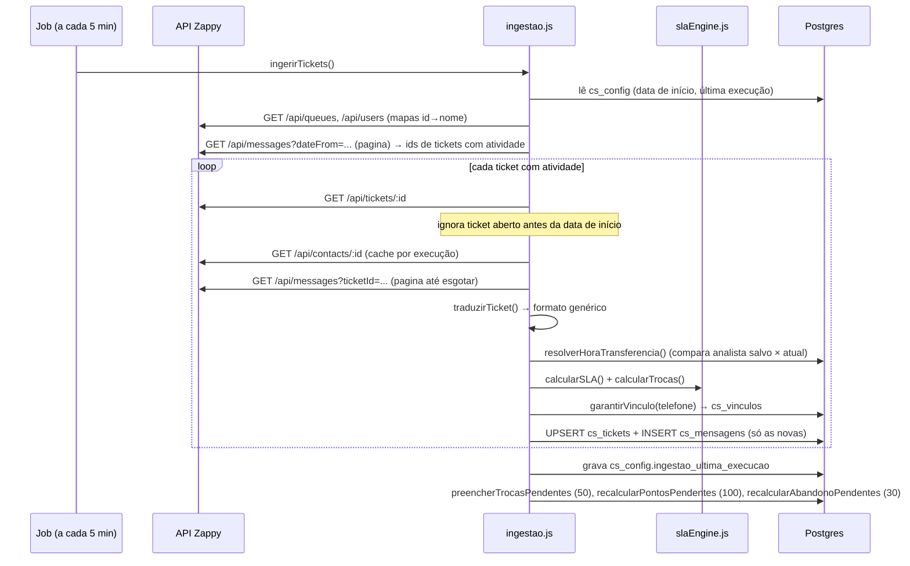

# /cs — Ingestão do Zappy, vínculos de contatos e motor de SLA

Cobre: `server/cs/zappyClient.js`, `tradutorZappy.js`, `ingestao.js`, `vinculos.js`, `depara.js`, `slaEngine.js`, `tempoUtil.js`, `slaTexto.js`, `schema_cs.sql`.

Níveis de certeza: [CONFIRMADO] explícito no código · [INFERIDO] deduzido · [DÚVIDA] ambíguo.

## 1. Objetivo de negócio

Espelhar os atendimentos do **Zappy Contábil** (WhatsApp) em tabelas próprias, ligar cada contato a uma empresa da carteira e medir, em **horas úteis**, o tempo que o escritório leva em cada etapa do atendimento (os "relógios" de SLA). Esses números alimentam o radar "Agora", o Dashboard, a pontuação da Gamificação, o risco de perda e a Qualidade.

## 2. Fluxo ponta a ponta



## 3. Modelo de dados (tabelas deste bloco)

Tabelas criadas **à mão** por `server/cs/schema_cs.sql` (o servidor não as cria sozinho). [CONFIRMADO]

### 3.1 `cs_vinculos` — de-para telefone → empresa
| Coluna | Tipo | Nulo | Default | Descrição |
| --- | --- | --- | --- | --- |
| `id` | UUID PK | não | `gen_random_uuid()` | |
| `telefone` | TEXT UNIQUE | não | — | só dígitos, com DDI 55 (ver RN-ING-006) |
| `cliente_id` | TEXT | sim | — | FK **lógica** para `clientes.id` (a carteira); NULL até vincular |
| `empresa_nome` | TEXT | sim | — | nome exibido (da carteira ou o nome bruto do contato) |
| `cnpj` | TEXT | sim | — | |
| `tipo` | TEXT | não | `'pendente'` | CHECK: `cliente`, `fornecedor`, `interno`, `software`, `pendente` |
| `confianca` | INTEGER | sim | — | 0 a 100, da sugestão automática |
| `confirmado_por`, `confirmado_em` | TEXT, TIMESTAMPTZ | sim | — | quem e quando confirmou |
| `created_at`, `updated_at` | TIMESTAMPTZ | sim | `NOW()` | |
Índices: `idx_cs_vinculos_cliente (cliente_id)`, `idx_cs_vinculos_tipo (tipo)`.

### 3.2 `cs_tickets` — espelho do ticket + resultado do SLA
| Coluna | Tipo | Nulo | Descrição |
| --- | --- | --- | --- |
| `id` | UUID PK | não | interno |
| `zappy_id` | TEXT UNIQUE | não | id do ticket no Zappy (chave do upsert) |
| `telefone`, `empresa_texto` | TEXT | sim | número e nome livre do contato |
| `vinculo_id` | UUID FK → `cs_vinculos` (`ON DELETE SET NULL`) | sim | |
| `departamento` | TEXT | sim | nome da fila do Zappy |
| `analista` | TEXT | sim | nome do atendente |
| `status` | TEXT | sim | status bruto do Zappy (`closed`, `pending`, `open`…) |
| `abertura`, `aceite`, `transferencia`, `encerramento` | TIMESTAMPTZ | sim | marcos do atendimento |
| `reaberturas` | INTEGER | sim (0) | [DÚVIDA] não é gravado por nenhum código lido |
| `nota_avaliacao` | SMALLINT | sim | 1 a 5, campo `rate` do Zappy |
| `comentario_avaliacao` | TEXT | sim | [DÚVIDA] não é preenchido |
| `sla` | JSONB | sim (`{}`) | `{ relogios, radar, trocas, trocasPosTransferencia }` |
| `em_risco` | BOOLEAN | sim (false) | radar existe e não é verde |
| `pior_status` | TEXT | sim | `verde`, `amarelo`, `vermelho` do radar |
| `ingerido_em`, `calculado_em`, `updated_at` | TIMESTAMPTZ | sim | |
Colunas acrescentadas por `ALTER` no código: `analista_id`, `analista_anterior`, `analista_anterior_id` (transferência), `revisao_nota_status`, `revisao_nota_por`, `revisao_nota_em`, `revisao_nota_override_analista_id` (revisão de nota baixa da Gamificação), `abandono_calculado_em`. Índices: `vinculo`, `em_risco` parcial, `abertura DESC`, `analista`.

### 3.3 `cs_mensagens`
`id UUID PK`, `ticket_id UUID NOT NULL → cs_tickets ON DELETE CASCADE`, `zappy_msg_id TEXT`, `remetente TEXT NOT NULL CHECK IN ('cliente','escritorio','sistema')`, `autor TEXT`, `hora TIMESTAMPTZ NOT NULL`, `texto TEXT`, `UNIQUE (ticket_id, zappy_msg_id)`, índice `(ticket_id, hora)`. Remetente `sistema` = mensagem automática (bot).

### 3.4 `cs_config` (chave/valor)
`chave TEXT PK`, `valor TEXT`, `updated_at`. Chaves deste bloco: `ingestao_data_inicio` e `ingestao_ultima_execucao` (ISO). Usada também por categorias, churn, risco e Questor (outros arquivos).

### 3.5 Tabelas do schema SQL **sem nenhum uso** no código
`cs_calendario` (feriados e expediente especial), `cs_analises` (IA, "Fase 2"), `cs_scores` (health/churn por empresa). [CONFIRMADO] nenhuma referência em `server/**`. Os feriados e o expediente estão **fixos no código** (RN-SLA-001).

## 4. Regras de negócio da ingestão (RN-ING)

- **RN-ING-001 — Sem carga retroativa automática.** Na primeira execução grava `ingestao_data_inicio = agora`; nunca processa ticket com `createdAt` anterior a essa data, mesmo que tenha mensagem nova (reabertura de ticket antigo). `executarCargaRetroativa` só recua a data, nunca avança. (`ingestao.js → obterDataInicio`, `ingerirTickets`)
- **RN-ING-002 — Cursor por dia.** `dateFrom = AAAA-MM-DD de max(ultimaExecucao, dataInicio)`. A API só filtra mensagens por **dia**, então o mesmo dia é relido a cada ciclo; ticket é reprocessado por inteiro (upsert).
- **RN-ING-003 — Descoberta de tickets.** Lista `GET /api/messages?dateFrom=` (100 por página, até `maxPaginas = 100`) e coleta os `ticketId` distintos. Não pagina a lista de tickets (mais de 10.000).
- **RN-ING-004 — Mensagem nova só.** Lê os `zappy_msg_id` já gravados e insere apenas os novos (`ON CONFLICT DO NOTHING` como segunda barreira), para não gastar a banda de saída do Render (02/10/2026).
- **RN-ING-005 — Bot.** Mensagem `fromMe = true` é **bot** quando o ticket ainda não tem `userId` (ninguém assumiu); vira remetente `sistema`. Mensagem do cliente nunca é bot. Limitação: se o ticket só for capturado depois de aceito, mensagens anteriores do bot podem ser tratadas como humanas. (`tradutorZappy.js → ehMensagemBot`)
- **RN-ING-006 — Telefone.** Só dígitos; remove zeros à esquerda; com 10 ou 11 dígitos acrescenta `55`. Telefone vazio = sem vínculo (`garantirVinculo` devolve `null`).
- **RN-ING-007 — Eventos do ticket** (`extrairEventos`): `abertura = createdAt`; `encerramento = updatedAt` se `status = closed`; `aceite` = o **mais antigo** `metas[type='acceptTicket'].createdAt` (campo fora do swagger) ou, sem ele, a 1ª mensagem do escritório não-bot.
- **RN-ING-008 — Transferência por diferença entre coletas.** A API não traz histórico de fila. Se o analista salvo era X e agora é Y (ambos definidos), grava `transferencia = agora` (precisão = intervalo do ciclo), `analista_anterior = X`. Uma vez detectada, hora e quem transferiu **não mudam** mais. Passar de "ninguém" para alguém é aceite, não transferência. Só vale para transferências ocorridas depois da ativação do código.
- **RN-ING-009 — Vínculo automático.** Se o telefone não existe em `cs_vinculos`, cria como `pendente` com a melhor sugestão da carteira (RN-VIN). Nunca sobrescreve vínculo existente.
- **RN-ING-010 — Linha do ticket.** `em_risco = radar.status != 'verde'`; `pior_status = radar.status`; `sla` guarda relógios, radar, `trocas` e `trocasPosTransferencia`.
- **RN-ING-011 — Tarefas encadeadas após cada ciclo** (falha isolada não derruba a ingestão): `preencherTrocasPendentes` (50 tickets sem `trocas`), `recalcularPontosPendentes` (100, Gamificação) e `recalcularAbandonoPendentes` (30).
- **RN-ING-012 — Nota do cliente.** `nota_avaliacao = rate` do Zappy (1 a 5). Não existe webhook de avaliação: a nota só aparece quando o ticket é relido. `atualizarNotasPendentes` (diário) relê tickets `closed` sem nota encerrados nos últimos `dias = 5` (limite 500) e, achando `rate`, grava a nota e pontua na hora (`persistirPontosTicket`).
- **RN-ING-013 — Recálculos sem Zappy.** `recalcularSlaTodos` refaz relógios dos tickets já salvos com a fórmula atual, em lotes de 300 por chave (`id > último`), opcionalmente de um mês (`AAAA-MM`). Não recalcula abandono aqui (evitou travar o banco em 02/09/2026).
- **RN-ING-014 — Reingestão pontual** `reingerirTicketsPorId`: relê do Zappy uma lista de `zappy_id` (ou todos de um analista num mês) sem escanear atividade e **sem** respeitar a data de início.
- **Trava de concorrência** em memória (uma carga retroativa, uma reingestão, um recálculo, uma atualização de notas por vez) → 409 se repetido. [INFERIDO] não vale entre instâncias.
- **Timeout** de 30 s por chamada ao Zappy; resposta não-JSON gera erro explícito de URL base errada.

## 5. Vínculos de contatos (RN-VIN)

`depara.js` (puro, sem I/O):
- **Candidatos de empresa** a partir do nome do contato ("Pessoa - Empresa", "Empresa" ou "Pessoa"): texto depois do hífen, texto antes do hífen e o nome inteiro, sem repetição.
- **Tokens:** minúsculas, sem acento e pontuação; remove stopwords societárias (`ltda`, `me`, `epp`, `eireli`, `sa`, `comercio`, `servicos`, `mei`…) e tokens de 1 letra.
- **Similaridade** (0 a 100): `jaccard(tokensA, tokensB)`; se todos os tokens do menor conjunto estão no maior, `max(jaccard, 0,85)`; `round(s × 100)`.
- **Sugestões:** compara cada candidato com `clientes.nome_empresa`; guarda as que chegam a **confiança mínima 40**, ordena por confiança e devolve no máximo **3**. A tag `Escritorial` no contato marca `is_escritorial`.
- **Confirmação humana** (`confirmarVinculo`): `tipo` deve ser `cliente`, `fornecedor`, `interno` ou `software` (senão erro "tipo de vínculo inválido"); grava `cliente_id`, `empresa_nome`, `cnpj`, `confirmado_por`, `confirmado_em`.
- **`recalcularSugestoes`**: refaz a sugestão de todos os pendentes com a carteira atual, **sem confirmar nada**.
- **Efeito do tipo:** só vínculos `tipo = 'cliente'` geram pontuação da Gamificação e entram no radar "Agora" e nos indicadores (ver `02-pontuacao-abandono.md` e os arquivos seguintes). Contato pendente, fornecedor, interno ou software fica fora.

Endpoints (em `server/cs/routes.js`, prefixo `/api/cs`): `GET /vinculos/pendentes`, `POST /vinculos/:id/confirmar`, `GET /vinculos/buscar` (admin), `POST /vinculos/recalcular` (admin), `GET /vinculos/analise-pendentes` (admin; cruza telefone com mensagens para separar bot de cliente real).
**[DÚVIDA]** `GET /vinculos/pendentes` e `POST /vinculos/:id/confirmar` exigem só login (`requireAuth`), não administrador: qualquer perfil que passe pelo filtro de módulos poderia confirmar vínculos. A tela (Qualidade dos Dados) é do perfil de equipe; confirmar no servidor quem pode é uma decisão a tomar.

## 6. Motor de tempo útil (RN-SLA-001)

Fuso `America/Sao_Paulo`, offset fixo `-03:00` (sem horário de verão desde 2019).

| Dia | Expediente (janelas) |
| --- | --- |
| Segunda a quinta | 07:30–11:00 e 13:00–17:30 |
| Sexta | 08:00–11:00 e 13:00–17:00 |
| Sábado e domingo | nenhuma |
| 24/12 e 31/12 de 2026 | só 07:30–11:30 |

Feriados de 2026 que não contam (fixos no código): 01/01, 03/04, 21/04, 01/05, 04/06, 31/08, 07/09, 12/10, 02/11, 20/11, 25/12. Pontos facultativos **contam**. **[DÚVIDA / manutenção anual]** a lista termina em 2026; a partir de 2027 todos os feriados passam a contar como dia útil até alguém atualizar `FERIADOS` em `server/cs/tempoUtil.js` (a tabela `cs_calendario` existe mas não é lida).

```text
minutosUteis(inicio, fim):
  se fim <= inicio -> 0
  total = 0
  para cada dia de diaISO(inicio) até diaISO(fim) (máx. 400 dias):
     para cada janela do dia (feriado -> nenhuma; senão especial ou padrão):
        a = max(inicio, janela.ini); b = min(fim, janela.fim)
        se b > a: total += b - a
  retorna round(total / 60000)

statusSLA(min, limite): min <= limite -> verde ; min <= 2*limite -> amarelo ; senão vermelho
```

Limites (`LIMITES`, minutos úteis): `aceite 15`, `transferencia 15`, `departamento 30`, `promessa 15`, `promessa_resolucao 120` (o prazo de 2 h foi desconsiderado em 22/10/2026, ver RN-SLA-005). `vez_cliente` não tem limite (status `neutro`). `LIMITE_TROCA = 30`.

## 7. Os relógios (RN-SLA)

Entrada genérica: `{ eventos: [{tipo, hora}], mensagens: [{hora, remetente, texto}] }`. Saída: `{ relogios: [...], radar }`. Cada relógio: `tipo`, `rotulo`, `inicio`, `fim`, `minutos_uteis`, `limite`, `status`, `em_curso`, `aguardando_cliente`.

Preparação (`calcularSLA`):
- **Fechamento pela pesquisa:** se não há evento de encerramento, o ticket termina quando o cliente responde só `1` a `5` depois de o escritório pedir "uma nota entre 1 a 5" (mensagem com "nota" e "1 a 5" ou "avaliar"). Mensagens do escritório depois disso são contato proativo e saem da conta.
- **Transferência implícita:** a recepção responde **sem assinatura** (`*Nome:*`) dizendo que vai transferir e logo depois um atendente responde **com** assinatura: vale como transferência a hora dessa primeira mensagem assinada.
- **Início** = 1ª mensagem do cliente (ou abertura se não houver).
- **Ticket iniciado pelo escritório** (1ª mensagem é do escritório, ou o cliente nunca falou): não tem relógio de aceite.

Relógios:
1. **Aceite** — `inicio → aceite`; sem aceite formal usa a 1ª resposta do escritório, depois o encerramento, e só então `agora` (em curso). Não existe se foi iniciado pelo escritório. Limite 15.
2. **Transferência** — se transferiu: inicia no **mais recente** entre aceite, última mensagem do escritório antes da transferência e última do cliente antes dela; mede até a transferência. Se não transferiu, não encerrou e ninguém respondeu após o aceite: relógio em curso desde o aceite. Limite 15.
3. **Departamento** — da transferência até a 1ª mensagem do escritório depois dela (ou encerramento, ou agora). Limite 30.
4. **Promessa** (RN-SLA-005) — só se aceitou, **não** transferiu e o escritório respondeu após o aceite:
   - se a resposta parece **intenção de transferir** (21 frases, ex.: "vou te transferir", "vou encaminhar", "um instante") → `promessa`, do momento da resposta até encerrar/agora, limite 15;
   - senão → `promessa_resolucao`: status **vermelho** apenas se alguma troca (RN-SLA-006) depois da resposta passou de 30 min úteis; caso contrário **verde** (silêncio sem nova mensagem do cliente não vira vermelho). Marca `aguardando_cliente` quando a última mensagem é do escritório e pede algo ao cliente (40 frases, ex.: "me envie", "aguardo o comprovante").
5. **Vez do cliente** — se o ticket não está encerrado e a última mensagem é do cliente: relógio vivo de essa mensagem até agora; sem limite (neutro).
6. **Radar "Agora"** = o pior relógio **em curso** (peso vermelho 3, amarelo 2, verde 1, neutro 0; empate → mais minutos), ou `null`.

**Trocas** (`calcularTrocas`, RN-SLA-006): ignora mensagens `sistema`; um turno do cliente é o início de uma sequência de mensagens dele; mede do início do turno até a próxima mensagem do escritório (ou agora, em curso); status por `statusSLA(min, 30)`. Depois de um **aviso de tratativa** do escritório ("sua solicitação está em andamento", "encerraremos este atendimento por ora", "retornarei com uma atualização"), os turnos seguintes ficam `verde` com `em_tratativa: true`. `trocasPosTransferencia` repete o cálculo só com mensagens posteriores à transferência, para separar quem aceita/transfere (recepção) de quem recebe.

Justificativas de texto (`slaTexto.js`): `"Aceite: 48 min úteis (prazo 15 min)"`; para `promessa_resolucao`: "a resposta ao cliente demorou mais de 30 min úteis". Rótulos das etapas: Aceite, Transferência, Departamento, P. Transferir, P. Resolver, Vez do cliente.

## 8. Classificadores de texto (zero IA)

Todos por **substring em texto normalizado** (minúsculas, sem acento). Listas fixas no código:
- `FRASES_CHURN` (171 frases): intenção de trocar de contador, frustração crônica, ameaça de reclamar. `detectarSinalChurn` devolve a frase que bateu.
- `PALAVRAS_INSATISFACAO` (188 termos): insatisfação, desespero, desrespeito, erro, demora, juros/multa, ameaça legal, comparação negativa. Mais permissiva que a de churn.
- **Motivo de abertura** (`MOTIVOS_ATENDIMENTO`): 11 categorias e 52 submotivos; a **primeira** categoria/submotivo que bater vence; sem batida = "Outros / Não identificado". Categorias: Guias e Impostos (7 submotivos), Boletos e Honorários (8), Folha de Pagamento/DP (8), Notas Fiscais (4), Documentos e Declarações (4), Abertura/Alteração/Baixa de Empresa (5), Certificado Digital (3), Prazos e Obrigações Acessórias (5), Dúvida Fiscal/Tributária (4), Erros e Reclamações Operacionais (3), Quer Falar com Alguém Específico (1, por último de propósito).
- `classificarMotivoConversa(textos)`: usa as mensagens do cliente no início do ticket (janela de até 20 mensagens): descarta saudação pura (`bom dia`, `oi`…) e mensagens sem conteúdo (só anexo, vCard, autorresposta, bot da empresa do cliente), remove esse ruído, concatena até 800 caracteres e classifica; extrai o nome de quem o cliente pediu para falar ("falar com o Fulano").
- `palavrasFrequentes`: conta palavras (mínimo 4 letras, sem stopwords) uma vez por texto, para calibrar a lista dos "Outros".

## 9. Endpoints deste bloco (`/api/cs`, todos exigem login)

| Método e rota | Acesso | O que faz |
| --- | --- | --- |
| `GET /agora` | login | tickets `em_risco` de vínculo `cliente`, ordenados por gravidade e atualização |
| `GET /historico` | login | até 500 tickets recentes com filtros `departamento`, `analista`, `status`, `etapa` (`resposta_continua` ou tipo de relógio) |
| `GET /filtros` | login | departamentos e analistas já vistos |
| `GET /dashboard`, `/dashboard/etapas`, `/dashboard/motivos` | login | totais, quebra por status/departamento/analista, % dentro do SLA por analista (mínimo 3 tickets; `COALESCE(pior_status,'verde')`), SLA por etapa (só relógios concluídos), motivos de abertura |
| `POST /backfill` | admin | carga retroativa (`dias` 1 a 365, padrão 90), em segundo plano |
| `POST /reingerir`, `GET /reingerir/status` | admin | reingestão pontual e progresso |
| `POST /atualizar-notas` | admin | relê notas de tickets fechados (`dias` 1 a 60, padrão 5) |
| `POST /recalcular-sla`, `GET /recalcular-sla/status` | admin | recálculo do SLA (todos ou um `mes`) e progresso |
| `POST /ingerir`, `GET /diagnostico` | admin | roda uma ingestão agora; diagnóstico do Zappy |

Filtros de período do Dashboard: `?period=todos|hoje|semana|mes` ou `?ano=&mes=`, mais `?analista=`; sempre pela data de **abertura**.

## 10. Integração externa

Zappy: `GET /api/tickets/:id`, `/api/messages?ticketId=` e `?dateFrom=`, `/api/contacts/:id`, `/api/queues`, `/api/users`, `/api/dashboard/tickets-por-qualificacao`. Autenticação `Authorization: Bearer ZAPPY_TOKEN`, base `ZAPPY_BASE_URL` (sem `/api`). Máximo 100 por página; paginação de mensagens até 50 páginas. Campos fora do swagger e **essenciais**: `rate` (nota) e `metas[acceptTicket]` (aceite). Se o Zappy mudar esses campos, nota e aceite quebram. Se o Zappy cair, o ciclo registra o erro e tenta de novo em 5 min; nenhum dado é perdido (o cursor só avança ao fim).

## 10b. Pendências deste bloco

1. Três tabelas e a coluna `reaberturas`/`comentario_avaliacao` sem uso.
2. Feriados só de 2026.
3. Confirmação de vínculo sem restrição de administrador.
4. Detecção de transferência por diferença entre coletas perde transferências quando o ticket muda de dono duas vezes entre dois ciclos (5 min) ou antes da ativação. [INFERIDO]
5. Travas de concorrência em memória não protegem uma segunda instância.
