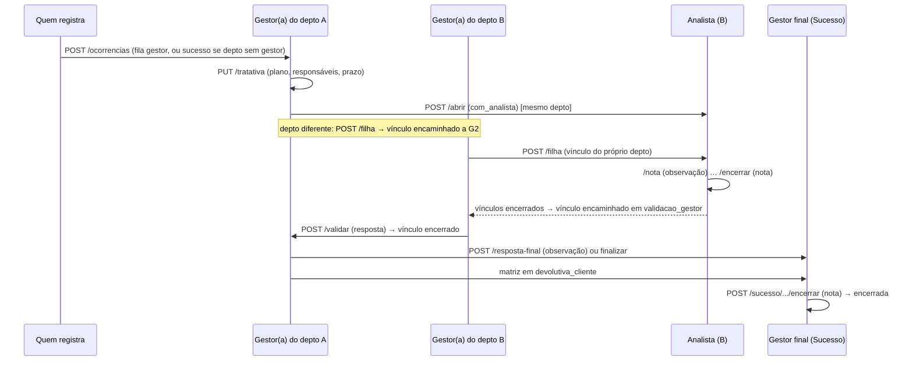

# /cs — Qualidade (ocorrências, tratativas, vínculos e devolutiva)

Cobre `server/cs/qualidade.js` (2.157 linhas, 53 rotas, prefixo `/api/cs/painel/qualidade`), `alertasPrazo.js`, `temposEtapa.js`, `analistasNomes.js`, `limpezaTeste.js` e as telas Qualidade, Portal do Gestor, Portal do Analista e Portal do Sucesso do Cliente de `public/js/cs-painel.js`.

Níveis de certeza: [CONFIRMADO] · [INFERIDO] · [DÚVIDA].

## 1. Objetivo de negócio

Registrar reclamações e falhas ("ocorrências") de um cliente e conduzi-las até a **devolutiva ao cliente**, com responsáveis, prazos, histórico e arquivos. O módulo alimenta os Sinais de atenção da empresa, o card Tratativas e o termômetro de Atendimento do risco de churn (só ocorrências com `origem = 'modulo'` e `plano_cs = false` pesam no risco).

## 2. Personagens e escopo

| Papel | Como é definido | O que faz |
| --- | --- | --- |
| Quem registra | equipe do painel (`administrador`, `usuario`, `acesso_cs`) ou qualquer perfil liberado em Acessos (módulo `qualidade`) | registra a ocorrência |
| Gestor(a) / Diretor(a) do departamento | linha em `cs_qualidade_gestores` (`papel` = `gestor` ou `diretor`) | cria a tratativa, abre vínculos, valida, devolve, responde ao Gestor final |
| Gestor final | `cs_qualidade_gestores.papel = 'final'` (é também o gestor do Sucesso) | responde à conversa, corrige o analista apontado, encerra o processo, exclui |
| Analista | `acesso_qualidade` + login ligado a `analistas.user_id` (ou por nome, `mesmoNome`) | trata, deixa observação, encerra a parte dele |
| Administração | `role = administrador` | tudo; age "em nome de" analista com sigilo preservado ao analista |
| Sucesso do Cliente | departamento `Sucesso` ou papel `final` | vê todas as ocorrências no portal; gestor final encerra |

`escopoDoUsuario(user, deptosGestor)` → `{ todos, deptos, sucesso }`; `ocorrenciaNoEscopo(esc, reg)` é verdadeiro se `esc.todos`, ou algum departamento da ocorrência está em `esc.deptos`, ou `esc.sucesso` e `reg.fila = 'sucesso'`.

## 3. Modelo de dados

RLS ligado e sem policy em todas (só o servidor acessa). [CONFIRMADO]

### 3.1 `cs_qualidade_registros` (ocorrência)
| Coluna | Tipo | Nulo | Default | Descrição |
| --- | --- | --- | --- | --- |
| `id` | UUID PK | não | `gen_random_uuid()` | |
| `cliente_id` | TEXT | não | — | `clientes.id` (carteira) |
| `cnpj`, `cliente_nome` | TEXT | sim | — | cópia no momento do registro (CNPJ só dígitos) |
| `tipo` | TEXT | não | — | um dos tipos ativos de `cs_qualidade_tipos` (semente: Multa, Erro, Reclamação, Atraso, Falha de atendimento, Falha técnica, Outros) ou `Plano de ação` na ficha |
| `departamentos` | TEXT[] | não | `{}` | departamentos envolvidos (Comercial, Contábil, Financeiro, Fiscal, Legalização, Pessoal, Sucesso) |
| `detalhe` | TEXT | não | — | descrição (5 a 1.500 caracteres) |
| `analista_id` | TEXT | sim (DROP NOT NULL) | — | responsável principal (NULL quando só os vínculos conduzem) |
| `analista_origem_id` | TEXT | sim | — | analista **indicado/apontado** no registro (o reclamado) |
| `analista_apontado_id` | TEXT | sim | — | correção do gestor final (NULL = vale o do registro; `''` = ninguém) |
| `prazo` | DATE | sim (DROP NOT NULL) | — | prazo de execução |
| `status` | TEXT | não | `'aberto'` | `aberto`, `em_tratamento`, `finalizada`, `resolvido`, `cancelado` (lido pelo risco) |
| `etapa` | TEXT | não | `'registrada'` | ver máquina de estados |
| `etapa_antes` | TEXT | sim | — | etapa em que estava ao ser cancelada (para reabrir no mesmo ponto) |
| `fila` | TEXT | sim | — | `gestor` (do departamento) ou `sucesso` (departamento sem gestor) |
| `origem` | TEXT | não | `'ficha'` | `ficha` (plano de ação na ficha; informativo), `modulo` (ocorrência raiz = "matriz"), `filha` (vínculo) |
| `plano_cs` | BOOLEAN | não | false | aberta pela ficha como "CS - Plano de Ação": mesmo processo, **não pesa no risco** |
| `pai_id` | UUID FK → si mesma `ON DELETE CASCADE` | sim | — | matriz (para vínculos); em vínculo de vínculo, o vínculo recebido |
| `mostrar_pai`, `ocultar_empresa` | BOOLEAN | não | false | sigilo em vínculos (ver RN-QUA-017) |
| `encaminhada` | BOOLEAN | não | false | vínculo aberto para **outro departamento** (ver RN-QUA-020) |
| `assunto`, `prioridade` | TEXT | sim | — | assunto (3 a 100) e prioridade (Muito Alta, Alta, Média, Baixa) |
| `plano_acao`, `tratativa_depto`, `gestor_obs`, `tratativa_definida_por`, `tratativa_definida_em` | | sim | — | tratativa criada pelo gestor |
| `liberada_em`, `liberada_por` | | sim | — | abertura para o analista |
| `analista_nota/obs/em/por` | | sim | — | devolutiva do analista (legado do analista único; hoje por responsável em `cs_qualidade_resp`) |
| `validacao_nota/obs/em/por`, `validado_em/por` | | sim | — | validação do gestor |
| `final_nota`, `final_obs`, `encerrada_em`, `encerrada_por` | | sim | — | encerramento pelo gestor final |
| `criado_por`, `criado_por_id`, `criado_em`, `atualizado_em`, `resolvido_em`, `resolvido_por`, `tratativa` | | | | auditoria e legado |
Índices: `cs_qualidade_cliente_idx (cliente_id)`, `cs_qualidade_analista_idx (analista_id)`.

### 3.2 Demais tabelas
- `cs_qualidade_historico (id BIGSERIAL PK, registro_id UUID NOT NULL → registros CASCADE, em TIMESTAMPTZ DEFAULT NOW(), por TEXT, acao TEXT NOT NULL, texto TEXT)`. Ações: `criado`, `nota`, `iniciada`, `finalizada`, `devolvida`, `validada`, `liberada`, `analista_encerrou`, `gestor_validou`, `encerrada`, `cancelada`, `reaberta`, `apontado`, `dialogo_gestor`, `dialogo_final`.
- `cs_qualidade_resp (registro_id UUID → registros CASCADE, analista_id TEXT, nota, obs, encerrado_em, encerrado_por, PK (registro_id, analista_id))`: **um responsável por linha**, com a devolutiva dele.
- `cs_qualidade_gestores (id SERIAL PK, user_id TEXT NOT NULL, departamento TEXT NOT NULL, papel TEXT NOT NULL DEFAULT 'gestor', criado_por, criado_em, UNIQUE (user_id, departamento))`.
- `cs_qualidade_tipos (id SERIAL PK, nome TEXT NOT NULL, peso INT NOT NULL DEFAULT 10, ativo BOOLEAN NOT NULL DEFAULT TRUE, ordem INT NOT NULL DEFAULT 0)` com índice único em `lower(nome)`; semente e **peso no termômetro de Atendimento**: Multa 25, Erro 15, Reclamação 20, Atraso 10, Falha de atendimento 20, Falha técnica 10, Outros 5.
- `cs_qualidade_anexos (id UUID PK, registro_id UUID → registros CASCADE, nome TEXT NOT NULL, mime TEXT, tamanho INT NOT NULL, dados BYTEA NOT NULL, criado_por, criado_em, historico_id BIGINT)`: arquivo **dentro do banco**; `historico_id` liga o arquivo a uma fala (observação ou nota final).
- `cs_qualidade_alertas (registro_id UUID → registros CASCADE, nivel TEXT, prazo DATE, enviado_em, PK (registro_id, nivel, prazo))`: controle de aviso de prazo já enviado.
- `analistas` (fora do repositório): recebe `user_id TEXT` e `departamentos TEXT[] NOT NULL DEFAULT '{}'` por `ALTER`.
- `notificacoes` (sino): `id UUID, tipo, titulo, mensagem, lida, link_modulo, created_at` (criada aqui também).

## 4. Máquina de estados da ocorrência

```mermaid
stateDiagram-v2
    [*] --> registrada: registrar (POST /ocorrencias)
    registrada --> tratativa_definida: gestor cria a tratativa (PUT /gestor/.../tratativa)
    registrada --> com_analista: 1º vínculo aberto (matriz passa a ser conduzida pelos vínculos)
    tratativa_definida --> com_analista: gestor abre para o analista (/abrir)
    com_analista --> validacao_gestor: todos os responsáveis encerraram E vínculos encerrados
    validacao_gestor --> com_analista: gestor devolve (/devolver)
    validacao_gestor --> devolutiva_cliente: gestor valida (/validar) ou resposta final (/resposta-final finalizar)
    devolutiva_cliente --> encerrada: gestor final encerra (/sucesso/.../encerrar)
    encerrada --> com_analista: reabrir (gestor final/admin; vínculo: gestor do depto)
    registrada --> cancelada: cancelar
    tratativa_definida --> cancelada: cancelar
    com_analista --> cancelada: cancelar
    validacao_gestor --> cancelada: cancelar
    devolutiva_cliente --> cancelada: cancelar
    cancelada --> registrada: reabrir (volta a etapa_antes)
```

Mapa etapa → `status` (o risco lê o status): registrada e tratativa_definida → `aberto`; com_analista → `em_tratamento`; validacao_gestor e devolutiva_cliente → `finalizada`; encerrada → `resolvido`; cancelada → `cancelado`. `situacao()` troca `aberto`/`em_tratamento` por `vencido` quando `prazo < hoje (Brasília)`.

Transições (`TRANSICOES`): `abrir` (de tratativa_definida), `analista_encerrar` (de com_analista), `gestor_devolver` e `gestor_validar` (de validacao_gestor), `filha_validar` (de validacao_gestor para **encerrada**: o vínculo não tem devolutiva ao cliente), `cancelar` (de qualquer etapa aberta), `reabrir_encerrada`, `final_encerrar` (de devolutiva_cliente). Toda mudança usa `UPDATE ... WHERE id = $ AND etapa = <esperada>`; se nenhuma linha muda, responde 409 "Esta ocorrência acabou de ser atualizada por outra pessoa. Atualize a tela e confira antes de continuar." (controle otimista).

## 5. Regras de negócio (RN-QUA)

**Registro**
- **RN-QUA-001** Validação de `POST /ocorrencias` (`validarOcorrencia`): empresa escolhida na lista ("Escolha a empresa na lista que aparece enquanto você digita."); assunto 3 a 100; tipo entre os ativos; prioridade da lista; departamento da lista; descrição 5 a 1.500 (mantém quebras de linha); prazo `AAAA-MM-DD` obrigatório, não passado e até 365 dias à frente; analista sugerido opcional. Cliente tem de existir em `clientes` com `status = 'ativo'` (404 "Empresa não encontrada entre os clientes ativos.").
- **RN-QUA-002** Responsável sugerido deve existir e estar ativo em `analistas`; se não é do departamento, só **avisa** (`avisoResponsavel`), não bloqueia.
- **RN-QUA-003 Fila.** Gestores `gestor` e `diretor` do departamento recebem a ocorrência (`fila = 'gestor'`); sem nenhum cadastrado, vai para o Sucesso do Cliente (`fila = 'sucesso'`). Quem registra recebe a frase de destino ("Encaminhada a Gestor(a) X: nomes.").
- **RN-QUA-004** Avisos do novo registro: sino a todos os administradores; push para administradores, gestores do departamento (se fila gestor) e Sucesso do Cliente; quem registrou nunca é avisado.
- **RN-QUA-005 Anexos da ocorrência:** até 5 arquivos de 10 MB, só quem registrou ou a equipe; baixados sempre como arquivo (`Content-Disposition: attachment`, `nosniff`).

**Tratativa e abertura**
- **RN-QUA-006** O gestor cria/edita a tratativa enquanto a etapa é `registrada` ou `tratativa_definida`: plano de ação (5 a 1.500), responsáveis (`idsResponsaveis`: até 20, sem repetir), departamento que trata, prazo (hoje até +365) e observação (até 1.500). Sem responsável só é aceito quando a matriz é conduzida por vínculos. O **analista apontado** do registro fica fixo entre os responsáveis (`analistaFixoPresente`).
- **RN-QUA-007** Abrir para o analista exige etapa `tratativa_definida`, plano, prazo e (responsável **ou** vínculos); passa a `com_analista`, grava `liberada_em/por` e avisa os responsáveis.

**Analista**
- **RN-QUA-008** Observação (`/analista/.../nota`): 3 a 1.000 caracteres, só enquanto `com_analista`; avisa o gestor (sino + push); repetição idêntica em 20 s é ignorada (duplo clique).
- **RN-QUA-009** Encerrar a parte (`/encerrar`): nota 5 a 2.000 e observação até 2.000; grava em `cs_qualidade_resp`; a ocorrência só segue para `validacao_gestor` quando **todos os responsáveis** encerraram **e** as vinculadas estão encerradas (`prontoParaValidacao`). Se for vínculo, encerra direto.
- **RN-QUA-010** Quem age: o próprio analista (login ligado) ou a liderança "em nome de" (`autorizaAgir`: `por = "Fulano (em nome de X)"`).

**Gestor**
- **RN-QUA-011** Validar (`/validar`): nota 5 a 2.000 + observação opcional; matriz → `devolutiva_cliente` (avisa Sucesso e administração); vínculo → `encerrada` e a matriz tenta avançar.
- **RN-QUA-012** Devolver (`/devolver`): nota obrigatória; volta a `com_analista` e **reabre a devolutiva de todos os responsáveis** (`encerrado_em = NULL`).
- **RN-QUA-013** Mensagem (`/mensagem`): gestor, gestor final ou administração escrevem a quem trata, até a ocorrência encerrar/cancelar; 3 a 1.000.
- **RN-QUA-014 Resposta final** (`/resposta-final`, só na matriz): **observação** (conversa com o Gestor final sem finalizar, ação `dialogo_gestor`) ou **finalizar** (nota 5 a 2.000; só com vinculadas encerradas e nenhum responsável ainda tratando; matriz vai para `devolutiva_cliente`). A conversa **nunca chega ao analista** (mascarada).
- **RN-QUA-015** Cancelar exige motivo (5 a 600) e cancela também os vínculos abertos; reabrir cancelada volta à `etapa_antes`.
- **RN-QUA-016** Reabrir encerrada: gestor final ou administração; no **vínculo**, também o gestor do departamento. O vínculo só reabre se a matriz ainda não está no Sucesso/encerrada (`matrizAceitaVinculoReaberto`); na `validacao_gestor` da matriz, a matriz volta para `com_analista`.

**Vínculos (filhas)**
- **RN-QUA-017 Sigilo.** `mascararParaAnalista`: o analista **não vê** a conversa do gestor com o Gestor final, nem o analista apontado (a menos que seja ele ou o gestor tenha marcado `mostrar_pai`), nem a ocorrência de origem (sem `mostrar_pai`), nem a empresa quando `ocultar_empresa`.
- **RN-QUA-018** Só a matriz recebe vínculos, em `registrada`, `tratativa_definida` ou `com_analista`. A primeira vínculo põe a matriz em `com_analista` conduzida pelos vínculos (`analista_id = NULL`, plano padrão "Conduzida pelas ocorrências vinculadas").
- **RN-QUA-019** Vínculo próprio: nasce em `com_analista` com os responsáveis em `cs_qualidade_resp`; fila do departamento escolhido; assunto 3 a 100, plano 5 a 1.500, prazo e responsáveis como na tratativa.
- **RN-QUA-020 Vínculo entre departamentos** (30/10/2026): se o departamento escolhido **não** está entre os de quem abre (administração: os da ocorrência) e a caixa "direto para o analista" **não** está marcada (`vinculoEntreDepartamentos`), o vínculo nasce `encaminhada = true`, `analista_id = NULL`, **sem linhas em `cs_qualidade_resp`** (nenhum analista o vê) e com `gestor_obs = "Analista(s) indicado(s) por X: nomes."`; vai ao gestor do departamento (ou Sucesso). Esse gestor abre um vínculo com um analista do **próprio departamento** (a janela só aceita o departamento do vínculo recebido; uma pessoa não encaminha de novo). Quando os vínculos dele encerram, o vínculo encaminhado vai para `validacao_gestor` (**não** se encerra sozinho) e o gestor responde (`/validar` ou `/resposta-final finalizar`; `devolver` é recusado: "não tem analista próprio"); só então volta ao solicitante, que faz a resposta final ao Gestor final. Quem pode marcar "direto": gestor, administração e Sucesso (o servidor responde 403 aos demais).
- **RN-QUA-021** Vínculo que encerra grava nota na matriz e chama `tentarAvancarParaValidacao(pai)`.

**Gestor final**
- **RN-QUA-022** Encerrar o processo (`devolutiva_cliente` → `encerrada`): só gestor final (a administração define em Gerenciar gestores); nota 5 a 2.000; avisa quem registrou.
- **RN-QUA-023** Corrigir o analista apontado: só gestor final; `analista_id` vazio volta ao do registro, `__nenhum` tira de todos; recusa trocar pelo mesmo (409); grava `apontado` no histórico.
- **RN-QUA-024** Excluir (gestor final ou administração, com motivo): apaga a ocorrência e os vínculos em cascata (histórico, responsáveis, anexos, alertas) e limpa os avisos do sino que citavam o assunto; só o Log de atividades guarda. Sem volta.

**Anexos de falas** (30/10/2026)
- **RN-QUA-025** Arquivo ligado a uma **fala** (observação, nota final do analista, validação, devolução, devolutiva ao cliente, conversa com o Gestor final): até 5 por fala, 10 MB cada; só o **autor** da fala (ou administrador) anexa, **até 2 horas** depois de enviá-la; ações aceitas: `nota`, `analista_encerrou`, `gestor_validou`, `devolvida`, `encerrada`, `dialogo_gestor`, `dialogo_final`. O arquivo aparece na própria fala e, para vínculos, no card do vínculo na matriz.
- **RN-QUA-026 Download:** quem já vê a ocorrência (equipe, criador, escopo do departamento) + o analista responsável + o gestor da matriz do vínculo; arquivos da **conversa** (`dialogo_*`) **nunca** vão a analista nem a quem só registrou.

**Prazos e alertas**
- **RN-QUA-027** Todo dia às 8h (Brasília), para ocorrências `modulo`/`filha` não canceladas nem resolvidas em etapas com prazo, avisa uma vez por (ocorrência, nível, prazo): `amanha` (+1 dia), `hoje` (0), `vencida` (−1 a −7 dias). Destinatários: `registrada`, `tratativa_definida`, `validacao_gestor` → gestores (ou Sucesso, se fila sucesso); `com_analista` → responsáveis e gestores; `devolutiva_cliente` → Sucesso. Vai por push, sino e Log; mudar o prazo permite novo aviso.
- **RN-QUA-028** Quem pode mudar prazo: administração ou gestor/diretor de um dos departamentos da ocorrência.

**Indicadores**
- **RN-QUA-029 Tempos por etapa** (`temposEtapa.js`, `GET /tempos`): horas corridas (inclui fim de semana) entre eventos do histórico: Com o gestor (`criado` → primeira `liberada`), Com o analista (`liberada` → última `analista_encerrou`), Validação (`analista_encerrou` → última `gestor_validou`), Devolutiva (`gestor_validou` → `encerrada`), Total. Resumo: n, média, mediana e máximo (2 casas); só entra a etapa já cumprida; por departamento: gestor, analista e total (média).
- **RN-QUA-030 Prioridades do analista** (`montarPrioridades`): tratativa aberta com prazo vencido = alta (ordem 0); com prazo em até 3 dias = média (1); e-mail sem resposta ≥ 3 = alta (0,5), 1 a 2 = média (2); atendimento com SLA vermelho nos últimos 30 dias = média (3).

## 6. Fluxo ponta a ponta

## 7. Endpoints (prefixo `/api/cs/painel/qualidade`)

Acesso: login; a **lista branca** `rotaAbertaGestorAnalista` define o que quem **não** é equipe do painel alcança (gestor ou analista): `GET /opcoes, /empresas, /tempos, /avisos, /gestores, /eu, /analistas, /ocorrencias/minhas, /gestor/ocorrencias, /analista/ocorrencias, /sucesso/ocorrencias, /pendencias, /versao, /analista/meu-painel, /anexo/:id`; `POST /ocorrencias`, `/ocorrencias/:id/anexo`, `/ocorrencias/:id/evento/:eid/anexo`, `/gestor/ocorrencias/:id/{abrir,validar,devolver,filha,cancelar,reabrir,excluir,mensagem,resposta-final}`, `/analista/ocorrencias/:id/{nota,encerrar}`, `/sucesso/ocorrencias/:id/{encerrar,apontar,responder}`; `PUT /gestor/ocorrencias/:id/tratativa`. O resto do módulo (`/resumo`, `/tipos`, `/cliente/:id`, `/analista/:id`, `PATCH /:id`, `DELETE /:id`, `PUT /vinculo/:analistaId`, `POST /gestores`…) é da equipe/administração. Cada rota confere o escopo (RN acima); a tela só esconde.

| Método e rota | Quem | Efeito |
| --- | --- | --- |
| `GET /opcoes` | login | tipos ativos, departamentos, prioridades, status, limites de tamanho |
| `GET/POST /tipos`, `PATCH/DELETE /tipos/:id` | equipe/admin | cadastro de tipos e **peso** no risco |
| `GET /analistas`, `PUT /analistas/:id/departamentos` | login / admin | lista canônica de analistas; departamentos que atendem |
| `POST /vinculos/automatico` | admin | liga analistas sem login ao login de mesmo nome |
| `PUT /vinculo/:analistaId` | admin | liga o analista a um login |
| `GET /cliente/:clienteId` | equipe | registros de um cliente |
| `POST /` | equipe | cria registro da ficha (legado) |
| `GET /resumo`, `GET /analista/:id` | equipe | uma linha por analista; registros de um analista |
| `PATCH /:id`, `DELETE /:id` | equipe / admin | status, prazo e tratativa (legado); excluir de vez |
| `GET/POST/DELETE /gestores` | login / admin | gestores por departamento (papéis `gestor`, `diretor`, `final`) |
| `GET /eu` | login | perfil: gestor, analista, final, sucesso, **módulos efetivos** |
| `GET /pendencias`, `GET /versao`, `GET /avisos` | login | selo do menu e avisos novos (push no navegador); versão leve consultada a cada 10 s para redesenhar a tela só quando muda |
| `POST /ocorrencias`, `GET /ocorrencias`, `GET /ocorrencias/minhas` | login | registrar; listar do módulo; as que a pessoa registrou |
| `GET /gestor/ocorrencias`, `GET /analista/ocorrencias`, `GET /sucesso/ocorrencias` | por escopo | portais (limites: gestor 500, analista 300, Sucesso do Cliente 500 registros) |
| `PUT /gestor/ocorrencias/:id/tratativa`; `POST …/{abrir,filha,validar,devolver,mensagem,resposta-final,cancelar,reabrir,excluir}` | gestor, final, admin | passos do fluxo (RN-QUA-006 a 024) |
| `POST /analista/ocorrencias/:id/{nota,encerrar}` | analista ou admin em nome | RN-QUA-008 e 009 |
| `POST /sucesso/ocorrencias/:id/{responder,apontar,encerrar}` | gestor final | RN-QUA-014, 022, 023 |
| `GET /tempos` | admin, equipe, Sucesso, gestor | RN-QUA-029 |
| `GET /empresas` | login | busca de empresa ao digitar: as que **começam** com o texto (nome ou CNPJ) primeiro, depois as que contêm |
| `POST /ocorrencias/:id/anexo`, `POST /ocorrencias/:id/evento/:eid/anexo`, `GET /anexo/:id` | por regra | RN-QUA-005, 025, 026 |
| `GET /analista/meu-painel` | analista, ou administração com `?analista=` | painel pessoal da Minha área: registros (até 300), atendimentos dos últimos dias (até 600 tickets), e-mails, evolução semanal, prioridades (`painelPessoal`) |
| `GET /painel`, `GET /minhas`, `PATCH /:id/tratar`, `POST /:id/nota` (em `routerAnalista`) | analista | portal antigo "Minhas tratativas" (**desligado em 17/10/2026**: `routerAnalista` não é montado em `index.js`) |

## 8. Avisos e logs

Push do navegador (`push.enviar`) e sino (`notificacoes`, `link_modulo = 'cs-qualidade'`) em: nova ocorrência, anotação do analista, finalização, abertura para o analista, devolução, validação (Devolutiva ao cliente), mensagem do gestor, resposta do Gestor final, reabertura, cancelamento, encerramento e alertas de prazo. Toda ação que muda dados passa por `auditoria.middleware()` (Log de atividades). O risco é recalculado (`refrescarRisco`) quando a etapa muda.

## 9. Pontos de atenção / dúvidas

1. `analistas`, `clientes` não são criadas no repositório; o módulo depende delas (`ALTER` e consultas). [CONFIRMADO]
2. Arquivos de ocorrência ficam em `BYTEA` no banco (até 5 × 10 MB por ocorrência e por fala): crescimento do banco. [INFERIDO]
3. Campos legados `analista_nota/obs/em/por`, `tratativa`, `resolvido_*` coexistem com `cs_qualidade_resp` e `final_*`. [INFERIDO]
4. Várias rotas do portal antigo (`/painel`, `/minhas`, `/:id/tratar`, `/:id/nota` do `routerAnalista`) existem sem montagem ativa. [CONFIRMADO]
5. A fila "sucesso" para departamento sem gestor faz o Sucesso agir como gestor desse departamento. [CONFIRMADO] regra de negócio, não bug.
6. Nenhum teste automatizado cobre as rotas de ponta a ponta (só validadores e fonte); `server/cs/testes_qualidade.js` verifica regras puras e trechos do código. [CONFIRMADO]
