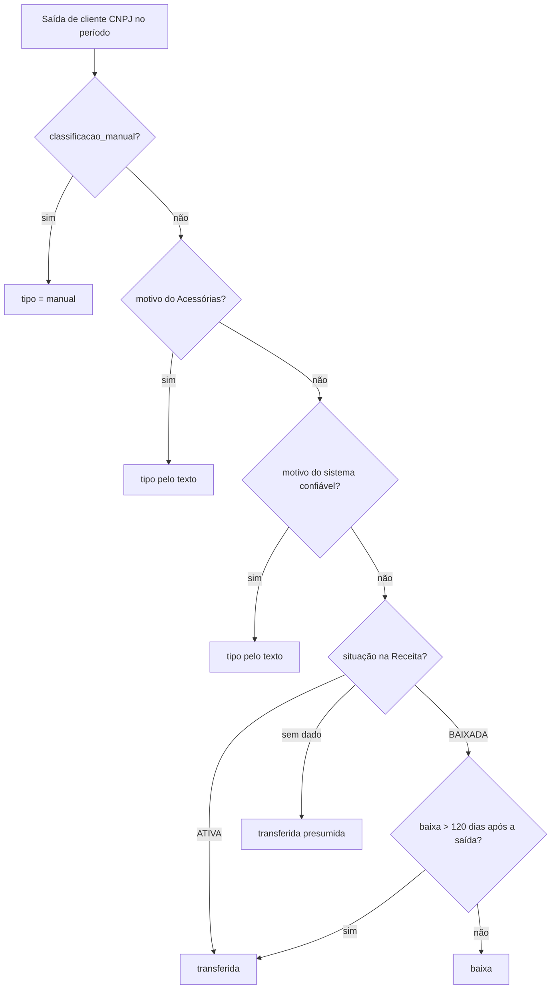

# /cs — Churn (saídas), motivos de churn e Categorias de cliente

Cobre `server/cs/churnSaidas.js`, `server/cs/churnMotivos.js`, `server/routes/motivos-churn.js` e `server/cs/categorias.js`. Prefixos: `/api/cs/churn`, `/api/cs/painel/churn-motivos`, `/api/motivos-churn`, `/api/cs/categorias` (todos montados **antes** de `/api/cs` e `/api/cs/painel` em `server/index.js`, linhas 67–90, para não serem engolidos pelo roteador genérico).

Níveis de certeza: [CONFIRMADO] (lido no código) · [INFERIDO] · [DÚVIDA].

---

## Parte A — Churn por saídas

### A.1 Objetivo

Medir quantas empresas **CNPJ** a carteira perdeu **por transferência para outro contador** em um período, sobre a base que existia no início dele. Baixa do CNPJ (empresa encerrada) e outras saídas ficam **fora** da taxa, mas aparecem na tela.

### A.2 Entradas (tabela `clientes`, criada fora do repositório — ver pendências)

Colunas lidas: `id`, `nome`, `cnpj` (texto com máscara do Acessórias), `data_entrada`, `data_saida`, `motivo_saida` (gravado pelo sistema), `motivo_acessorias` (lido do Acessórias), `classificacao_manual` (`transferida` | `baixa` | NULL), `situacao_receita`, `data_situacao_receita`, `situacao_receita_em` (quando foi consultada). [CONFIRMADO] pelo `UPDATE clientes SET situacao_receita…` (churnSaidas.js:269) e por `calcularChurn`.

Configuração em `cs_config`: `churn_padroes_motivo` (JSON com os trechos que significam "transferida"), `churn_motivos_sync` e `churn_receita_sync` (data/resultado da última rodada).

### A.3 Regras (RN-CHU)

- **RN-CHU-001 Só CNPJ.** `tipoDocumento` devolve CPF (11 dígitos), CNO (12), CAEPF/CNPJ (14, distinguidos pela **máscara**: `000.000.000/000-00` = CAEPF, `00.000.000/0000-00` = CNPJ). Só `CNPJ` entra (decisão de 06/10/2026). Os demais são contados à parte em `desconsiderados_cpf_caepf_cno` (`base` e `saidas`). [CONFIRMADO]
- **RN-CHU-002 Base do período** `[ini, fim]`:
  ```text
  base = clientes CNPJ onde (data_entrada é nula OU data_entrada < ini)
                       e (data_saida é nula OU data_saida >= ini)
  saidas = clientes CNPJ onde data_saida está entre ini e fim
  ```
  Datas são texto ISO `AAAA-MM-DD` (comparação alfabética vale).
- **RN-CHU-003 Classificação da saída** (`classificarSaidaDetalhe`, ordem de precedência; a primeira que bater vence e grava a `origem`):

  | # | Fonte | Quando vale | Resultado |
  | --- | --- | --- | --- |
  | 1 | `manual` | `classificacao_manual` = `transferida` ou `baixa` | o que o administrador marcou |
  | 2 | `acessorias` | `motivo_acessorias` não vazio | texto normalizado: contém algum padrão (`transferida por`, `transferido por`, `transferencia por`) **ou** começa com `transferida para outro contador` → `transferida`; contém `baixa` → `baixa`; senão `outra_saida` |
  | 3 | `sistema` | `motivo_saida` vale se **não** for vazio, `Baixa de empresa` nem começar com `Pendente de revisão` | mesma regra do texto acima |
  | 4 | `receita` | `situacao_receita` conhecida | `ATIVA` → `transferida`; `BAIXADA` → `baixa`, **exceto** se a baixa foi mais de **120 dias depois** da saída (então a empresa saiu viva = `transferida`); outras situações (suspensa, inapta, nula) → não infere |
  | 5 | `presumida` | nada acima | `transferida` (presunção, o administrador pode trocar) |

  Normalização do texto: minúsculas, sem acento (NFD), espaços colapsados.
- **RN-CHU-004 Taxa.**
  ```text
  contadas = saidas com tipo = 'transferida' E que estavam na base
  taxa     = 100 × contadas ÷ base               (2 casas; null se base = 0)
  taxa_teto= 100 × (contadas + a_confirmar_na_base) ÷ base
  ```
  Saída por transferência de empresa que **entrou dentro do período** não está na base: fica fora do cálculo, mas é mostrada (`transferidas_fora_da_base`). [CONFIRMADO]
- **RN-CHU-005** `a_confirmar`: o código ainda soma o tipo na `taxa_teto`, porém a cadeia atual **nunca o produz** (o passo 5 virou `presumida`). [INFERIDO] resquício de versão anterior; `fora_do_churn.a_confirmar` tende a 0.
- **RN-CHU-006 Contadores de transparência** devolvidos pela tela: `inferidas_pela_receita`, `presumidas` (contadas sem prova), `fora_do_churn {baixas, outras_saidas, a_confirmar}`.
- **RN-CHU-007 Períodos:** `GET /` devolve **todos os presets de uma vez** (`mes_atual`, `mes_anterior`, `ultimos_12_meses`, `ano`), cada um com rótulo e `calcularChurn`; ou um período livre com `?ini=&fim=`. Atenção: `ultimos_12_meses` = **hoje − 365 dias** até hoje (não "12 meses fechados"). [CONFIRMADO] (`presets()`, churnSaidas.js:155–163).

### A.4 Rotinas automáticas (no ciclo diário do Acessórias — `index.js:381–408`)

Ordem dentro de `rodarSyncAcessorias`, cada etapa com `try/catch` próprio (uma falha não impede a seguinte):
1. `sincronizarAcessorias()` (empresas).
2. `categorias.sincronizarTags()` (parte B).
3. `churnSaidas.sincronizarMotivos()` — lê o motivo de cancelamento direto do Acessórias.
4. `churnSaidas.classificarSaidasPelaReceita()` — consulta a situação do CNPJ para saídas sem motivo.
5. `risco.sincronizarEntregas()` (arquivo 04).

**Consulta à Receita** (`classificarSaidasPelaReceita({ limite = 150 })`): fontes em ordem `https://brasilapi.com.br/api/cnpj/v1/{cnpj}` e `https://minhareceita.org/{cnpj}`; espaçamento de ~800 ms entre consultas; até 150 empresas por rodada; reconsulta após **90 dias** (situação conhecida) ou **7 dias** se estiver `INDISPONIVEL` (as duas fontes falharam). Quando falha grava `situacao_receita = 'INDISPONIVEL'`, `data_situacao_receita = NULL`. [CONFIRMADO] (linhas 246–269).

### A.5 Endpoints (`/api/cs/churn`)

| Método e rota | Acesso | O que faz |
| --- | --- | --- |
| `GET /` | login | cálculo do período (`calcularChurn`) com a lista de saídas e seus tipos/origens |
| `PUT /config` | admin | salva os padrões de motivo que significam "transferida" |
| `PUT /saidas/:id/classificacao` | admin | grava `classificacao_manual` (`transferida`, `baixa` ou vazio para voltar ao automático) |
| `POST /classificar-saidas` | admin | roda a consulta à Receita agora (segundo plano) |
| `POST /sincronizar-motivos` | admin | lê os motivos do Acessórias agora (segundo plano) |
| `GET /diagnostico` | admin | conferência da leitura (quantas saídas, quantas com motivo, quantas pela Receita) |

### A.6 Fluxo



---

## Parte B — Motivos de churn (lista, fechamento do mês)

### B.1 Lista de motivos (`/api/motivos-churn`, `routes/motivos-churn.js`)

Lista canônica usada no campo **Motivo do Churn** da Gestão de Clientes, que só aparece quando a Solicitação é "Saída de empresa" (não em "Baixa de empresa"). Dropdown em vez de texto livre, para os motivos serem comparáveis.

- **Tabela** `motivos_churn (id UUID PK DEFAULT gen_random_uuid(), nome TEXT UNIQUE NOT NULL, ativo BOOLEAN NOT NULL DEFAULT TRUE, created_at TIMESTAMPTZ DEFAULT NOW())`, criada por `garantirTabela()` (`CREATE TABLE IF NOT EXISTS` a cada chamada).
- **Lista inicial** (definida pelo Reysner em 28/10/2026, substitui a anterior de 17 motivos): **Falha técnica · Falha Atendimento · Falha Comercial · Preço · Conveniência**. A troca roda **uma única vez**, marcada em `cs_painel_config` (chave `motivos_churn_lista_2026_10_28`): apaga a lista antiga e insere as cinco. Depois disso o seed só roda se a tabela estiver **vazia**.
- Coluna `clientes.motivo_churn` guarda o motivo escolhido por saída (criada pelo painel de churn, `churn.garantirColuna()`).

| Método e rota | Acesso | O que faz |
| --- | --- | --- |
| `GET /api/motivos-churn?ativo=true` | login | lista (todos, ou só ativos) |
| `POST /` | admin | cria `{ nome }`; se já existe, **reativa** |
| `PATCH /:id` | admin | `{ nome }` renomeia (3 a 120 caracteres; 409 se duplicado ignorando maiúsculas) e **propaga o novo nome** para `clientes.motivo_churn`; `{ ativo }` liga/desliga |
| `DELETE /:id` | admin | apaga de vez (uso raro; prefira desativar). Não toca `clientes.motivo_churn` |

Tela: **Gerenciar lista** (incluir, renomear, desativar, excluir). [CONFIRMADO]

### B.2 Churn por motivo e Fechamento do mês (`/api/cs/painel/churn-motivos`, `churnMotivos.js`)

| Método e rota | Acesso | O que faz |
| --- | --- | --- |
| `GET /motivos` | equipe (`router.use(requireAuth, soEquipe)`) | lista de motivos **ativos** (`id`, `nome`) lida de `motivos_churn`; devolve `[]` se a leitura falhar |
| `PUT /definir` | `administrador` ou `usuario` (outros recebem 403: "Só administrador ou usuário classifica o motivo do churn.") | grava o motivo de uma saída (`cliente_id` obrigatório); aceita `novo_motivo` ao escolher "Outro" (3 a 120 caracteres, não pode ser "Outro"; erros: "Escreva qual é o motivo do churn (mínimo de 3 letras).", "O motivo passa de 120 caracteres.", 'Escreva qual é o motivo em vez de "Outro".') |
| `GET /fechamento?mes=AAAA-MM` | login | fechamento do mês: clientes com **menos de 90 dias** de casa, distribuição de motivos em %, leitura em texto |

- **RN-CHM-001** A distribuição por motivo usa as saídas **do mês** já classificadas; o texto de "leitura" é gerado por regra (não por IA). [INFERIDO]
- **RN-CHM-002** "Menos de 90 dias" = `data_saida − data_entrada < 90`. [CONFIRMADO]

---

## Parte C — Categorias (Diamante, Ouro, Prata, Bronze)

### C.1 Objetivo

Classificar cada cliente ativo em **Diamante, Ouro, Prata ou Bronze** por valor de honorário, respeitando exceções (pisos e grupos econômicos). Alimenta o filtro por categoria do painel e o Risco.

### C.2 Tabelas

| Tabela | Colunas | Observação |
| --- | --- | --- |
| `acessorias_tags` | `id TEXT PK`, `nome TEXT NOT NULL`, `status TEXT`, `tratamento TEXT NOT NULL DEFAULT 'ignorar'`, `atualizado_em TIMESTAMPTZ DEFAULT NOW()` | criada por `garantirSchema()` (`categorias.js:162`) |
| `cliente_tags` | `cnpj TEXT`, `tag_id TEXT → acessorias_tags(id) ON DELETE CASCADE`, **PK (cnpj, tag_id)** | recriada por inteiro a cada sincronização |
| `honorarios` | (fora do repositório) lida pelo **último valor por `data_vigencia`** | origem do valor por cliente |
| `clientes` | `grupo_empresas`, `honorario`, `cnpj` | `grupo_empresas` define o "Grupo de Clientes" |
| `cs_config` | chaves `categoria_cortes`, `categoria_tags_sync`, `categoria_grupoe_cnpjs` | cortes, data da última sincronização e lista de CNPJs do Grupo-E |

`tratamento` ∈ `ignorar | piso_ouro | grupo`. Ao sincronizar, TAG cujo nome casa `/hands|devia|talentos/i` nasce como `piso_ouro`; as demais como `ignorar` (só no primeiro `INSERT`; o `ON CONFLICT` **não** sobrescreve o tratamento escolhido).

### C.3 Regras (RN-CAT)

- **RN-CAT-001 Faixas por valor.** `categoriaPorValor(v, cortes)`: `v >= diamante` → Diamante; `>= ouro` → Ouro; `>= prata` → Prata; senão Bronze. **Cortes padrão: Prata R$ 250 · Ouro R$ 500 · Diamante R$ 1.000.** Editáveis (`PUT /config`) desde que `0 < prata < ouro < diamante`; erro: "As faixas precisam estar em ordem crescente: Prata < Ouro < Diamante."
- **RN-CAT-002 Três caminhos para a categoria**; vale a **maior** categoria entre eles (`ORDEM: Bronze 0 … Diamante 3`) e o resultado guarda a **precedência** do motivo:

  | Precedência | Caminho | Detalhe |
  | --- | --- | --- |
  | 3 | **Piso Ouro** | cliente tem TAG com tratamento `piso_ouro` ou CNPJ na lista `categoria_grupoe_cnpjs` (empresas do Grupo-E): categoria **no mínimo Ouro** (pode subir a Diamante pelo valor) |
  | 2 | **Grupo** | cliente pertence a um grupo (`grupo_empresas` ou TAG com tratamento `grupo`, ou **mesma raiz de CNPJ de 8 dígitos**) com **2 ou mais** empresas: usa a **soma** dos honorários do grupo |
  | 1 | **Individual** | honorário do próprio cliente |

  Honorário não positivo conta como 0. Sem honorário e sem exceção → sem categoria (`sem_categoria` no resumo).
- **RN-CAT-003 Texto explicativo.** Cada resultado devolve a frase que explica o porquê (ex.: valor formatado em `R$ 1.234,56`), usada no tooltip da tela.

### C.4 Endpoints (`/api/cs/categorias`)

| Método e rota | Acesso | O que faz |
| --- | --- | --- |
| `GET /` | login | `{ cortes, data: { [cliente_id]: resultado }, resumo }` — `resumo` conta Diamante, Ouro, Prata, Bronze e `sem_categoria` |
| `GET /config` | admin | cortes, última sincronização, TAGs com `empresas_ativas`, lista do Grupo-E, grupos (nome, quantidade, soma), total de vínculos |
| `PUT /config` | admin | salva `grupo_e` (só CNPJ de 14 dígitos, sem repetir), `cortes` e `tags[].tratamento` (valida contra `ignorar/piso_ouro/grupo`: "Tratamento de TAG inválido.") |
| `POST /sincronizar-tags` | admin | dispara a sincronização em segundo plano; 409 se já rodando; 400 sem `ACESSORIAS_API_TOKEN` |

### C.5 Sincronização das TAGs (`sincronizarTags`)

1. Lista todas as TAGs do Acessórias e, para cada uma, os CNPJs (`listarTags`, `listarEmpresasDaTag`).
2. Em **uma transação**: `INSERT … ON CONFLICT` das TAGs, `DELETE FROM cliente_tags` e reinserção de todos os vínculos, e grava `categoria_tags_sync` com a data.
3. Roda sozinha no ciclo diário do Acessórias e manualmente pela rota. Trava local `_sincronizando` impede duas ao mesmo tempo.

---

## Pontos de atenção

1. `clientes`, `honorarios`, `eventos_clientes`, `analistas` e `investimentos` **não têm `CREATE TABLE` no repositório** (varredura em 30/10/2026): vieram do esquema original. Sem `pg_dump --schema-only` a documentação de colunas dessas tabelas é inferida pelo uso. [DÚVIDA — pedir o dump] (Correção: `gamificacao_colaboradores/notas/premios` também apareciam na varredura, mas são só do arquivo morto `routes/gamificacao.js`, que não é montado; a Gamificação real usa as tabelas `gam_*`, todas criadas no código — ver [gamificacao.md](../gamificacao.md).)
2. `a_confirmar` é código morto na classificação atual (RN-CHU-005).
3. A reclassificação pela Receita depende de BrasilAPI e minhareceita (serviços externos sem contrato): queda prolongada deixa a saída como `presumida`, que **conta** no churn.
4. `DELETE FROM cliente_tags` + reinserção acontece dentro de transação, então a tela nunca vê vínculos pela metade; mas uma TAG apagada no Acessórias continua em `acessorias_tags` (não há limpeza). [CONFIRMADO]
5. As regras "Grupo-E = piso Ouro" estão no código (`/hands|devia|talentos/i`) e na lista de CNPJs; mudar a regex exige deploy.
